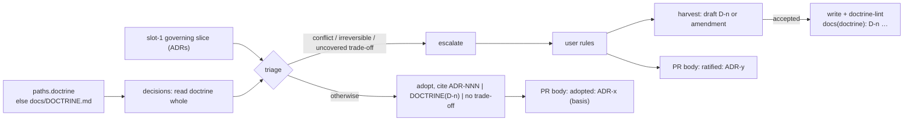

# Design — decisions-doctrine-layer

> Brief: give the decisions phase a doctrine layer. (1) Seed `docs/contributing/DOCTRINE.md` by
> clustering the rationales of the user-ratified ADRs, each entry citing its source ADRs, with the
> against-recommendation rulings as primary evidence. (2) The adopt rule cites doctrine entries as
> the stated principles. (3) After an escalation, a harvest step proposes a new entry or an
> amendment, always for an against-recommendation ruling. (4) Escalate only on an ADR/doctrine
> conflict, an irreversible choice, or an uncovered real trade-off; adopt the rest and list them in
> the PR body. Gates: one ADR supersedes ADR-433's threshold (the user decides it); add the missing
> "clear + aligned + trade-off" eval fixture; bump the README corpus count.
> Status: draft → self-reviewed ×3

## Context

### The adopt rule today

`skills/decisions/SKILL.md` Procedure step 1 adopts a candidate only when "its design
recommendation is clear AND aligns with an existing ADR or a stated craft principle". Alignment
with an ADR is checked against the governing slice that reaches slot 1 (`skills/run/SKILL.md` walk
step 4, **Intention hint**: the `IntentionView` entries whose `subjects` intersect the phase's
touched set). Everything else is escalated. ADR-433 (superseding ADR-100's escalation wording) set
that threshold. Its Consequences say a clear, aligned recommendation over a real user trade-off
has no eval.

"Stated craft principle" has no home. Nothing in `skills/`, `agents/`, `contracts/`,
`docs/guides/`, `docs/contributing/specs/` or `docs/contributing/DOD.md` defines one. The phrase
appears once, in the adopt rule (`grep -rn -i "stated principle\|craft principle"` returns only
`skills/decisions/SKILL.md:27`). The session falls back on its own reading of the ADR log, or asks.

### Measured corpus (2026-11-05, `docs/contributing/adr/`, 720 files)

| Population | Count | Command |
|---|---|---|
| ADRs holding "adopted-as-recommended" | 262 | `grep -li "adopted-as-recommended" *.md \| wc -l` |
| ADRs holding "ratified by the user" | 177 | `grep -li "ratified by the user" *.md \| wc -l` |
| …of which still live (Status not `superseded`) | 168 | loop: skip files matching `Status:\*\* superseded` |
| Ratified **against** the design's recommendation | 9 | `grep -il -E "deviat[a-z]* from the (design\|designer)\|against the …recommend"` over the 177 |
| …of which live | 8 | ADR-301 is `superseded by ADR-384` |

The brief names four against-recommendation rulings (301, 375, 564, 719). The wider grep finds
nine. Five use "deviates from the design's/designer's recommendation" instead of "against":

| ADR | Recommended | User chose | Shape of the ruling |
|---|---|---|---|
| 234 | keep the dead `parseUsage`, log a follow-up | fix it in this change | fold the proven defect, do not file it |
| 249 | list only fully enforcing guards | list every binding that ships a guard, criterion stated | an explicit, observable listing criterion |
| 257 | pin the persisted rollout shape before shipping | ship on the confirmed envelope, row 5a recorded DEFERRED | ship on the confirmed contract, record the open row |
| 301 *(superseded by 384)* | commit the ledger via a gitignore re-include | run-local, no gitignore change | no committed churn for a protection the failure mode does not need |
| 322 | delete two guards, keep one as stated contract | delete all three (behaviour-preserving) | no dead code |
| 338 | tokens only, document the dollar gap, file follow-ups | correct both now | fold, do not file |
| 375 | not now (YAGNI) | ship the PreCompact hook now | a proven risk earns machinery now |
| 564 | keep `>=18` with the real-path fallback | raise the floor, throw, delete the fallback | close the hole fully, no fallback |
| 719 | live terminal width | fixed 80-cell budget | a fixed bound beats tracked state |

So the brief's "3 of 4 chose less machinery" does not hold for the nine. The common thread is a
**root-cause or complete option over a deferral or a carve-out** (234, 338, 375, 564, 322), plus
**a fixed or stateless mechanism over a tracked one** (301, 719, 257).

ADR-684 to ADR-698 ratify one principle about ten times: an unparsed bash construct fails closed.
Each is its own ruling and none is citable as a principle. That is the doctrine gap.

### Surfaces this touches

- `skills/decisions/SKILL.md`: Preamble step 1 (manifest/ADR-dir probe), Procedure step 1
  (triage), step 2 (escalation), step 3 (no-op), step 5 (authoring and supersession obligations).
- `skills/documentation/SKILL.md` step on the PR body (the "Provenance & verification" trailer),
  `templates/pr-body.md` line `- **Decisions:** <ADR-### … or none>`.
- `docs/contributing/specs/run-record.md` §Token vocabulary, greppable-only list.
- Manifest `paths.*`: `engine/src/manifest.js` `validatePaths` checks only `paths.dod`
  (`checkFileRef`) and `paths.lessons` (`checkLessonsDir`). `paths.adr`, `paths.design` and
  `paths.plan` are read by consumers and not validated. Craft's own `.claude/workflow.md` sets
  `paths.*` to `docs/contributing/*`.
- Lint precedent: `engine/src/lesson.js` (pure parser) + `engine/src/lesson-lint-main.js` +
  `engine/bin/lesson-lint.js` (an `isEntryPoint(import.meta)` shim), wired in
  `scripts/static-lints.sh` as `node engine/bin/lesson-lint.js docs/contributing/lessons`, with
  tests `engine/test/lesson.test.js`, `engine/test/lesson-lint-main.test.js` and
  `engine/test/lesson-lint.bin.test.js`. `engine/stryker.conf.json` mutates `engine/src/**/*.js`,
  so a new `engine/src` module is in mutation scope with no config change.
- `adr-lint` C3 (`engine/src/adr-lint-main.js` `runC3`/`sweepHits`): any `ADR-<superseded id>`
  in a tracked file outside the exempt set (`paths.adr`, `paths.design`, `paths.plan`, plus
  `archive/` and `prd/` beside them) is a finding, and a waiver covers a whole file. The repo
  holds no `DECISION-CITE-WAIVE` line. Precedent is to rewrite live mentions. `docs/contributing/DOCTRINE.md` is **live tier**.
- Evals: `evals/decisions-noop-when-clear/` and `evals/decisions-escalates-fork/`, each holding
  `case.yaml`, `prompt.md`, `scaffold.sh`, `fixture/docs/{adr,design}/` and `graders/*.md`. They
  are run by hand, never in CI (`test/plugin-evals-local-only.test.js`). They are listed in
  `docs/contributing/maintainer-smokes.md` (unit table :147, cost table :160-170).
- README `README.md:227`: `[100 design docs](docs/contributing/design/)` and `[720 ADRs]` are
  recomputed from disk by `scripts/readme-drift.sh`.

### Why a standing rule, not one missing fact

One stated fact (for example "the user prefers the recommendation") would not cover the
corpus: 9 of 177 rulings went against the recommendation, and they split across distinct
principles (root cause over deferral, fixed bound over tracked state, a proven risk earns its
machinery). A single fact either adopts those 9 wrongly or escalates the other 168 as before.
The doctrine file carries the per-principle facts; the threshold is the procedure that applies
them, and the harvest is how a new fact enters.

## Requirements

1. **R1 — doctrine file.** A doctrine file resolves per consumer: `paths.doctrine`, else
   `docs/DOCTRINE.md`. Craft's manifest sets `docs/contributing/DOCTRINE.md`. An absent file means
   no entries. It is the normal state and never an error.
2. **R2 — entry schema.** Each entry is `## D-<n> — <rule title>` followed by four bullets in
   order: `- **Trigger:**`, `- **Rule:**`, `- **Evidence:**` (one or more `ADR-NNN`) and
   `- **Counter-cases:**` (`none`, or `ADR-NNN — <why>` items). Ids are never reused and entries
   are never deleted, only amended.
3. **R3 — honest citations.** `doctrine-lint <doctrine-file> <adr-dir>` exits 2 when an entry
   breaks R2, when an evidence or counter-case `ADR-NNN` does not resolve to exactly one
   `<adr-dir>/NNN-*.md` whose `- **Status:**` line is not `superseded…`, or when a
   `DOCTRINE(D-<n>)` citation in `<adr-dir>/*.md` names no entry. `scripts/static-lints.sh` runs
   it on craft's own doctrine.
4. **R4 — seed.** `docs/contributing/DOCTRINE.md` ships with the entries ratified at this run's
   decisions phase (§Seed). Every one of the 8 live against-recommendation ADRs is cited as
   evidence by at least one entry. Every citation is to a live, user-ratified ADR, and the file is
   lint-green.
5. **R5 — threshold.** The decisions phase escalates a candidate only when (a) its
   recommendation conflicts with an existing ADR in the governing slice or with a doctrine entry,
   (b) it is irreversible or outward-facing, or (c) it carries a real trade-off that no ADR or
   doctrine entry covers. Every other candidate is adopted and its basis cited. A new ADR
   supersedes ADR-433's threshold.
6. **R6 — harvest.** After a ruling on an escalated candidate, the phase drafts a doctrine entry
   or amendment. It always does so when the ruling differs from the recommendation or contradicts
   an entry. When the ruling matches the recommendation and no entry covers its rationale, it
   drafts one if the rationale reaches beyond this candidate. The user accepts, edits or declines.
   Each outcome is recorded.
7. **R7 — adopted are listed.** The PR body's Decisions line separates ratified from adopted
   ADRs, each adopted ADR with its basis.
8. **R8 — eval.** A new case shows that a clear recommendation over a real trade-off covered by a
   doctrine entry is adopted citing that entry. With `decisions-escalates-fork` (the same
   trade-off, no doctrine) it forms an exact pair.
9. **R9 — README.** Each commit adding a design doc or an ADR bumps the matching README count
   (`readme-drift` is red otherwise).

## Design

### Shape



### Doctrine file (R1, R2)

The doctrine is one markdown file, read whole by the decisions phase (DC-2). It does not join the
living pages. Reasons:

- The slot-1 intention hint slices by `subjects ∩ touched set`. A cross-cutting principle has no
  narrow subject, so it would drop out of every slice.
- `subjects: ['**']` would match every diff. Freshness is `glob ∩ diff`, so the page would read
  stale on every run.
- `scripts/living-corpus.sh` enumerates craft's own `docs/contributing/*` tree. The decisions skill
  is generic.

Format (craft's own file; a consumer's file has the same shape):

```markdown
# Doctrine

Principles distilled from user-ratified decisions. The decisions phase cites an entry as
`DOCTRINE(D-<n>)` when it adopts a recommendation the entry covers.

## D-1 — An input the parser does not model fails closed
- **Trigger:** a guard or parser meets a construct outside the grammar it models
- **Rule:** refuse it with a named reason; never pass it through
- **Evidence:** ADR-582, ADR-594, ADR-684, ADR-691, ADR-693
- **Counter-cases:** ADR-546 — a fail-open the hook cannot observe is documented, not fixed
```

Invariants:

- Ids increase in file order and are never reused. An entry is amended in place: its Rule is
  narrowed, or evidence and counter-cases are added. Git history keeps the earlier wording.
  Deletion is not a supported edit. Old adopted ADRs cite `DOCTRINE(D-n)`, and lint check L4
  would go red.
- Evidence and counter-cases cite **live** ADRs only. When a later decision supersedes an evidence
  ADR, its decisions phase re-points the citation to the superseding ADR in the same commit. That
  is the existing step-5 live-tier sweep, because C3 flags `DOCTRINE.md` like any live page. If
  the superseding ADR contradicts the Rule, the reversal is a ruling against the entry and the
  harvest drafts the amendment.

### `doctrine-lint` (R3)

Files, modelled on the lesson lint:

- `engine/src/doctrine.js` is a pure parser, `parseDoctrine(content) → { entries: [{ id, title,
  trigger, rule, evidence: string[], counterCases: string[], line }], errors: string[] }`, with no
  I/O and no throws. Named constants hold the heading regex `^## D-(\d+) — (.+)$`, the
  `BULLETS` order and `ADR_REF = /ADR-(\d{3})\b/g`.
- `engine/src/doctrine-lint-main.js` exports `main(argv, io, deps)`, with deps injected as in
  `lesson-lint-main.js` `DEFAULT_DEPS` (`readFile`, `listDir`).
- `engine/bin/doctrine-lint.js` is the shim (a copy of `engine/bin/lesson-lint.js` with the import
  swapped).

| Check | Finding text (stdout, `doctrine-lint:` prefix) | Exit |
|---|---|---|
| L1 heading form, ids unique and increasing | `<file>:<line>: heading must be "## D-<n> — <title>"` / `duplicate id D-<n>` / `D-<n> out of order` | 2 |
| L2 the four bullets present, in order, non-empty | `D-<n>: bullets must be exactly, in order: Trigger, Rule, Evidence, Counter-cases` | 2 |
| L3 every `ADR-NNN` in Evidence and Counter-cases resolves to exactly one `<adr-dir>/NNN-*.md` whose Status is not `superseded`; Evidence holds at least one | `D-<n>: ADR-NNN does not resolve` / `D-<n>: ADR-NNN is superseded` / `D-<n>: evidence is empty` | 2 |
| L4 every `DOCTRINE\(D-(\d+)\)` in `<adr-dir>/*.md` names an entry | `<adr-file>: DOCTRINE(D-<n>) names no entry` | 2 |
| Missing args, or the doctrine file or ADR dir is absent | usage / `no such file` | 2 |
| Clean | `doctrine-lint: <k> entries, <m> ADR citations — OK` | 0 |

L4's regex takes digits only. The literal placeholder `DOCTRINE(D-n)` in prose (for example the
superseding ADR's own text) is not a citation. L3 resolves by filename prefix, as adr-lint C1
does, and does not parse ADR bodies beyond the Status line.

`scripts/static-lints.sh` gains one line after the lesson-lint line:
`node engine/bin/doctrine-lint.js docs/contributing/DOCTRINE.md docs/contributing/adr`. It goes in
the same commit that creates the file, so the gate is never wired to an absent file.

### Seed (R4)

Method: an implementation part reads the **Options** and **Decision** sections of the 168 live
ratified ADRs and checks each proposed entry below against them. It may **drop** an entry, or
**narrow** its Rule or evidence, when a cited Decision does not support it. It never **adds** an
entry the decisions phase did not ratify. An addition goes through a later harvest. The set below
comes from the nine rulings read in full, plus Decision sections sampled for 546, 551, 582, 594,
313, 306, 324, 325, 599, 257, 373, 355, 569, 322, 640, 485, 479, 399, 686, 384, 321 and 327. The
other clusters are drawn from ADR titles and are unverified until the part reads them. Every id
below was checked live and ratified (no `superseded` Status, "ratified by the user" present).

| # | Rule title | Evidence (primary first) | Counter-cases |
|---|---|---|---|
| D-1 | An input the parser does not model fails closed | 582, 594, 684, 691, 693, 694, 695, 698, 519, 535 | 546, 551 — a fail-open the hook cannot observe is documented, not fixed |
| D-2 | Close the class of a proven hole, not the vector; no compatibility fallback | **564**, 384, 569 | — |
| D-3 | A proven defect the change exposes is fixed in the change, not filed | **234**, **338** | 325 — unreachable on every supported platform, so documented |
| D-4 | Code that cannot change behaviour is deleted | **322** | — |
| D-5 | A fixed bound beats tracked state | **719**, 313, 321 | — |
| D-6 | Run-local state stays out of the tree; no committed churn for a protection the failure mode does not need | 384 (carries the superseded 301 ruling) | — |
| D-7 | A proven risk earns its machinery now; an unproven one waits | **375**, 373 | 599 — no launch boundary, so the check stays on demand |
| D-8 | Ship on the confirmed contract; record the unconfirmed remainder as an open row instead of gating on it | **257** | — |
| D-9 | A listing or membership criterion is an observable property, stated explicitly | **249** | — |
| D-10 | Heuristics advise; correctness facts block | 306, 312, 324, 355 | — |
| D-11 | One verdict, one implementation, shared by every caller | 640, 487, 556, 216, 251 | — |
| D-12 | Shipped artifacts carry no provenance refs and no home-rooted paths | 485, 489, 490, 492, 466, 467, 468 | — |
| D-13 | A waiver is a fixed column-0 token line with a non-empty reason | 357, 479, 482, 483 | — |
| D-14 | Decide by measurement or probe, not assumption | 399, 686, 324 | — |

Bold marks the 8 live against-recommendation ADRs, each cited at least once (R4). Each Trigger and
Rule bullet is written by the part from the Decision text it cites, at most one line each.

### Threshold (R5): new skill step 1

The new step 1 replaces "adopted … only when clear AND aligned" and "Any other candidate is a
GENUINE FORK". ADR-433's eval showed the bare model already escalates forks, so the text stays
minimal. It names the triggers and leaves out how to converse:

```text
1. Triage every candidate (session-owned). Read the doctrine file (paths.doctrine, else
   docs/DOCTRINE.md; absent = no entries). ESCALATE a candidate only when:
   (a) its recommendation conflicts with an existing ADR — checked against the governing slice
       on slot 1 — or with a doctrine entry;
   (b) it is irreversible or outward-facing: reverting the PR would not undo it (a release, a
       support floor, an external send, a deletion), or it changes a contract other repos consume;
   (c) it carries a real user-judgment trade-off that no ADR or doctrine entry covers — a
       candidate without a clear recommendation is this case.
   ADOPT every other candidate and cite its basis: ADR-NNN, DOCTRINE(D-<n>), or "no trade-off".
```

Edge behaviour:

- **Precedence.** Any trigger escalates. A doctrine entry that covers a trade-off does not
  override (a) or (b). An irreversible choice is escalated even when D-n agrees.
- **"Covers."** An entry covers a candidate when the entry's Trigger describes the candidate's
  trade-off and its Rule picks the recommended option. When the Rule picks another option, the
  candidate is in conflict (a), not covered. Whether an entry applies is a session judgment, as
  "aligned" was under ADR-433.
- **New adopt basis "no trade-off".** A candidate whose alternatives differ only in mechanics
  (no option costs the user anything) is adopted. Under ADR-433 it escalated unless it aligned
  with an ADR. That shift is the intent: escalate fewer.
- **Basis surface.** The adopted ADR's Decision keeps the existing marker and appends the basis:
  `**adopted-as-recommended (no user judgment)** — DOCTRINE(D-3)` (or `— ADR-NNN`, `— no
  trade-off`). `DOCTRINE(D-<n>)` is a fixed greppable citation, checked by L4.
- **Steps 3 to 6 are unchanged** in mechanism: the no-op path, the cross-candidate check,
  authoring, supersession and scope-fold. Step 3's justification names each basis.

**Superseding ADR (authored by this run's decisions phase, user-ratified).** Frontmatter is
`supersedes: [{ adr: "433", scope: "the adopt threshold: adopt only a clear recommendation aligned
with an ADR or stated principle, escalate the rest" }]`. The Decision states
`Superseded from ADR-433: …` and `Carried forward from ADR-433: adopted candidates are still authored as ADRs
marked adopted-as-recommended; "aligned/covered" stays a session judgment; the no-op path`. The same commit makes these
edits:

- flip ADR-433's Status and prepend its note;
- rewrite the one live-tier mention, `BACKLOG.md:865` ("ADR-433 records the partial
  supersession"), so the id goes and the history stays. This was measured with
  `git grep -n "ADR-433" -- . ':!docs/contributing/adr' ':!docs/contributing/design' ':!docs/contributing/plan'`,
  and archive/prd are exempt;
- bump the README ADR count;
- emit `DECISION-REVERSAL(ADR-433): <scope> -> ADR-<M>`.

### Harvest (R6): new step 2b, after step 2 and before the cross-candidate check

```text
2b. Harvest. After the user rules on an escalated candidate, draft a doctrine entry (or an
    amendment to the entry concerned) when the ruling differs from the design's recommendation
    or contradicts a doctrine entry: always. When the ruling matches and no entry covers its
    rationale, draft one only if that rationale reaches beyond this candidate. Show the draft
    in the same conversation: Trigger, Rule, Evidence (the ADR this ruling becomes),
    Counter-cases. The user accepts, edits or declines. Record one line per ruling:
    DOCTRINE-HARVEST(<candidate>): D-<n> added | D-<n> amended | declined — <reason> | none — covered by D-<n> | none — one-off
```

- **Ordering.** Harvest runs before step 4, so an accepted entry joins the cross-candidate check.
  A new entry that voids an adopted candidate's premise re-surfaces that candidate through the
  existing step-4 rule.
- **Write.** After step 5 commits the ADR, the accepted entry is written with `<n>` = highest id
  + 1 (amendments edit in place), `doctrine-lint` is run, and the result is committed as
  `docs(doctrine): D-<n> <title>`. The lint runs as
  `node "${CRAFT_ROOT:-${CLAUDE_PLUGIN_ROOT}}/engine/bin/doctrine-lint.js" <doctrine> <adr-dir>`.
  The evidence ADR exists at that commit, so L3 passes at every
  commit. A consumer with no doctrine file gets it created at the resolved path, with the H1 and
  the intro line.
- **The token** keys on the candidate (`#<k> <slug>`), because the ADR number is not yet assigned
  at 2b. It is greppable only and has no `run-state` regex row, like `LESSONS:`. Every escalation
  gets exactly one line, so an against-recommendation ruling with no `added|amended|declined` line
  is detectable by grep.
- **Remote decisions** (`examples/decisions-remote/`): the draft goes over the same channel as the
  escalation. Nothing new.

### Adopted listed in the PR body (R7)

`templates/pr-body.md`:

```diff
-- **Decisions:** <ADR-### … or none>
+- **Decisions:** <ratified: ADR-### …; adopted: ADR-### (ADR-NNN | D-n | no trade-off) …; or none>
```

`skills/documentation/SKILL.md` gets one clause: the split and each basis are read from this
run's ADRs (the `adopted-as-recommended` marker and its `— <basis>` suffix). No new run-record
token is needed, because the ADRs are the durable source and survive a context reset.

### Eval fixture (R8): `evals/decisions-adopts-covered-tradeoff/`

The case copies `decisions-escalates-fork` and differs in two files only, so the pair isolates the
doctrine:

| Path | Content |
|---|---|
| `case.yaml`, `scaffold.sh` | byte-identical to `decisions-escalates-fork` |
| `prompt.md` | name `decisions-adopts-covered-tradeoff`; description "The decisions phase adopts a recommendation over a real trade-off that a doctrine entry covers, citing the entry."; same body, `max_turns`, `timeout_seconds` and `allowed_tools` |
| `fixture/docs/design/shout-flag.md` | **byte-identical** to escalates-fork's (candidate 1: piped output, recommendation (a) shout anyway) |
| `fixture/docs/adr/001-greet-stays-bash-3-portable.md` | byte-identical |
| `fixture/docs/adr/002-quiet-applies-on-a-pipe-too.md` | **new**, with the same `subjects: [greet.sh]` fence as 001 so it reaches the governing slice: `--quiet` suppresses output on a terminal and on a pipe alike; a caller that needs pipe-specific output passes a separate flag |
| `fixture/docs/DOCTRINE.md` | **new**: `D-1 — A flag behaves the same on a terminal and on a pipe`, Trigger "a flag's effect could depend on whether stdout is a terminal", Rule "it does the same on both; pipe-specific output is a separate flag", Evidence ADR-002, Counter-cases none. The file must not contain the literal `DOCTRINE(D-1)`, so the with-only regex can match only the phase's own citation |

Graders:

| File | Type / arm | Asserts |
|---|---|---|
| `fired.md` | `tool_used` Skill `craft:decisions` | the skill fired |
| `adopts-citing-doctrine.md` | `llm`, both | "The reply does not ask the user to choose between options. It adopts option (a) for the piped-output candidate and names doctrine entry D-1 (docs/DOCTRINE.md) as the basis for adopting it." |
| `adr-authored.md` | `file_exists` `docs/adr/003-*.md`, both | the adopted choice is still authored |
| `doctrine-cite.md` | `regex` `trace`, with-only | `DOCTRINE\(D-1\)` |
| `noop-token.md` | `regex` `trace`, with-only | `NO-OP\(decisions\):(?! no user-judgment decisions — [<…])` (copied from noop-when-clear) |

`decisions-escalates-fork` is unchanged. Under R5 its candidate is (c), an uncovered trade-off, so
it still escalates and remains the anti-vanity half. `decisions-noop-when-clear` is unchanged: it
is adopted on basis ADR-001. `docs/contributing/maintainer-smokes.md` adds the case to the
`skills/decisions` unit row (:147) and updates "the two decisions cases" to three (:152). The cost
table gets its row when the user runs the pilot. Running it is a paid maintainer smoke the user
triggers, never CI.

### Docs and manifest

- `.claude/workflow.md`: `paths.doctrine: docs/contributing/DOCTRINE.md`.
- `docs/contributing/README.md`: a table row for `DOCTRINE.md`, and `paths.doctrine` in the
  `.claude/workflow.md declares …` sentence.
- `docs/guides/customizing.md` Ports table: a **doctrine** *(Tier 0)* row (`paths.doctrine`,
  default `docs/DOCTRINE.md`). The decisions phase adopts what an entry covers and drafts new
  entries from rulings that override a recommendation. Sample `—` (`test/examples-lint.test.js`
  requires every example dir to be listed, not every row to have a sample). Add `doctrine` to the
  section title list.
- `docs/contributing/specs/run-record.md` greppable-only list: `DOCTRINE-HARVEST(<candidate>):`.
- `docs/guides/concepts.md:174`: the outer-loop row names the doctrine beside the ADR read.
- `README.md:113`: `decisions 🧑 → you rule on the real forks; the rest are adopted from your ADRs
  and doctrine and listed in the PR`. It sits in a plain fenced block, outside any
  `readme-drift` region.
- `CHANGELOG.md` `[Unreleased]`: an `### Added` line (the doctrine file and the lint) and a
  `### Changed` line (the escalation threshold).

### Suggested parts (pre-chewed context per part)

| Part | Files | Symbols / anchors | Extend |
|---|---|---|---|
| P1 doctrine-lint | new `engine/src/doctrine.js`, `engine/src/doctrine-lint-main.js`, `engine/bin/doctrine-lint.js`; tests `engine/test/doctrine.test.js`, `engine/test/doctrine-lint-main.test.js`, `engine/test/doctrine-lint.bin.test.js` | mirror `engine/src/lesson-lint-main.js` `main(argv, io, deps)`, `DEFAULT_DEPS`, `EXIT_OK=0`/`EXIT_INVALID=2`; `isEntryPoint` from `engine/src/cli-io.js`; `extractFrontmatter` is not needed (no frontmatter) | copy the fixture style of `engine/test/lesson-lint-main.test.js` (in-memory deps) |
| P2 seed + wiring | new `docs/contributing/DOCTRINE.md`; `scripts/static-lints.sh` (after the `lesson-lint` line); `.claude/workflow.md` `paths:`; `docs/contributing/README.md` | the ratified §Seed table; `docs/contributing/adr/NNN-*.md` Options/Decision sections | — |
| P3 decisions skill | `skills/decisions/SKILL.md` Preamble step 1, Procedure steps 1, 2b (new), 3, 5 | the step-1 text in §Threshold; the step-2b text in §Harvest | new `test/decisions-doctrine-prose.test.js`, using `sliceProse` from `test/helpers/region-slice.js` (as `test/lessons-harvest-prose.test.js` does); `test/no-op-token.test.js` stays green |
| P4 PR body + docs | `templates/pr-body.md`, `skills/documentation/SKILL.md` (the trailer sentence at :68-70), `docs/contributing/specs/run-record.md`, `docs/guides/customizing.md` (:228-238), `docs/guides/concepts.md:174`, `README.md:113`, `CHANGELOG.md` | — | prose assertions in the same new test file |
| P5 eval | `evals/decisions-adopts-covered-tradeoff/**`, `docs/contributing/maintainer-smokes.md` :147/:152 | copy from `evals/decisions-escalates-fork/` | `test/plugin-evals-local-only.test.js` stays green (no CI reference) |

The superseding ADR, the ADR-433 flip, the `BACKLOG.md:865` rewrite and the README ADR-count bump
belong to the **decisions phase** (step 5 obligations), not to a part.

## Decision candidates

| # | Choice | Alternatives (≤3) | Recommendation | Why |
|---|---|---|---|---|
| 1 | Doctrine location for consumers | (a) `paths.doctrine` knob, default `docs/DOCTRINE.md`, not validated by manifest-lint (like `paths.adr/design/plan`); (b) the same knob plus a `checkLessonsDir`-style repo-relative shape check in `validatePaths`; (c) no knob, fixed `<adr-dir>/../DOCTRINE.md` | **(a)** | It matches the `paths.dod` default shape (`docs/DOD.md`) and the unvalidated `paths.adr` precedent. (b) adds a validator and tests with no failure case shown. (c) breaks a consumer whose ADR dir is not under `docs/`. |
| 2 | How the doctrine reaches the decisions phase | (a) the phase reads the file whole; (b) it joins the living pages with `subjects:` and arrives through the slot-1 intention hint | **(a)** | The subject slicing drops cross-cutting principles. `subjects: ['**']` would read stale on every diff (`glob ∩ diff`), and `living-corpus.sh` is craft-tree specific. |
| 3 | Citation integrity mechanism | (a) new `doctrine-lint` bin (L1-L4) wired in `static-lints.sh`; (b) no lint, prose rule only; (c) a C4 check inside `adr-lint` | **(a)** | 14 entries citing ~50 ADRs, written by an agent: an invented or superseded id is a plausible defect and must be caught mechanically. (c) couples a 728-line lint to a second file and path knob. |
| 4 | Seed ratification | (a) this run's decisions phase ratifies the §Seed table in one batch; the part verifies and may drop or narrow, never add; (b) the part clusters freely and the user reviews at PR; (c) seed only the entries citing an against-recommendation ADR (D-2…D-5, D-7…D-9) plus D-1, and let harvest grow the rest | **(a)** | Doctrine entries become adopt authority, so the user ratifies them at the phase built for it. (b) moves that authority to a PR review that may be admin-merged. (c) leaves the ten-times-ratified clusters (D-10…D-14) uncited. |
| 5 | Harvest trigger for a ruling that matches the recommendation | (a) draft only when no entry covers it and the rationale reaches beyond the candidate; (b) draft for every ruling; (c) never, only against-recommendation or against-doctrine | **(a)** | (b) turns every escalation into two questions. (c) misses a principle the user states while agreeing. The against-recommendation and against-doctrine cases are always drafted in every option. |
| 6 | Harvest commit and record | (a) separate `docs(doctrine): D-n <title>` commit after the ADR, plus one `DOCTRINE-HARVEST(<candidate>):` line per ruling; (b) the doctrine edit inside the ADR commit, no token | **(a)** | Separate commits keep a greppable doctrine history, and the evidence ADR already exists so lint is green at every commit. The token makes "always for against-recommendation" auditable, including declines. |
| 7 | Superseding ADR-433's threshold | (a) escalate only on the three triggers; adopt the rest, including the "no trade-off" basis; (b) keep ADR-433's adopt-iff-aligned and only add doctrine as an alignment source (no supersession) | **(a)** | (a) is what the brief asks. (b) still escalates mechanical choices with no trade-off. Whichever you rule, the new ADR records it. |
| 8 | Where adopted decisions are listed | (a) the PR body's Decisions line splits ratified and adopted with basis, derived from this run's ADRs; (b) a new `ADOPTED(ADR-NNN):` run-record token per adopted candidate | **(a)** | The ADRs already hold the marker and basis and survive a reset. (b) duplicates them in a second surface. |
| 9 | Eval fixture shape | (a) a new case whose design is byte-identical to `decisions-escalates-fork`'s, plus `DOCTRINE.md` D-1 and evidence ADR-002; (b) a case with an aligning ADR only, no doctrine (ADR-433's literal gap); (c) both | **(a)** | It pairs exactly with the existing fork case, so the doctrine is the only variable. Under R5 an ADR-covered trade-off is adopted by the same path, and (b) adds a paid case that measures nothing new. |

## Test strategy

- **`engine/test/doctrine.test.js` (parser, pure).** Given/When/Then over strings. Valid
  one-entry and multi-entry files; a heading missing the em dash; a non-integer id; duplicate and
  out-of-order ids; bullets missing, reordered, empty or extra; Evidence with zero refs;
  Counter-cases `none` versus refs; `ADR-12` (two digits) and `ADR-1234` not matched as `ADR-NNN`;
  a heading inside a fenced code block is not an entry (reuse the fence recognizer from
  `engine/src/hygiene-lint-core.js` if exported, else a fence state as in `lesson.js`
  `CODE_FENCE`).
- **`engine/test/doctrine-lint-main.test.js` (in-memory deps).** L3: an evidence id with no file;
  two files sharing a prefix; a file whose Status is `superseded by ADR-x`; a live file passes. L4:
  an ADR holding `DOCTRINE(D-9)` with no D-9 fails; the placeholder `DOCTRINE(D-n)` is ignored; a
  citation inside an ADR fence still counts (the ADR body is not fence-parsed, which keeps it
  conservative). Exit codes 0/2, the usage line, the absent file and the absent dir.
- **`engine/test/doctrine-lint.bin.test.js`.** It spawns the bin against a temp dir, mirroring
  `lesson-lint.bin.test.js`.
- **Mutation.** The new `engine/src` modules fall under the existing `engine/src/**/*.js` mutate
  glob. Run one module per Stryker run, at concurrency 1, with a narrowed test corpus as the repo practice requires.
- **Prose pins (`test/decisions-doctrine-prose.test.js`).** On the decisions skill: the three
  triggers (a)(b)(c) present in step 1; `paths.doctrine` and the `docs/DOCTRINE.md` default; the
  literal `DOCTRINE(D-`; step 2b holding `DOCTRINE-HARVEST(` and "always"; the phrase "stated
  craft principle" absent; no ADR ids in the skill; no numbered `DOCTRINE(D-<digit>` example in the skill (it would satisfy the eval's trace regex by being read). On `templates/pr-body.md`: `ratified:` and
  `adopted:`. On `docs/contributing/specs/run-record.md`: `DOCTRINE-HARVEST(`.
- **Corpus gates.** `doctrine-lint` green on the seed; `adr-lint` green after the supersession
  (C1 flip, C2 anchors, C3 with `BACKLOG.md:865` rewritten); `readme-drift` green at every commit
  (design count 101 in this commit, ADR count per decisions commit).
- **Eval.** `decisions-adopts-covered-tradeoff` ships. Its pilot (with and without craft) is a
  maintainer smoke the user runs. The expected with-craft result is a pass on all with-only
  graders, and `decisions-escalates-fork` re-run to confirm it still escalates under R5.
- **Edge matrix (session judgment, covered by eval and prose, not by unit test):**

| Candidate | ADR/doctrine | Irreversible | Outcome |
|---|---|---|---|
| clear, trade-off covered by D-n picking the recommendation | — | no | adopt, `DOCTRINE(D-n)` |
| clear, D-n's Rule picks another option | conflict | no | escalate (a) |
| clear, aligned with ADR-NNN | — | no | adopt, `ADR-NNN` |
| clear, mechanical, no trade-off | — | no | adopt, `no trade-off` |
| clear, covered by D-n | — | yes | escalate (b) |
| no clear recommendation | — | no | escalate (c) |
| clear, real trade-off, nothing covers | — | no | escalate (c) |

## Out of scope

- **The designer reading the doctrine** so its recommendations pre-align: not asked for, and the
  decisions phase is where alignment is judged.
- **An `examples/doctrine/` sample:** the eval fixture already shows a minimal consumer doctrine.
- **Length caps on Trigger and Rule bullets in the lint:** no defect is shown. The seed part keeps
  them to one line.
- **A retired or archived entry status:** amendment covers narrowing, and deletion is not
  supported (L4 would go red). Add a status if a real retirement need appears.
- **Re-clustering the 262 adopted-as-recommended ADRs:** they record no user judgment, so they
  are not doctrine evidence.
- **Changes to `decisions-noop-when-clear` or `decisions-escalates-fork`:** both hold under R5
  unchanged.
