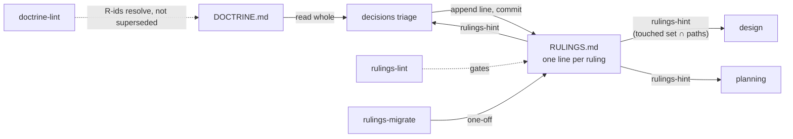

# Design — doctrine-register

> Brief: craft's decision memory becomes `docs/contributing/DOCTRINE.md` (how to choose) plus a
> rulings register (what is settled, what was refused, for which paths), one line per decision,
> no Context, no Consequences. The ADR directory, `adr-lint` and the supersession machinery are
> retired; the design, decisions and planning phases read the register slice where they read the
> governing ADR slice today. Migration is by a tested script, never by an agent reading the
> corpus. No behaviour change outside decision memory.
> Status: draft → self-reviewed ×3

## Context

### Decision memory today

| Surface | What it does with ADRs | Anchor |
|---|---|---|
| `skills/decisions/SKILL.md` | writes one ADR per settled decision (ratified or adopted), commit `docs(adr): NNN <title>`; supersession obligations (frontmatter `supersedes`, status flip, two body anchors, live-tier sweep, doctrine re-point, `DECISION-REVERSAL`) | Preamble 1–2, Procedure 1, 3, 5, 6 |
| `scripts/governing-corpus.sh` | lists the ADR files carrying a line-1 frontmatter fence (381 of 729) | whole file |
| `engine/src/intention.js` | `consult(scope, deps)` merges the living lane with the governing lane (`deps.listGoverning`) and returns `{ path, purpose }` per page whose `subjects` match the scope | `consult`, `readSubjectPages`, `mergeLanes` |
| `engine/src/intention-subjects.js` | `parseSubjects` — shared frontmatter parser (living pages, lessons, ADRs) | `parseSubjects` |
| `skills/run/SKILL.md` | §1c-int loads the view once per run; step 4 **Intention hint** prepends the slice to `design`, `decisions`, `planning` | lines 94–108, 320–324 |
| `engine/src/adr-lint-main.js` (728 lines), `engine/bin/adr-lint.js`, `scripts/adr-lint.sh` | C0 form, C1 status flip, C2 both anchors, C3 whole-tree citation sweep with `DECISION-CITE-WAIVE` and the `adr.frozen` manifest knob | `scripts/ci.sh:136-167` `run_adr_lint` |
| `engine/src/doctrine.js`, `engine/src/doctrine-lint-main.js` | parse `ADR-(\d{3,})` evidence and counter-cases; resolve each against the ADR directory; flag superseded targets; flag orphan `DOCTRINE(D-n)` inside ADRs | `ADR_REF`, `COUNTER_CASE_ITEM`, `missingInput` (`:29-33`), `citationProblem`, `orphanFindings`; `scripts/static-lints.sh:17` |
| `skills/planning/SKILL.md:27`, `agents/planner.md:9`, `templates/plan.md:3` | planner receives "the accepted ADR paths"; plan header lists `ADRs <numbers or none>` | — |
| `skills/documentation/SKILL.md:68-74`, `templates/pr-body.md:35` | PR Decisions line splits ratified from adopted by reading this run's ADRs' `adopted-as-recommended — <basis>` marker | — |
| `docs/contributing/specs/run-record.md:110-128`, `skills/run/SKILL.md:213-214` | `DECISION-REVERSAL(ADR-NNN): <scope> -> ADR-MMM`, `DECISION-CITE-WAIVE(<file>): <reason>` | — |
| `engine/src/manifest.js` `validateAdr`, `engine/src/manifest-vocabulary.js` `TOP_KEYS` (`'adr'`) | the `adr: { frozen }` knob | `docs/guides/customizing.md:188` |
| `.claude/workflow.md` | `paths.adr: docs/contributing/adr`; `paths.doctrine` | — |
| `engine/src/readme-regions.js` `CORPUS_CLAIM`, `engine/src/readme-drift-main.js` `corpusCountFindings` | README `[729 ADRs](docs/contributing/adr/)` is a counted claim (directory links only) | `README.md:228` |
| `BACKLOG.md:9` SoT pointer `docs/contributing/adr/` | resolved by `intention-lint` (`engine/src/intention-lint-main.js` SoT block) | — |
| `templates/adr.md`, `templates/design.md` ("pre-decided by existing ADRs"), `agents/designer.md:15` | — | — |
| Tests pinning ADR surfaces | `engine/test/adr-lint-main.test.js`, `adr-lint.bin.test.js`, `bin-entry-symlink.bin.test.js:44-51` and `bin-entry-swap-race.bin.test.js` (adr-lint as representative bin), `doctrine*.test.js`, `intention.test.js` (governing lane, from `:177`), `test/governing-corpus.test.js`, `test/adr-lint-ci.test.js`, `test/decision-tokens.test.js:14,56`, `test/hermetic-suite.test.js:41,78`, `test/docs-history.test.js:18`, `test/decisions-doctrine-prose.test.js`, `test/decisions-pr-body-prose.test.js`, `test/source-hygiene.test.js:131-132` (`PROVENANCE_REF_TOKENS`), `engine/src/glob.js:57-75` (`PROBE_PATHS` example ADR path) | — |
| Evals (local, never CI) | `decisions-adopts-covered-tradeoff` (fixture `docs/adr/`, `DOCTRINE.md` cites `ADR-002`, grader `adr-authored`), `decisions-escalates-fork` (grader `no-adr`), `decisions-noop-when-clear` (graders `adr-authored`, `no-escalation`), `planning-plan-lints` (prompt names `docs/adr/001-…`) | — |

craft is a published plugin: the decisions skill, `paths.adr` (default `docs/adr/`), the `adr` manifest
key, `templates/adr.md` and the `adr-lint` bin are surfaces every consumer repo runs, not only
craft's own tree.

### What the spike measured

Spike of 2026-11-20 (findings and harness kept outside the repo, at
`<main-repo-dir>/.claude/spike-doctrine-register*`), on `claude-fable-5-2`:

- Experiment 1, 40 past rulings: doctrine alone and doctrine + ADR slice gave the same pick on
  40 of 40; the ADR arm cost 66% more tokens.
- Experiment 2, 14 re-proposed refused options and 10 controls: every arm caught 14/14 with 0/10
  false alarms. Doctrine alone: 9 high-confidence catches, 103 tool calls. Doctrine + register:
  14 high, 46 calls. Today's ADR setup: 14 high, 71 calls.
- A register derived by script is 702 live lines, 117,280 bytes, against 729 files, 1,380,225
  bytes (91.5% smaller). 357 lines carry paths, 345 do not (their ADR has no frontmatter).
- 604 distinct ADR ids are cited in 247 files outside the ADR directory.
- `DOCTRINE.md` cites 47 distinct ADR ids; ADR-504 (security reporting channel, ruled against the
  recommendation) is cited by no doctrine entry and was missed by every arm of experiment 1.

The spike's register test was close to a lookup: proposals and lines came from the same ADR text.

### Probe before deletion

The brief required re-running experiment 2's arms G (doctrine only) and F (doctrine + register
slice) before any ADR file is deleted, with the two conditions the spike left untested. The
maintainer approved and the probe ran on 2026-11-20 (harness and raw data at `<scratchpad>/probe/`,
not committed).

| Change from the spike | How |
|---|---|
| Model | every agent on `opus` — the tier `pipeline/default.yml` pins for the designer and the planner, which read the slice |
| Proposals reworded | one `opus` author rewrote the 24 scored proposals in fresh words, same substance and touched paths; shared 3-word phrases with the refused option's wording fell from 49 to 9 (the 9 are identifiers); new tokens renamed (K01 `CHARACTERISATION` → `PINNING`) |
| Register lines hand-written | one `opus` writer restated the 127 sliced records from Title + Options + Decision only, without seeing the proposals; paths attached by script from `subjects` |
| Unchanged | snapshot `2031ab0` minus adr/design/plan/prd/archive with today's `DOCTRINE.md`; arm briefs verbatim; scorer; ground truth |

| Arm | Conflicts caught | False alarms | Conflict confidence h/m/l | Control confidence h/m/l | Conflicts citing a register line | Tokens | Tool calls | Agent time |
|---|---|---|---|---|---|---|---|---|
| G — doctrine only (spike, fable, verbatim) | 14/14 | 0/10 | 9/4/1 | 2/6/2 | — | 291,505 | 103 | 1168 s |
| F — doctrine + register (spike, fable, verbatim) | 14/14 | 0/10 | 14/0/0 | 5/5/0 | 14 | 197,479 | 46 | 412 s |
| **G — doctrine only (probe, opus, reworded)** | **10/14** | **1/10** | 7/5/2 | 0/9/1 | — | 160,850 | 49 | 215 s |
| **F — doctrine + register (probe, opus, reworded, hand lines)** | **14/14** | **0/10** | 13/1/0 | 2/8/0 | 14 | 149,901 | 15 | 78 s |

- G missed K01 (ADR-409), K10 (ADR-649), K15 (ADR-395), K24 (ADR-552) — four rulings no doctrine
  entry cites — and false-alarmed on K20 (ADR-662, a control). Once the wording no longer matches,
  the memory doctrine-only rebuilt from `BACKLOG.md` and code is not there.
- F caught 14/14, cited a register line on all 14, no false alarm. Its one medium-confidence catch
  is K01, where `PINNING` matches no refused option literally.
- Paired on the same 14 conflicts: 4 discordant, all in F's favour; exact two-sided p = 0.125. Not
  established at n = 14; the direction matches the spike's confidence gap.
- 0 misses in 14 leaves an F miss rate up to 19% (95% bound); 0 false alarms in 10 leaves up to 26%.

Limits still open:

- Retrieval was a guaranteed hit: each proposal's touched paths are its source record's `subjects`.
- One run per arm, one model; only the triage step was tested (not design or planning reading
  the slice).
- The writer saw the records' Options and Decision, so its lines are a faithful restatement, not
  lines written live during a decisions conversation.

Cost: 502,642 tokens, 73 tool calls, six agents.

What the probe settles for this design: doctrine alone is not a sufficient memory (4 misses, all
on rulings doctrine does not cite), and the register is what closes that gap under reworded
proposals and hand-written lines on the designer/planner model. What it does not settle — retrieval
misses, design and planning reading the slice — is the same for any variant that reads the
register, kept or not beside the ADR files.

### Migration fidelity, measured for this design

Two mechanical questions decide what a scripted migration can produce. Both were measured by
aggregate-only scripts over `docs/contributing/adr/` (counts printed, no ADR text read by an
agent); the scripts are throwaway, not committed.

**Paths for the 345 path-less lines.** Backfilling from the commit that added each un-fenced ADR
(348 files, 74 distinct commits, history followed across the `docs/adr/` → `docs/contributing/adr/`
move): non-doc paths touched per ADR, median 19, p90 56, max 69; 31 ADRs get zero. Inverted, a
touch to `scripts/ci.sh` would slice in 197 backfilled lines, `skills/run/SKILL.md` 187,
`engine/src/manifest.js` 113. The spike's slices had a median of 6 lines, max 26. Commit-derived
paths are noise, not retrieval.

**The chosen option on ratified rulings.** The prototype builder takes the chosen option to be the
one marked recommended, plus an 11-entry table of verified against-recommendation rulings
(234, 249, 257, 301, 322, 338, 375, 504, 564, 572, 719). Measured over live, ratified (not
adopted-as-recommended) ADRs with exactly one recommended marker — 307:

| Signal in the Decision section | Hits | Ids naming a non-recommended option, outside the table |
|---|---|---|
| `option N` anywhere on the first line, case-insensitive | 186; 11 name a non-recommended N | 263, 538, 655, 674 |
| `Option N` in the first paragraph, case-sensitive, not after "recommended" | 96; 7 name a non-recommended N | 319 (a false hit: "Option 3 is rejected") |
| a deviation phrase (`deviat…`, `against the … recommendation`) and no number | 6 outside the table | 133, 136, 138, 140, 156, 158 |
| option titles quoted inside the Decision text | resolves 12 of 307; finds 0 of the 10 live table entries | — |

Spot-check of the lead paragraph (seven ADRs, one paragraph each): 538, 655 and 674 read "The
user chose option 2" with option 1 recommended, and 133 reads "deviating from the
recommendation" — four real against-recommendation rulings missing from the spike's table. 263
picks neither listed option (the user reframed the premise). 257's lead names "recommended
option 2" before its choice, "Option 1", so a loose number rule reads the recommendation as
the choice. No single text rule is reliable in either direction; the table is not exhaustive.

Line-grammar facts from the same corpus: no H1 title or option title contains `Refused:`,
`Adopted:`, `Rejected:` or `Superseded by`; no H1 ends with punctuation; 119 option titles contain
`; ` and 9 contain `|`; none contains ` · `. Ids run 001–729 with no gap and no duplicate. Status
lines: 702 accepted, 27 superseded, 1 rejected (ADR-447, "reverted after measurement").

### Self-hosting boundary

The live plugin is the main checkout, so this run executes the pre-change pipeline: its decisions
phase writes ADRs 730+ through today's skill, runs today's `doctrine-lint <doctrine> <adr-dir>`,
and bumps the README ADR count per ADR commit. Its gates (`bash scripts/ci.sh` in the worktree)
run the branch's own `ci.sh`, so each commit must be green under the scripts it carries.

## Requirements

- **R1** A single register file holds one line per decision, append-only by id, in a fixed
  grammar: id, paths, statement, refused options, adoption basis, status. No Context, no
  Consequences.
- **R2** A `rulings-lint` bin gates the register's form, id order, path shape, statuses and the
  references inside it; exit 0 clean, 2 on a finding; wired into `scripts/static-lints.sh`. It
  replaces `adr-lint`.
- **R3** A migration bin derives the register from an ADR directory deterministically, with its
  own tests; it refuses loudly on any input it cannot map (conflicting chosen-option signals, a
  reserved marker in a title, a malformed id) rather than guessing.
- **R4** The `design`, `decisions` and `planning` phases receive the register lines whose paths
  match the phase's touched set where they receive the governing ADR slice today; a superseded
  line is shown with its pointer (today's lane does not filter superseded ADRs either); path-less
  lines are never sliced.
- **R5** The decisions phase writes one register line per settled decision (ratified or adopted),
  one commit per line, and records a reversal by marking the superseded line, never by deleting
  or rewriting it.
- **R6** `DOCTRINE.md` Evidence and Counter-cases cite register ids; `doctrine-lint` resolves them
  against the register file and needs no ADR directory.
- **R7** After the change no tracked file outside the dated tier (`docs/contributing/{design,plan,
  archive,prd}/`, `CHANGELOG.md`) depends on `docs/contributing/adr/`, `templates/adr.md`,
  `paths.adr`, the `adr` manifest key or `adr-lint` (under candidates #1, #2 and #6 as
  recommended; another ruling narrows this list).
- **R8** Every phase and lint not listed in this document behaves as before: the living lane and
  lessons lane of `consult`, `assert-fresh`, hygiene lints, plan-lint, design-lint, review,
  validation.
- **R9** `bash scripts/ci.sh` is green at every commit of the change, including the commits this
  run's pre-change decisions phase authors.

## Design

### Shape



New modules, all in the existing bin-shim-over-pure-src shape (`main(argv, io, deps)`,
`DEFAULT_DEPS`, `EXIT_OK = 0` / `EXIT_INVALID = 2`, repo-relative output, control characters
escaped as `adr-lint-main.js` `safeLabel` does):

| Module | Role |
|---|---|
| `engine/src/rulings.js` | pure parser: `parseRegister(content) → { rulings, errors }`, `parseRulingLine(line, lineNo)`, `sliceRulings(rulings, touched)`; the one grammar every consumer below shares |
| `engine/src/rulings-lint-main.js`, `engine/bin/rulings-lint.js` | R2 |
| `engine/src/rulings-hint-main.js`, `engine/bin/rulings-hint.js` | R4 |
| `engine/src/rulings-migrate-main.js`, `engine/bin/rulings-migrate.js` | R3 (and the live-tier citation sweep, verb `cite`) |

### Register file

One file, `docs/contributing/RULINGS.md` in craft (`paths.rulings`; consumer default
`docs/RULINGS.md`, matching `paths.doctrine` → `docs/DOCTRINE.md`). Layout:

```markdown
# Rulings

What is settled, what was refused, for which paths. One line per ruling, append-only; the
decisions phase writes them, `rulings-lint` checks them. Why a ruling was made is not stored:
infer it from `DOCTRINE.md` and the code.

- R-050 [] `architecture` report/exception home + `<arch gate>` resolution. Superseded by R-348: <scope>.
- R-409 [agents/planner.md, templates/plan.md] An already-passing test is a `GUARD` entry. Refused: Free prose · A fixed token, `CHARACTERISATION`. Adopted: as recommended.
- R-447 [<paths>] The PLAN-MISMATCH observation is unconditional for an arriving GUARD. Rejected: reverted after measurement.
```

### Line grammar

```text
ruling    = "- " id " [" paths "] " statement [refused] [adopted] [status]
id        = "R-" 3*DIGIT                       ; strictly ascending, unique
paths     = "" | path *(", " path)             ; path: repo-relative glob; no whitespace , [ ]
statement = text "."                           ; the ruling, stated as a rule
refused   = " Refused: " item *(" · " item) "."
adopted   = " Adopted: " basis "."             ; absent = ratified by the user
basis     = text                               ; its R-NNN and DOCTRINE(D-n) references are checked
status    = " Superseded by " id ": " scope "." | " Rejected: " text "."
```

- The reserved markers ` Refused: `, ` Adopted: `, ` Superseded by R-`, ` Rejected: ` each occur
  at most once, in that order; the parser splits on them left to right, so `statement` and items
  may contain any other text, including `.`, `;` and `|`.
- The item separator is ` · `, not `; `: 119 option titles in today's corpus contain `; ` and none
  contains ` · ` (measured, Context).
- New lines carry one of the decisions skill's three adopt bases: `R-NNN`, `DOCTRINE(D-<n>)` or
  `no trade-off`. Migrated lines carry the ADR marker's basis text verbatim (ids rewritten to
  `R-`), or `as recommended` when the marker names none.
- A ruling is one physical line; a line under the intro that does not start `- R-` is a finding.

### `rulings-lint`

`rulings-lint <register-file>`, wired in `scripts/static-lints.sh` beside `lesson-lint`:

| Check | Finding |
|---|---|
| RL1 form | a line fails the grammar; a reserved marker repeats or is out of order; an empty item, scope or statement |
| RL2 order | an id repeats or is not greater than the previous line's id (append-only; next id = last id + 1) |
| RL3 paths | a path is absolute, starts with `~`, contains `..`, whitespace, `,`, `[` or `]` (mirrors `manifest.js` `checkLessonsDir`); existence is not checked — a ruling outlives the files it named |
| RL4 supersession | `Superseded by R-M`: M exists, M > N, M is not itself superseded (the pointer names the live tail of the chain) |
| RL5 basis | an `R-M` inside an `Adopted:` basis names an existing line, whatever its status — a basis records why a choice was adopted at the time, so a later reversal of R-M does not rewrite it; `DOCTRINE(D-n)` bases are checked by `doctrine-lint` (orphan check, below) |

`adr-lint`'s C1/C2 have no successor: there is no second file to flip and no body to anchor.
C3 (whole-tree citation sweep) is candidate #6.

### Slice delivery: `rulings-hint`

Mirrors `lessons-hint` (touched set on stdin, one call per phase entry, advisory, every failure
but a usage error is a stderr note and exit 0):

```text
git diff --name-only <base>...HEAD | node "${CRAFT_ROOT:-${CLAUDE_PLUGIN_ROOT}}/engine/bin/rulings-hint.js" --register "<rulings-file>"
```

with the same input-artifact paths appended to stdin as the lessons hint (the brief for `design`,
the design doc for `planning`; for `decisions`, the design doc). Output, prepended into the same
slot-1 prepend, only when non-empty:

```text
Rulings (settled for these paths — a proposal that re-opens one escalates):
- R-409 [agents/planner.md, templates/plan.md] An already-passing test is a `GUARD` entry. Refused: Free prose · A fixed token, `CHARACTERISATION`. Adopted: as recommended.
(<n> rulings carry no paths — search docs/contributing/RULINGS.md by topic)
```

- Matching is today's: a line is in the slice when any touched path matches any of its globs
  (`glob.js` `matchGlob`). Superseded and rejected lines are in, printed with their status: a
  supersession can be partial (ADR-050's note keeps its report and exception decisions), so the
  old line plus its scope says what still stands, and a rejected statement is itself what was
  refused. Lines print verbatim, in id order, uncapped — a cap would drop rulings and re-open the
  misses the probe measured.
- It reads the working-tree register, unlike `lessons-hint`'s base revision: the decisions phase
  is the ratification, so a line committed on the run's branch is already settled and `planning`
  must see it.
- `consult`'s governing lane goes: `deps.listGoverning` and its merge are removed from
  `engine/src/intention.js`; `scripts/governing-corpus.sh` stays, because `skills/validation/SKILL.md`
  lists the lessons directory through it for `assert-fresh`, and only its ADR use goes; `skills/run/SKILL.md` §1c-int drops "plus the resolved ADR directory for the
  governing lane", and step 4's **Intention hint** keeps the living-page entries while the new
  **Rulings hint** paragraph sits beside it. The living and lessons lanes are untouched (R8).
  Alternative wiring is candidate #10.

### Decisions phase

`skills/decisions/SKILL.md` changes, everything else in the skill stays:

- **Preamble 1**: probe the register (`paths.rulings`, else `docs/RULINGS.md`; created with the
  H1 and intro when absent); next id = last line's id + 1. The ADR template probe goes.
- **Preamble 2**: register writes route through the intention port's `record`; for `file`, an
  append to the register. The "only ADR backfill writer" sentence becomes: the decisions phase is
  the only register writer; it may add paths to a path-less line a settled decision touches.
- **Procedure 1**: trigger (a) reads "conflicts with an existing ruling — checked against the
  rulings hint on slot 1 — or with a doctrine entry"; bases are `R-NNN`, `DOCTRINE(D-<n>)` or
  "no trade-off"; `doctrine-lint` is called with the register file.
- **Procedure 2b / 3**: the harvest's Evidence names "the ruling this becomes"; the no-op
  paragraph says adopted recommendations are still written as lines, marked `Adopted: <basis>.`
- **Procedure 5**: author each settled decision as one line — statement in the phase's own words
  as a rule, refused list = the options not chosen, `Adopted: <basis>.` for an adopted one — and
  commit each as `docs(rulings): R-NNN <statement>` (one commit per line keeps the one-artifact
  respawn invariant of `skills/run/SKILL.md:694`). Doctrine write unchanged except Evidence names
  `R-NNN`.
- **Reversal** (replaces the supersession obligations at lines 87–98), in one commit: append R-M;
  append ` Superseded by R-M: <scope>.` to R-N; re-point every `Superseded by R-N` pointer to R-M
  (RL4) and every doctrine citation of R-N to R-M; then emit
  `DECISION-REVERSAL(R-N): <scope> -> R-M`, `<scope>` verbatim from the line. Reversal shape is
  candidate #5.
- **Procedure 6** (scope-fold): the fresh designer is fed the R-ids and the design-doc path.

### Doctrine anchor

- `engine/src/doctrine.js`: `ADR_REF` → `/R-(\d{3,})\b/g`, `COUNTER_CASE_ITEM` →
  `/^R-(\d{3,}) — \S/`, messages say `R-NNN`.
- `engine/src/doctrine-lint-main.js`: usage `doctrine-lint <doctrine-file> <register-file>`;
  `missingInput` checks a regular file, not a directory; `citationProblem` resolves an id to
  exactly one parsed ruling and reports `R-NNN does not resolve` / `R-NNN is superseded`;
  `orphanFindings` scans the register's `Adopted: DOCTRINE(D-n)` bases instead of ADR files; the
  OK line reads `… N ruling citations — OK`.
- `scripts/static-lints.sh:17` and both `doctrine-lint` calls in the decisions skill pass the
  register file. `DOCTRINE.md` and the eval fixture's `DOCTRINE.md` are rewritten by the sweep
  (`ADR-` → `R-`), the numbers unchanged.

### Migration: `rulings-migrate`

```text
rulings-migrate register <adr-dir> [--chosen <json>]   → register on stdout, report on stderr
rulings-migrate cite <file>...                          → rewrites ADR citations in place
```

**`register`**, per `NNN-*.md`, in id order:

1. id from the filename prefix; statement from the H1 `# NNN — <title>` + `.`; refuse if either
   is missing, an id repeats, or the title holds a reserved marker.
2. paths from `parseSubjects` (`engine/src/intention-subjects.js`); no fence or no `subjects` →
   `[]`; a present-but-malformed fence → refuse.
3. chosen option: the `--chosen` table entry (`N`, or `none` when the ruling picked no listed
   option) → an `adopted-as-recommended` marker (the recommended option) → the single option
   marked recommended → none. A ratified ADR that is **suspect** — its Decision's first paragraph
   names an `option N` other than the recommended one, or carries a deviation phrase — and has
   no table entry makes the script refuse, listing every such id: the table is completed before
   a register is emitted, never guessed.
4. refused = the option titles (bold run, else text before ` — `) other than the chosen one, in
   option order; none when the chosen option is `none`, unknown, or there are fewer than two
   options.
5. `Adopted:` when the ADR carries the `adopted-as-recommended` marker, basis = the text after the
   marker's ` — ` with `ADR-` rewritten to `R-`, else `as recommended`.
6. status: `Status: superseded by ADR-M` → `Superseded by R-<live tail of M's chain>: <scope>`,
   scope from M's `supersedes` entry for N (else `see R-M`); `Status: rejected — <reason>` →
   `Rejected: <reason>`.

The report (stderr) gives counts per step-3 source and lists, by id, every line whose chosen
option is not the recommended one — the list the maintainer checks at PR review.

The `--chosen` table for craft starts from the spike's 11 verified entries (234→2, 249→2, 257→1,
301→2, 322→2, 338→3, 375→2, 504→3, 564→3, 572→3, 719→3) and is completed with the suspects the
script's first run lists — about a dozen by the measurement (263, 538, 655, 674, 133, 136, 138,
140, 156, 158, plus whatever this run's ADRs add), each settled from one Decision paragraph, the
way the spike built its 11. It is committed with the generated register and deleted with the
ADR files (no input left to apply it to). The bin stays: consumer repos migrate with it
(candidate #11).

**`cite`** rewrites `ADR-(\d{3,})` → `R-$1` and markdown link targets `…/adr/NNN-<slug>.md` →
the register path, in the files given. The craft run passes the live tier only (below).

### What happens to the rest

| Item | Fate |
|---|---|
| ADR files | candidate #2 (recommended: deleted; git history keeps them) |
| `templates/adr.md` | deleted with the ADR files; `templates/design.md` and `agents/designer.md:15` say "rulings" |
| `paths.adr` | replaced by `paths.rulings` in `.claude/workflow.md`, `docs/contributing/README.md:21`, `docs/guides/customizing.md`; `paths` is unvalidated, so no manifest code changes for the key |
| `adr` manifest key (`adr.frozen`) | removed with C3 (candidate #6): `TOP_KEYS`, `validateAdr`, its errors and tests, `customizing.md:188` |
| `adr-lint` (src, bin, wrapper, tests, `ci.sh` `run_adr_lint`, `test/adr-lint-ci.test.js`) | deleted; `bin-entry-*.bin.test.js` retarget their representative bin to `rulings-lint.js` |
| `DECISION-REVERSAL` | kept, ids `R-`: `DECISION-REVERSAL(R-NNN): <scope> -> R-MMM` |
| `DECISION-CITE-WAIVE` | follows C3 (candidate #6); recommended: retired from `run-record.md`, `skills/run/SKILL.md:214`, `test/decision-tokens.test.js` |
| ADR ids cited elsewhere | numbers kept (candidate #3); the live tier is rewritten by `rulings-migrate cite`: `BACKLOG.md` (incl. the `:9` SoT pointer → the register file), `DOCTRINE.md`, `README.md`, `CONTRIBUTING.md`, `docs/contributing/README.md`, `docs/contributing/specs/*.md`, `docs/guides/*.md`, `skills/**`, `agents/**`, `templates/**`, `examples/**`, `evals/**`, `.claude/workflow.md`; the dated tier is left as written (an `ADR-NNN` there reads as `R-NNN`) |
| Provenance ban | `test/source-hygiene.test.js` `PROVENANCE_REF_TOKENS` gains `R-\d{3,}` |
| README | `[729 ADRs](docs/contributing/adr/)` → `[<n> rulings](docs/contributing/RULINGS.md)`; `readme-regions.js` gains a file-target claim whose count is the register's ruling lines, so `readme-drift` keeps guarding it; `:47`, `:79`, `:113`, `:318` reworded |
| Design-doc decision tables | kept (candidate #8) |
| ADR-504 | candidate #9 |
| `docs/contributing/specs/intention.md` | "Governing lane" section and the `listGoverning` pre-condition replaced by a pointer to the rulings hint; `record` for `file` = register append |
| `docs/guides/concepts.md:57,83,87,160,174` | ADR wording → rulings; `adr-lint` → `rulings-lint` |
| `scripts/ci.sh` prose-lint exclusion | the register joins the excluded provenance docs (it quotes refused wording) |
| `test/docs-history.test.js:18` | the ADR representative is dropped (its tree no longer exists) |
| `engine/src/glob.js:57-75` | example ADR path in `PROBE_PATHS` / `MARKDOWN_PROBE_PATHS` → another `.md` path at the same depth |

### This run's own rulings

They land as ADRs 730+ through the pre-change decisions phase, each with its README count bump —
nothing else is possible: the register, its lint and `doctrine-lint`'s new signature do not exist
until the implementation commits. The migration commit then runs `rulings-migrate register` over
the whole directory, 730+ included, so they become R-730+ with their numbers; the sweep rewrites
any `ADR-7xx` the run's harvest put into `DOCTRINE.md`. The pre-PR gate runs the branch's `ci.sh`,
which by then calls `rulings-lint` and the new `doctrine-lint`, not `adr-lint`: green. The
documentation phase (pre-change skill, "read from this run's ADRs") reads them at the commits
that authored them (`git show <sha>:<path>`) or from R-730+'s `Adopted:` segments — both carry the
marker and basis; the orchestrator hands it the R-ids.

A ruling this run settles after the migration commit (a review fold, a scope-fold revision) is
caught in two ways. Before the retire commit, the ADR the pre-change skill writes is picked up by
re-running `rulings-migrate register` (deterministic) and committing the regenerated register
with it. After the retire commit, the pre-change skill would recreate `docs/contributing/adr/`
("create if absent"), so the orchestrator writes the register line directly instead — the
register and `rulings-lint` exist by then — and no ADR file is created.

### Commit outline (the planner partitions)

Each commit green on `bash scripts/ci.sh` under the scripts it carries.

1. `feat(rulings)`: `engine/src/rulings.js` + `rulings-lint` (src, bin, tests); not wired.
2. `feat(rulings)`: `rulings-migrate` `register` + `cite` (src, bin, tests, fixtures).
3. `docs(rulings)`: generate `docs/contributing/RULINGS.md` from `docs/contributing/adr/` (730+
   included) with the `--chosen` table; wire `rulings-lint` into `static-lints.sh`; `paths.rulings`
   in `.claude/workflow.md`; prose-lint exclusion. `adr-lint` still runs, both green.
4. `feat(rulings)`: `rulings-hint` (src, bin, tests); run skill §1c-int and step 4; governing lane
   removed from `intention.js`; `governing-corpus.sh` kept for its lessons use; intention spec.
5. `feat(doctrine)`: `doctrine.js` / `doctrine-lint` on the register; `DOCTRINE.md` and the eval
   fixture swept; `static-lints.sh:17`.
6. `feat(decisions)`: decisions skill, planning skill, planner, designer, `templates/{design,plan,
   pr-body}.md`, documentation skill, run-record spec, prose and token tests; the four evals'
   fixtures and graders.
7. `docs`: `rulings-migrate cite` over the live tier; README claim + `readme-regions.js`
   file-target claim; BACKLOG SoT pointer; guides.
8. `refactor!`: retire `adr-lint`, the `adr` manifest key, `DECISION-CITE-WAIVE`,
   `templates/adr.md`, the `--chosen` table and (candidate #2) the ADR files; retarget
   `bin-entry-*` tests, `docs-history` representative, `glob.js` example paths, provenance token;
   `CHANGELOG.md` Unreleased entry naming the breaking change.

## Decision candidates

| # | Choice | Alternatives (≤3) | Recommendation | Why |
|---|---|---|---|---|
| 1 | Scope of this run | (a) introduce and wire the register; ADRs stay authoritative and are still written; (b) introduce, wire, migrate and retire the ADR files, `adr-lint` and supersession in this run; (c) (b) minus deletion of the ADR files, kept until a later run | **(b)** | The brief's reason to wait was the probe; it ran: on `opus`, reworded proposals and hand-written lines, doctrine + register caught 14/14 with 0/10 false alarms and cited a line on all 14, while doctrine alone fell to 10/14 with 1/10. What the probe leaves open (retrieval misses, design/planning reading the slice, n = 14) is identical under (a) and (c), because those variants read the same register. (a) makes every run write an ADR and a line — two sources of truth that drift. (c) leaves 1.38 MB in the tree that today's setup reads at 71 tool calls against 46 for the register (spike, same model). |
| 2 | ADR files once retired | (a) delete — git history keeps them; (b) move to `docs/contributing/archive/adr/`, frozen; (c) leave in place, frozen | **(a)** | Ids are kept (#3), so every citation resolves to a line; the text is `git show <sha>:docs/contributing/adr/<file>`. (b) and (c) keep 1.38 MB in the tree that agents grep (spike arm E cited an ADR on 14 of 14 when the directory was present) and keep a second, stale source for each ruling. Dated-tier links to ADR files break under all three alike; they are ledgers and stay as written. |
| 3 | Register ids | (a) reuse ADR numbers with an `R-` prefix, next = highest + 1; (b) reuse ADR numbers and keep the `ADR-` prefix; (c) renumber the live lines densely | **(a)** | Reusing the numbers makes the 604 cited ids in 247 files resolve with no edit to the dated tier. (b) avoids the live-tier sweep but names a line after a file kind that no longer exists, and readers would look for the file. (c) breaks all 604 citations. The sweep cost of (a) is one tested script run over the live tier. |
| 4 | The 345 lines without paths | (a) keep them as an unsliced `[]` tail; the hint prints their count and the register path; a decisions phase may add paths when a ruling touches one; (b) backfill paths from the commit that added each ADR; (c) backfill by agents reading the ADRs | **(a)** | No regression: those ADRs carry no fence today, so they are already outside the governing slice. (b) measured: median 19 paths per ADR, and a touch to `scripts/ci.sh` would slice in 197 lines (spike slices: median 6, max 26). (c) breaks the brief's constraint that no agent reads the corpus. |
| 5 | Reversal of a ruling | (a) keep the old line, append `Superseded by R-M: <scope>.`; the hint shows it with the pointer; `DECISION-REVERSAL(R-N): <scope> -> R-M` stays; (b) edit the line in place, old statement moved into its refused list, token without `-> R-M`; (c) delete the old line | **(a)** | A doctrine citation of R-N keeps its meaning and `doctrine-lint` flags it as superseded, as today. Under (b) the same id silently changes meaning under every citation. (c) breaks citations and the id order. |
| 6 | Whole-tree citation sweep (`adr-lint` C3), `DECISION-CITE-WAIVE`, `adr.frozen` | (a) retire all three; superseded lines stay in the register, so a citation never dangles, and `doctrine-lint` keeps the one machine-read citation set honest; (b) port C3 into `rulings-lint` with the waiver and a renamed knob; (c) port C3 without waiver or knob | **(a)** | A citation of a superseded id lands on a line that names its successor; C3 existed because a superseded ADR file read as live. (b) keeps the sweep, exempt-set and waiver half of `adr-lint-main.js` (728 lines in all) for that case. (c) re-creates the problem the waiver was built for (a whole-tree blocking gate with no per-line escape). |
| 7 | Register file, location, grammar, lint | (a) one file `paths.rulings` (craft: `docs/contributing/RULINGS.md`, default `docs/RULINGS.md`), grammar above with ` · ` separators, `rulings-lint` RL1–RL5; (b) several files (by area or by hundred); (c) a data file (YAML/JSON) plus a rendered markdown view | **(a)** | 117 KB in one file is read only through the hint, never whole. (b) needs a routing rule for every new line and splits the id order check. (c) adds a render step and a drift check between two files. ` · ` is measured absent from all option titles; `; ` is in 119. |
| 8 | Design-doc decision tables | (a) keep them — they are the decisions phase's input, and `design-lint` requires the heading; (b) drop them in favour of the register | **(a)** | The table carries alternatives, recommendation and why before a ruling exists; the register keeps only the outcome. The duplication the spike found (finding 5) is in past docs, which are dated tier and stay. |
| 9 | ADR-504 (security reporting channel) | (a) a one-off: R-504's line carries the refusal; no doctrine entry; (b) draft a doctrine entry from it; (c) leave it unaddressed | **(a)** | One ruling is no principle; the harvest rule drafts only when the rationale reaches beyond the candidate. The probe shows the line is what catches a re-proposal (F cited a line on 14/14). Every experiment-1 arm escalated C12 rather than picking silently, so a new, similar case still reaches the user. |
| 10 | How the slice reaches the phases | (a) a `rulings-hint` bin at each `design`/`decisions`/`planning` entry, reading the working-tree register; governing lane removed from `consult`; (b) keep `consult`'s governing lane, its source switched to register lines, loaded once at §1c-int | **(a)** | (a) shows `planning` the lines this run's decisions phase just wrote, holds no in-session state, and reuses the tested `lessons-hint` shape. (b) loads before the decisions phase writes, so planning misses this run's rulings, and needs a new row type in `IntentionView` anyway. |
| 11 | Consumer repos (published plugin) | (a) breaking change: the register replaces ADRs for every consumer; `rulings-migrate` ships as a bin for them; the `adr` key is removed; CHANGELOG names it; (b) dual mode: ADR behaviour kept when `paths.adr` is set and no register exists; (c) craft-only: the plugin keeps ADRs, craft's manifest opts into the register | **(a)** | D-2: no compatibility fallback, accept the breaking cost. (b) keeps both write paths, both lints and the governing lane alive. (c) leaves craft dogfooding a path its consumers do not run. Outward-facing under trigger (b): this one escalates regardless. |
| 12 | Chosen option when migrating ratified ADRs | (a) `--chosen` table → adopted marker → recommended marker; the script refuses while any suspect (non-recommended `option N` or a deviation phrase in the Decision lead) lacks a table entry, and the table is completed from those ~12 paragraphs; (b) refused lists only on adopted-as-recommended ADRs and table entries, none on other ratified lines; (c) the prototype: recommended marker + the 11-entry table | **(a)** | Measured: 133, 538, 655, 674 are against-recommendation rulings missing from the spike's table, so (c) writes their refused lists on the wrong side — the line would call the chosen option refused. No text rule alone is reliable (257 and 319 fool the number rules), so (a) uses the rules only to stop the script, never to pick. (b) drops the refused memory — what arm F matched on — from about 430 ratified lines. |
| 13 | Where this run's own rulings land | (a) ADRs 730+ through the pre-change decisions phase, migrated by the same script in the same PR; (b) direct register lines, the decisions phase overridden by hand | **(a)** | The register, its lint and the new `doctrine-lint` do not exist when this run's decisions phase runs; (b) has no lint to gate the lines and a pre-change `doctrine-lint` that needs the ADR directory. (a) keeps every commit green under its own scripts. |

## Test strategy

TDD, Given/When/Then titles, AAA bodies, `sut`; new test files under `engine/test/` and `test/`
are registered as `test/every-test-file-registers.test.js` requires.

- **`engine/test/rulings.test.js`** (parser): one test per grammar production and per refusal —
  empty paths, several paths, each optional segment alone and combined, markers out of order,
  a repeated marker, an empty item, a statement holding `.`, `;`, `|`; `sliceRulings` includes
  superseded and rejected lines, never returns a `[]` line, matches globs through `matchGlob`.
  Property lens (parser/printer pair): `formatRulingLine(parseRulingLine(l)) === l` over generated
  lines whose text avoids the reserved markers.
- **`engine/test/rulings-lint-main.test.js`** (in-memory deps, `lesson-lint-main.test.js`
  style): RL1–RL5 each with a red and a green fixture; exit codes 0/2/usage; control characters
  in a path escaped in output; output paths repo-relative. **`rulings-lint.bin.test.js`**: spawn
  smoke.
- **`engine/test/rulings-hint-main.test.js`**: header + lines + tail note; empty slice prints
  nothing; missing register is a stderr note and exit 0; bad flags exit 2; stdin with blank lines
  and duplicates.
- **`engine/test/rulings-migrate-main.test.js`**: fixture ADR directory under
  `engine/test/fixtures/rulings-migrate/` with one file per case — fenced/unfenced,
  malformed fence (refuse), adopted with and without basis, a ratified suspect without a table
  entry (refuse, id listed) and with one (`N` and `none`), the 257 shape ("recommended option 2
  … Option 1") as a suspect, a ratified non-suspect (chosen = recommended), no recommended
  marker, one option only, superseded (scope from the
  superseding `supersedes`), a supersession chain (pointer = live tail), rejected, a title with
  a reserved marker (refuse), an option title with `; `; byte-exact expected register;
  report counts. `cite`: id rewrite, link-target rewrite, a file with no citation left
  byte-identical, `ADR-12` (two digits) untouched.
- **Migration acceptance** (in the commit that generates the register): the generated file
  passes `rulings-lint`; line count = ADR file count; the lines carrying paths = the ADRs whose
  fence parses to a non-empty `subjects` list (computed from the same directory, not hard-coded);
  the report's non-recommended list is in the PR body.
- **Slice swap**: `engine/test/intention.test.js` governing-lane cases (from `:177`) removed and
  one case added proving `consult` ignores a `listGoverning` dep; the living and lessons lane
  cases stay unchanged (R8). Parity check, one-off in the part: for the touched sets of the last
  three merged runs, the R-ids `rulings-hint` prints ⊇ the ADR ids today's governing slice
  returns.
- **`doctrine-lint`**: `doctrine.test.js` and `doctrine-lint-main.test.js` fixtures move to `R-`
  ids and a register file; new reds: an R-id with no line, a superseded line, an orphan
  `Adopted: DOCTRINE(D-9)`; a directory argument is now a usage finding.
- **Prose and token tests**: `test/decisions-doctrine-prose.test.js`,
  `test/decisions-pr-body-prose.test.js`, `test/decision-tokens.test.js` re-pinned to the new
  wording; `test/source-hygiene.test.js` red on an `R-123` in a source file.
- **`readme-regions` / `readme-drift`**: a file-target claim counts ruling lines; a drift of one
  line is a finding.
- **Mutation**: Stryker per module, one module per run, concurrency 1, `nice -n 19`, narrowed
  vitest/test corpus to the module's own suites (`rulings.js`, `rulings-lint-main.js`,
  `rulings-hint-main.js`, `rulings-migrate-main.js`, changed `doctrine*.js`).
- **Evals** (local, the maintainer runs them by hand, never CI): `decisions-adopts-covered-tradeoff`
  (fixture `docs/RULINGS.md` replaces `docs/adr/`, `DOCTRINE.md` cites `R-002`, grader
  `adr-authored` → a trace regex for an `R-003` line), `decisions-noop-when-clear` (graders
  `adr-authored`, `no-escalation`), `decisions-escalates-fork` (grader `no-adr` → no `R-` line
  written before the user rules), `planning-plan-lints` (prompt names the ruling, not
  `docs/adr/001-…`). The other seven cases touch no decision memory and need no re-run.

## Out of scope

- Rewriting the dated tier (`design/`, `plan/`, `archive/`, `prd/`, `CHANGELOG.md`): ledgers;
  their `ADR-NNN` reads as `R-NNN` because the numbers are kept.
- Backfilling paths on the 345 path-less lines: measured as noise by commit; done lazily by the
  decisions phase when a ruling touches one.
- Rewording the 729 migrated statements by hand or by agent: the probe's hand-written lines were
  a test condition, not a migration method; new lines are written in the phase's own words.
- A retrieval study (scope from a real design missing a line's paths): the open limit of the
  probe; measurable after this ships, from live runs.
- A release (version bump, tag): this change lands under Unreleased; releasing is its own run.
- Changing `DOCTRINE.md` entries beyond the id sweep and candidate #9, or the decisions triage
  triggers.
