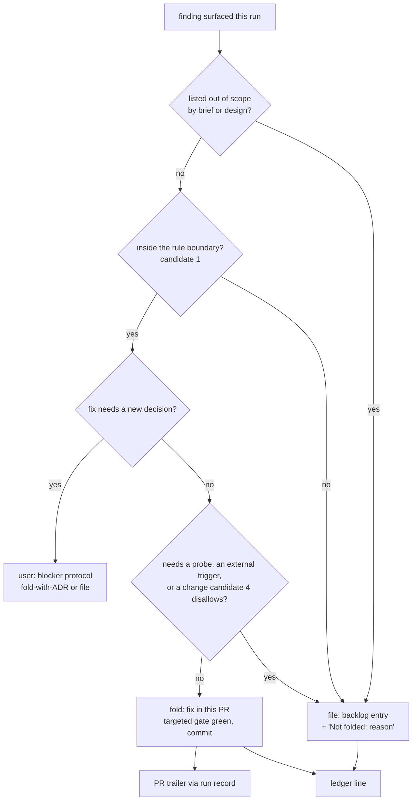

# Design — fold in-scope follow-ups: the documentation synthesis folds a finding into the PR before it files one

> Brief: the documentation phase's synthesis authors a backlog entry for every finding a run
> surfaces and never asks whether the finding belongs to the change being shipped. Add a fold step
> before any entry is authored: an in-scope, small finding is fixed in this PR and recorded in the
> PR body; only the rest is filed, and each filed entry says why it was not folded. Prose and pins
> only: no engine code, no new bin.
> Status: draft → self-reviewed ×3

---

## Context

### What exists

- **The synthesis step.** `skills/documentation/SKILL.md` (54 lines). Frontmatter L3: "refresh
  affected documentation pages, tick the backlog entry under guard, author follow-ups". Procedure
  step 3 (L45–54, the last lines of the file): "**Synthesis — session-owned, never delegated:** new
  backlog follow-up entries surfaced during the run (full context, cross-links, placed per the
  repo's ordering convention) …", then the PR body drafting per `templates/pr-body.md`. Nothing in
  the step asks whether a finding is in the change's scope. Step 2 (L30–44) already has the
  session do a one-line edit itself when the backlog-ticker's diff is wrong. That is the precedent
  for a session-owned edit inside this phase.
- **The run skill.** `skills/run/SKILL.md`:
  - L334–335, phase-walk step 5: "`delivery` (`documentation`): synthesis (follow-ups, backlog
    guard) — may parallel a running executing-harness".
  - L187–203, `### Run-record tokens`: the walk's own tokens, then a `| Token | Emitted by |` table
    of tokens emitted elsewhere (`INTENTION-*`, `STUB-*`/`SLOP-*`, `DECISION-REVERSAL`,
    `DECISION-CITE-WAIVE`, `MEMORY-RETRACT`).
  - L428–434, Cross-phase invariant "Scope expansion re-enters the harness-read phase". It binds
    feature behaviour added "during phases of archetype `construction` or `refinement`" that is
    "NOT a fix to an existing finding". `documentation` is archetype `delivery`
    (`pipeline/default.yml` L141–153) and carries no `gate:`, so the invariant's wording does not
    reach a change made at documentation time.
  - The phase order is `refactoring` → `validation` (background harness, per-hunk scope fixed when
    it starts, `skills/validation/SKILL.md` L120–135) → `documentation` → `propose` (pre-propose
    gate). A fold made in `documentation` lands after the harness run has taken its hunk list.
- **The PR body.** `templates/pr-body.md` trailer `### Provenance & verification`: Decisions /
  Design / Divergences / Pinned behaviours / Test plan / Run record. ADR-102 decided that a phase
  note in the PR body **is** the run-record line, which the documentation phase carries verbatim,
  and that no dedicated bullet is added. ADR-214 fixes the trailer's shape.
- **The token vocabulary.** `docs/contributing/specs/run-record.md` `## Token vocabulary`
  (L73–92): the family list, then a table of parsed tokens with regexes (`run-state` consumes
  them). The greppable-only tokens (`DECISION-REVERSAL`, `DECISION-CITE-WAIVE`, `MEMORY-RETRACT`,
  L111–147) are bullets that sit under `## Compaction survival` (L94), not under
  `## Token vocabulary`. Precedents for adding a token: ADR-357, ADR-360, ADR-379, ADR-464.
  Convention: fixed `TOKEN(<param>): <payload>` lines that grep (memory "prefer fixed greppable
  tokens").
- **Integrate-don't-defer already exists, one phase earlier.** `skills/refactoring/SKILL.md`
  L29–30: "in-scope gains land NOW in this change; only a genuinely feature-sized refactor (own
  design + ADRs) becomes a follow-up entry." The fold rule extends the same principle to synthesis.
- **Where findings reach synthesis from.** Review findings are already applied in full ("apply ALL
  findings", `skills/run/SKILL.md` L328). `agents/harness-triager.md` L21–29 resolves each harness
  finding to RESOLVED / EXCEPTION / FALSE. `agents/reviewer.md` (25 lines) returns structured
  findings only. Neither agent has any follow-up or backlog wording
  (`git grep -n -i "follow-up\|out-of-scope" -- agents` hits nothing). So the findings that reach
  synthesis are the ones no phase owned: one-line out-of-scope notes in agent handbacks, the
  orchestrator's own observations, triage EXCEPTIONs, and doc-refresh discoveries.

### Pinned evidence (verified against this tree, 2026-10-17)

| # | Probe | Result |
|---|---|---|
| E1 | `git show 98771b5:BACKLOG.md \| grep -c "follow-ups surfaced"` | 30 run-scoped sections on 2026-10-16. On HEAD (`0013295`): 31. |
| E2 | PR #68 `a310f8b` `--numstat` | It touched `BACKLOG.md`, `README.md`, `adapters/codex/test/native-surface.test.js` (1+/1−), and its design and plan docs. It did **not** touch `docs/contributing/adr/253-codex-shared-skills-by-reference.md`, and that file is not next to the edited test. The filed entry (`BACKLOG.md` L205) states the same claim the PR corrected, and its fix is "a user-ratified ADR that supersedes 253". |
| E3 | PR #70 `a56c878 -- BACKLOG.md` | It only flipped its own entry to "delivered" and added no new section (0 `+…follow-ups surfaced` lines). |
| E4 | PR #71 `e7f39cf` `--numstat` | It touched `adapters/copilot/README.md` (15+/7−), `docs/contributing/specs/gate.md` (14+/6−) and `engine/src/guards/git-plain-command-gate.js` (3+/35−). The entry it filed (`BACKLOG.md` L260) concerns exactly these three files. Its README hunk inserted the item right after the understated one: "an apostrophe plus `$` in a quoted word" is now `adapters/copilot/README.md` L129, and the PR added L129–131. So the finding sits in a list item the PR edited. The entry went into the older copilot-git-argv-normalising-guard section and carries the reason "Not folded into that run: it is a claim about the false-block list, not about the commit idiom." |
| E5 | `grep -o '^\*\*[^*]*\*\*' BACKLOG.md` | 103 bold-led lines: 8 contain `(` or `)` (e.g. L255 "…interactive (pty) session…"), 10 contain `:`. Some entries have no bold title at all (L216 starts with a code span). |

### Constraints already decided

- Synthesis is session-owned, never delegated (documentation step 3; `contracts/delivery.md` L3:
  backlog files and PR bodies are out of scope for role agents).
- ADR-102: a PR-body note is the run-record line, carried verbatim. No dedicated bullet.
- Only the orchestrator appends to the ledger (`skills/run/SKILL.md` L182–185).
- Gate cadence: every fix commit gates on the targeted check, and nothing is committed on a known red
  (`skills/run/SKILL.md` Cross-phase invariants, "Gates").
- `test/craft-root-shim.test.js` L19 and L29 pin exactly 1 shimmed `${CRAFT_ROOT:-…}/` invocation in
  `skills/documentation/SKILL.md` and 9 in `skills/run/SKILL.md`. The edit must not add or remove
  one.

## Requirements

No requirements artifact this run. These are self-supplied, and each one can be checked.

1. **R1 — fold before file.** Documentation step 3 triages every finding the run surfaced, before
   it authors any backlog entry. The verdict is either **folded** or **filed**.
2. **R2 — fold criteria.** A finding is folded when it is inside the change's scope (the rule
   boundary, Decision candidate 1) **and** small: its fix needs no new decision (ADR), no paid or
   live probe, and no external trigger, and its change is in the set candidate 4 allows at documentation time.
3. **R3 — fold record.** A folded finding is fixed in this PR. The record is the PR body's
   Provenance trailer, never BACKLOG.
4. **R4 — file record.** A filed finding is a backlog entry as today, plus one sentence that opens
   `Not folded: ` and gives the reason (out of scope, needs its own decision, needs a probe, or waits
   on an external trigger).
5. **R5 — decisions go to the user.** A finding that is in scope but whose fix needs a new decision
   is put to the user through the blocker protocol `{ unit, reason, ≤3 options }`. It is never
   folded silently and never filed silently. The user picks fold-with-decision (the decisions-phase
   flow, with an ADR authored) or file.
6. **R6 — brief exclusions win.** A finding the brief or the design explicitly lists as out of
   scope is never folded, whatever the boundary says.
7. **R7 — the run skill says it.** The `delivery` (`documentation`) bullet names the fold step.
8. **R8 — the frontmatter says it.** The documentation skill's `description` names folding
   in-scope findings and filing the rest, in place of "author follow-ups".
9. **R9 — pinned.** A test pins R1, R4, R5, R6, R7 and R8 (and R10 if candidate 3 (a) is ratified). It
   is red on the current tree.
10. **R10 — tokens (conditional on candidate 3).** Each verdict appends one fixed, greppable ledger
    line, and the vocabulary documents both tokens.

## Design

### The fold step (documentation step 3, new first sub-step)



Order inside step 3 (the existing synthesis text stays, after the fold step):

1. **Inventory.** Gather every finding the run surfaced that no phase resolved: agent handback
   out-of-scope lines, triage EXCEPTIONs, the orchestrator's own observations, and doc-refresh
   discoveries from step 1. The inventory is session-owned and read from the ledger and the
   handbacks. Nothing new is written for it.
2. **Triage** each finding per the flowchart.
3. **Fold.** The session makes each fold edit itself, as in step 2's one-line-edit precedent and the
   step's "never delegated" rule. Each fold is its own commit, with the conventional type of what
   it changes (`docs(<scope>): …`, `fix(<scope>): …`, `test(<scope>): …`). A fold that touches
   anything beyond prose commits only on a green `gates.part` (gate cadence). The pre-propose gate
   still covers every fold.
4. **File** the rest: the existing synthesis text, with the R4 sentence added to each entry.
5. **Draft the PR body.** Unchanged. Folds reach the trailer through the run record (ADR-102), or
   through a dedicated line if candidate 3 (c) is ratified.

### The boundary, settled on the evidence cases

Each rule applied to E2 and E4 (candidate 1 lists the alternatives):

| Case | (a) same files | (b) same claim, ≤ +1 file | (c) same files ∪ same claim ≤ +1 file |
|---|---|---|---|
| E4: copilot false-block item, README L129, a list item the PR edited | **fold**: all three locus files are in the PR's diff | **file**, if "claim" means the change's subject (the commit idiom), which is the run's own reading. **Fold**, if "claim" means any statement the diff edits. Undefined until the word is defined | **fold**, by the files arm |
| E2: ADR-253 states the claim PR #68 corrected | **file**: ADR-253 is not in the diff | in scope (+1 file), but superseding an ADR is a new decision → **user** (R5) | same as (b) → **user** |

"Same claim" therefore needs a definition, and the doc fixes one: **a claim or behaviour the diff
edits, or a statement that contradicts what the diff now makes true.** Under that definition, (b)
also folds E4. The table keeps the run's reading so that the user sees the fork the brief asked to
settle.

The `+1 file` cap counts files outside `git diff --name-only <base>...HEAD`. Craft's own artifacts
(the design, plan and ADR docs this run wrote, and `BACKLOG.md`) are in the diff, so a finding
inside them counts as same-file under every alternative.

### Ledger tokens (conditional on candidate 3)

The documentation phase appends these lines, one per finding, after the fold commit or the entry
commit:

```text
<run-id> documentation FOLDED(adapters/copilot/README.md): false-block list understates the quoted-word rule -> <sha>
<run-id> documentation FILED(docs/contributing/adr/253-codex-shared-skills-by-reference.md): ADR-253 still records … — not folded: superseding an ADR is a user decision
```

- Both tokens are greppable-only, like `DECISION-REVERSAL` and `MEMORY-RETRACT`. They are never
  parsed: no regex row, and `run-state` does not consume them. A `-> <sha>` or ` — not folded:`
  inside the payload is cosmetic, exactly as ADR-357's note says of `->`.
- The parameter is the finding's locus file, repo-relative (candidate 5 recommends this). A
  multi-file fold writes one line per file.
- Documented in `docs/contributing/specs/run-record.md` as bullets inside `## Token vocabulary`,
  before `## Compaction survival` at L94, so that a region-sliced pin sees them. Mirrored as one row
  in `skills/run/SKILL.md`'s `### Run-record tokens` table: `FOLDED(<file>): …`, `FILED(<file>): …`
  | the `documentation` phase's synthesis fold step.

### Fold candidate surfaced by this design (this run applies its own rule)

The three greppable-only token bullets in `run-record.md` (L111–147) sit under
`## Compaction survival`, so `## Token vocabulary` does not contain them (E-probe:
`grep -n "^## \|^- \`DECISION-REVERSAL" docs/contributing/specs/run-record.md` puts L111 after
L94). This change touches that region and that claim (the token vocabulary). Under candidates
1 (b)/(c) it folds: move the bullets up, verbatim. Under 1 (a) it also folds, because the file is in
the diff. `test/decision-tokens.test.js` greps the whole file, so the move stays green there. The
planner schedules it as a separate part only if candidate 3 (a) is ratified (the new bullets land
in the same region).

### Edge behaviour

- **No findings:** step 3 records nothing for the fold step. Synthesis proceeds as today.
- **A fold that turns red:** revert the fold edit (it is uncommitted, because nothing is committed
  on a red gate), and file the finding with `Not folded: the fix did not pass <gate> — <first
  failing line>`. Never spin on it.
- **A fold during the background harness:** the harness keeps the hunk list it started with, so a
  source fold is outside the harness run. The trailer says so (candidate 4 (b)).
- **Override:** a manifest `override:` of the documentation procedure replaces the fold step too.
  The step is default-body text, not part of the Preamble.

## Decision candidates

| # | Choice | Alternatives (≤3) | Recommendation | Why |
|---|---|---|---|---|
| 1 | Rule boundary: what "in scope" means | (a) same files: the finding's locus is in the PR's diff · (b) same claim/behaviour, capped at +1 file outside the diff (the brief's recommendation) · (c) (a) ∪ (b), with "claim" defined as a claim or behaviour the diff edits, or a statement contradicting what the diff now makes true | **(c)** | E4 (PR #71 copilot README L129, in a list item the PR edited) folds under (a) and (c), and under (b) only if "claim" is defined; with the run's reading, (b) files it. E2 (ADR-253, outside the diff) is filed under (a). Under (b) and (c) it is in scope but routes to the user (R5), because superseding an ADR is a decision. (c) catches both motivating cases and keeps the cap. (a) misses E2's whole class: a contradicting statement in a file the change did not touch. |
| 2 | Where the rule lives | (a) documentation step 3 only · (b) step 3 + one clause in `skills/run/SKILL.md`'s `delivery` (`documentation`) bullet · (c) (b) + one line each in `agents/reviewer.md` and `agents/harness-triager.md` | **(b)** | Review findings are already applied in full, and the triager resolves each one to RESOLVED / EXCEPTION / FALSE. Neither agent has a path to file anything (`git grep` over `agents/` finds no follow-up wording), so (c) adds lines that change no outcome. (a) leaves the run skill's walk line saying "follow-ups" with no hint of the fold step, and that line is what an orchestrator reads per phase. |
| 3 | Record form | (a) ledger tokens `FOLDED(<file>):` / `FILED(<file>):`, greppable-only, documented in `run-record.md` `## Token vocabulary` + a row in the run skill's token table; they reach the PR trailer as run-record lines (ADR-102) · (b) the same tokens, documented in the documentation skill only, not in the vocabulary · (c) no tokens; a new `- **Folded:**` trailer line in `templates/pr-body.md` | **(a)** | It follows the token-addition precedents (ADR-357, ADR-360, ADR-464) and ADR-102 (the PR note is the run-record line, with no new bullet). (b) leaves an undocumented token family, which the vocabulary exists to prevent. (c) contradicts ADR-102 and is not greppable across runs. |
| 4 | What a fold may change at documentation time | (a) prose/docs only; any source or test finding is filed · (b) prose plus source/test fixes that add no feature behaviour, each committed on a green `gates.part` and named in the trailer as outside the executing-harness run · (c) as (b), plus behaviour-adding folds that re-enter the harness-read phase and the executing harness for their hunks before `propose` | **(b)** | The documentation phase runs after review and with the harness already started, and it has no gate of its own. (b) follows the gate-cadence invariant and states the harness gap instead of hiding it. (a) would file even a one-line test retitle, and that was the whole of PR #68 (E2). (c) reopens review from the delivery archetype, which the scope-expansion invariant does not cover today. That is a new cross-phase rule, too big for a fold. |
| 5 | Token parameter | (a) `FILED(<entry>)`: the entry's bold title (the brief's form) · (b) `FOLDED(<file>)` / `FILED(<file>)`: the finding's repo-relative locus file, with the title in the payload · (c) a slug derived from the title | **(b)** | E5: 8 of 103 bold titles hold parentheses and 10 hold a colon, which breaks a `TOKEN(<param>):` read. Some entries have no bold title. A file path has neither problem (the ledger already assumes whitespace-free repo-relative paths, `run-record.md` L141–147), and it makes FOLDED and FILED greppable by the same key. (c) adds a slug rule that no other token has. |

## Test strategy

- **RED first.** New suite `test/fold-followups.test.js` (sibling of `test/decision-tokens.test.js`
  and `test/model-retry-token.test.js`). It uses `sliceProse` / `TO_END` from
  `test/helpers/region-slice.js`, follows Given/When/Then titles and AAA, and names its result
  `sut`. Run it on the current tree: every test fails.
  1. The documentation step-3 region (`/^3\. \*\*Synthesis/` → `TO_END`) names both verdicts
     (`folded`, `filed`) and the `Not folded: ` sentence. It names the user route for a fold that
     needs a decision, and the brief-exclusion rule (R6).
  2. Ordering: in that region, the fold-step index precedes the "backlog follow-up entries"
     authoring phrase (R1).
  3. The frontmatter `description` (line 3) names folding, and no longer says "author follow-ups"
     (R8).
  4. The `skills/run/SKILL.md` `delivery` (`documentation`) bullet, sliced to the next
     `` - `delivery` `` bullet, names the fold (R7).
  5. *(if 3 (a))* `FOLDED(` and `FILED(` are in the `run-record.md` region `/^## Token
     vocabulary/` → `/^## /`, and in the run skill region `/^### Run-record tokens/` → `/^## /`.
- **Kept green, must not move:** `test/craft-root-shim.test.js` (shim counts 1 / 9),
  `test/decision-tokens.test.js` (whole-file token grep; it survives the bullet move),
  `test/model-retry-token.test.js` L130 (slice ends at the token table header, so a new row is
  invisible to it), `test/run-record.test.js` L108 (the vocabulary region must keep the 7 parsed
  tokens).
- **Gate:** `bash scripts/ci.sh` (design-lint, prose-lint, hygiene, full suite). No source changes,
  so no mutation scope. `validation` is expected to record a no-op.
- **No eval.** A behavioural eval of the fold verdict is a paid, local run (memory "evals local,
  not CI"). Out of scope here.

## Out of scope

- Cleaning the 31 existing run-scoped sections or folding old entries. The ADR-253 entry stays as
  it is; it is the motivating example (brief).
- The backlog driver's contract (status file, election file) (brief).
- Extending the scope-expansion invariant to the `delivery` archetype. Candidate 4 (b) avoids
  needing it, and (c) would be its own design.
- A size cap in lines for "small". R2's criteria (no decision, no probe, no trigger, no behaviour)
  are the test, and a line count would be a magic number with no evidence behind it.
- The README pipeline line "documentation → affected pages refreshed, backlog entry ticked"
  (`README.md` L119) stays as it is: it does not claim follow-ups are filed, so no statement
  contradicts the change.
