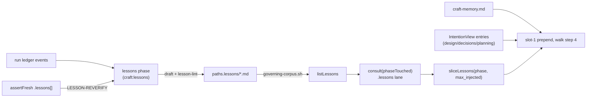
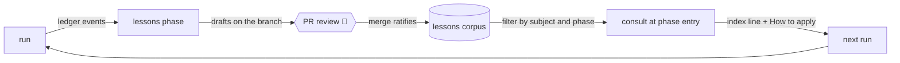

# Design — lessons-corpus

> Brief: add a committed, cited, subject-scoped **lessons** corpus beside the ADRs. The
> intention port's `consult` reads it through a new lane into the existing slot-1 prepend. A new
> default-on `lessons` phase harvests it from evidence-carrying ledger events, `assert-fresh` lists
> lessons whose subjects a change touched, and `lesson-lint` checks the corpus in CI (issue #82).
> The README explains the loop as craft's compound-engineering practice.
> Status: draft → self-reviewed ×3 → accepted → revised against ADR-655…659

## Context

### What exists

- **Two cross-run stores, neither holds a lesson.** `docs/contributing/adr/` holds decisions.
  The memory port (`engine/src/observability/memory.js`, `docs/contributing/specs/memory.md`)
  holds mechanically derived facts only: ADR-123 bans prose, and ADR-116 keeps it advisory, so it
  never gates. A trap found while delivering, such as the repeated `--mutate` flag, lives today
  only in prose that `.claude/workflow.md` carries for this repo, or in private agent memory.
- **Intention port, read side.** `engine/src/intention.js` is pure, with all I/O injected.
  - `consult(scope, deps)` → `{ entries, skipped }`. It reads two lanes:
    `deps.listCorpus()` (living pages) and the optional `deps.listGoverning?.()` (ADRs, ADR-351).
    Both lanes go through `readSubjectPages(list, readPage)` → `classifySubjects(content)`, which
    uses `parseSubjects` from `engine/src/intention-subjects.js` and skips with the reason
    `no-subjects` or `malformed-subjects`. It never throws.
  - `assertFresh(change, deps)` → `{ schemaVersion: 1, stale[], uncovered[], skipped[], note? }`.
    It reads the living lane only. A `StaleRow` is `{ page, changedPaths, waived }`, built by
    `buildStaleRow(page, subjects, changed, touched, waived)`.
  - No in-process JS caller exists. Skill prose follows the procedure, which is the same
    reference-impl precedent as `dod.js` and `memory.js`.
- **Slot 1.** In `skills/run/SKILL.md` walk step 4 ("Assemble the injected block"), the
  **Memory hint** and the **Intention hint** are prepended into the same slot-1 block. The
  intention hint is limited to `design`, `decisions` and `planning`, and §0 step 1c-int loads the
  `IntentionView` once per run.
- **Pipeline.** `pipeline/default.yml` declares 13 descriptors, 11 enabled. `engine/src/resolve.js`
  computes `autoSkipEligible` through `computeAutoSkipEligibility` (`engine/src/autoskip.js`: not
  a `FLOOR_PHASES` id, not `required: true`, no strand). `engine/src/gates.js`
  `buildProposeDecision` fills `propose`'s `awaitingHarnesses` with every enabled
  executing-harness (`archetype: harness` with `harness-exec` in its contract). A descriptor with no
  `role` is session-owned (`decisions`, `propose`, `integrate`). `contract-assemble` resolves
  `--descriptor-id` against the default descriptor set.
- **Phase vocabulary.** `engine/src/manifest-vocabulary.js` exports `PHASE_NAMES` (13 ids).
  `manifest.js` `validatePhases` (L512) rejects a `phases.<id>` block whose id is not in it, and
  `tune-plan.js` drops skip and turn-budget proposals for ids outside it. `pipeline.skip` entries
  are **not** checked against it (pinned below).
- **Enumerators.** `scripts/living-corpus.sh` exits 1 when it finds zero pages.
  `scripts/governing-corpus.sh <dir>` emits the fenced `*.md` files of one directory,
  NUL-safe, `LC_ALL=C`-sorted and `-`-guarded. It exits 0 when the directory holds zero fenced
  records and 1 when the directory is missing.
- **Lints.** `intention-lint` (`engine/bin/intention-lint.js` → `engine/src/intention-lint-main.js`)
  is the gating form check over an advisory runtime corpus. That is the posture lessons copy.
  `scripts/static-lints.sh` runs one statement per line (ADR-429/430). In
  `test/static-lints-ci.test.js`, the `LINT_IDS`/`NODE_STUB_NAMES` table makes each position fail
  in turn (ADR-431). `scripts/ci.sh` calls `bash scripts/static-lints.sh`.
- **Manifest.** `engine/src/manifest.js` `validatePaths` checks **only** `paths.dod`, as a
  file-ref. `paths.adr`, `paths.design` and `paths.plan` are inert to manifest-lint and are read
  by `adr-lint-main.js` and the skills. `TOP_KEYS` and the vocabulary sets live in
  `engine/src/manifest-vocabulary.js`.
- **README guards.** `engine/src/readme-regions.js` reads the **first** `mermaid` block as the
  pipeline diagram and the **first** `text` block as the run timeline. `readme-drift-main.js`
  sub-guard 2 (`phaseNameFindings`) diffs both against `enabledPhaseIds(pipeline/default.yml)`.
  `CORPUS_CLAIM` treats any README link `[<n> …](docs/…/)` as a counted claim, and
  `corpusCountFindings` recounts the `*.md` files in that directory. `test/readme-drift.test.js`
  runs the guard on the live tree inside `ci.sh`, so a phase or count change must land in the
  same commit as the README edit. ADR-500 keeps named products out of the README; ADR-502 pins
  every other new README claim with a root `test/*.test.js` (`test/readme-comparison.test.js` is
  the pattern: `sectionOf`, a placement check, a no-digit check).
- **Documentation synthesis.** `skills/documentation/SKILL.md` Procedure 3 is session-owned. It
  inventories findings from the ledger and handbacks, then triages, folds and files them
  (ADR-608–613). It drafts the PR body from `templates/pr-body.md`. A late triage EXCEPTION from
  the background harness gets the same triage before `propose`. `documentation` may run in
  parallel with a background executing-harness; `propose` may not.
- **Pi adapter.** `adapters/pi/src/run.js` walks `effective[]`: role phases spawn Pi, role-less
  phases call `deps.rolelessSteps[phase.id](…)` (L211) from `adapters/pi/src/roleless.js`
  (`workspace`, `decisions`, `propose`, `integrate`).
- **Token registries.** Two registries list ledger tokens: the "Token vocabulary" section of
  `docs/contributing/specs/run-record.md`, which has a parsed regex table and a greppable-only
  list, and the "Run-record tokens" table in `skills/run/SKILL.md`. `run-state` parses
  `NO-OP(<phase>):` with `PHASE_ID = [a-z][a-z0-9-]*`.
- **Metrics.** `engine/src/observability/role-phase.js` maps spawned **roles** to phases; a
  session-owned phase's tokens stay in the orchestrator bucket. `skip-signals.js` collects
  `auto-skip: <phase>` markers for any `[a-z][a-z-]*` id, and `tune-plan` turns repeated ones
  into a `pipeline.skip` proposal when the id is in `PHASE_NAMES`.

### Decisions that constrain this one

- ADR-116 and ADR-123: the memory port stays advisory and prose-free. Lessons do not touch it.
- ADR-351: a new corpus enters `consult` through its own injected lane. It never enters through a
  widened `listCorpus`.
- ADR-355 is the precedent for a whole-corpus lint. ADR-429/430/431 set the static-lints wiring
  and its test discipline.
- ADR-379: `PHASE-START`/`PHASE-DONE`. ADR-608–613: the fold rule. A finding this design surfaces
  is folded here, not filed.
- ADR-500 / ADR-502: README compares categories, never named products; each new README claim is
  pinned by a root repo-shape test.
- **ADR-655**: harvesting is its own default-on `lessons` phase, procedure `craft:lessons`, turned
  off by `pipeline.skip: [lessons]` / `--skip lessons`; `lessons` joins the phase vocabulary.
- **ADR-656**: PR review and merge ratify lessons; no new checkpoint.
- **ADR-657**: `lessons.max_injected` defaults to 3, applied per phase; `0` disables injection.
- **ADR-658**: lessons are numbered `001`… in their own sequence and cited by path.
- **ADR-659**: frontmatter is never injected; each lesson renders an index line plus its How to
  apply section, capped at 6 non-empty lines by `lesson-lint`. ADR-657's "about 60 lines at the
  20-line How-to-apply cap" is superseded by this cap: the per-phase prepend is now at most
  3 × (1 + 6) = 21 lines. The ADRs stay as written.

### Pinned behaviour (probed 2026-10-19 against this tree)

Phase probes ran in a throwaway copy of the tree with the `lessons` descriptor added after
`documentation` and `lessons` added to `PHASE_NAMES`, never in the worktree.

| Probe | Result | Consequence |
|---|---|---|
| js-yaml 4.2.0 `load('last-verified: 2026-10-19')` | a `Date` (`2026-10-19T00:00:00.000Z`), while the quoted form stays a string | the lesson parser accepts both and normalises to `YYYY-MM-DD` |
| Stryker 10.0.0 `StrykerCli` (injected `runMutationTest`), `run --mutate a.js:1-2 --mutate b.js:3-4` | `options.mutate = ["b.js:3-4"]` | the dogfood lesson's trap, reproduced |
| same, `run --mutate a.js:1-2,b.js:3-4` | `["a.js:1-2","b.js:3-4"]` | the lesson's "How to apply" |
| `matchGlob('adapters/codex/src/safe-text.js', 'adapters/*/src/**')`, `matchGlob('engine/src/guards/x.js', 'engine/src/**/*.js')` | `true`, `true` | the dogfood lesson's subjects |
| `matchGlob('.claude/workflow.md', '.claude/workflow.md')` / `(…, '**/*.md')` | `true` / `false` | a literal evidence path works as a glob, but `**` skips dot-dirs |
| `governing-corpus.sh <dir>`: missing / empty / one fenced + one unfenced | exit 1 / exit 0 + stderr note / emits only the fenced file | reusable as the lessons enumerator, behind an existence check |
| `deriveRunState` over `NO-OP(lessons):`, `LESSONS:` and `LESSON-REVERIFY(<p>):` lines with `AWAITING(propose): validation` | `warnings: []`, `awaitingHarnesses: ["validation"]` | the new tokens are inert to `run-state`, and `NO-OP(lessons)` releases nothing that is awaited |
| `pipeline-resolve pipeline/default.yml` with the descriptor | `ok: true`; order `… validation documentation lessons propose integrate`; `lessons`: `autoSkipEligible: true`, `execution: agent`, gate `""`; `propose.awaitingHarnesses = ["validation"]` | the engine needs no code change; `lessons` is never awaited by `propose` |
| same, `--skip lessons` | `ok: true`, record `skip: lessons (manifest pipeline.skip)`, `waivers: []`, no strand | a skip waives no floor (ADR-655 consequence holds) |
| same, `--skip documentation` / `--skip validation` | `lessons` stays; `--skip validation` empties `awaitingHarnesses` | `lessons` consumes nothing those phases produce |
| `manifest-lint` on today's tree: `pipeline.skip: [lessons]` / `phases: { lessons: { turn_budget: 50 } }` | `valid` / `unknown phase: lessons` | `pipeline.skip` already accepts any id (an unknown skip is a resolver no-op); `PHASE_NAMES` is what admits `phases.lessons`, a lesson's `phases: [lessons]`, and `tune-plan`'s skip proposal |
| `contract-assemble --descriptor-id lessons` today / with the descriptor | `unknown descriptor-id "lessons"` / core + the `delivery` bundle | the default-phase path needs no `--descriptor-json` |
| full suites with the descriptor | red: `engine/test/descriptor.test.js` (13-descriptor count, golden table), `engine/test/resolve.test.js` (`SC1_IDS` ×7 tests), `engine/test/scenarios.test.js` (`SC1_IDS`, `S_REORDER_IDS`, `SC3_EFFECTIVE_IDS`), `engine/test/run-state.bin.test.js` (`next` becomes `lessons`), `adapters/pi/test/engine.test.js` (`10`/`11` literals), `engine/test/readme-drift-main.test.js` + `test/readme-drift.test.js` (`phase-names:mermaid` / `:timeline: missing lessons`). Green: `static-lints.sh`, `pipeline-lint`, `contracts-lint`, `sync-adapter-agents --check`, every other adapter suite | the exhaustive fallout list the spine part edits |
| same, but the descriptor `enabled: false` | still red in `descriptor.test.js`, plus `resolve.test.js` (reorder unknown-id) and `scenarios.test.js` (the default-skip record seeds three entries) | a default-off first step is not a cheaper split |
| `rolelessSteps` keys in `adapters/pi/src/roleless.js` | `workspace, decisions, propose, integrate`; `lessons` is `undefined` | Pi's walk would throw at `run.js:211` on the new role-less phase: the adapter needs a `lessons` step |
| synthetic phase lists in `engine/test/run-state.test.js`, `run-state-main.test.js`, `phase-truth.test.js`, `readme-regions.test.js`, `adapters/pi/test/run.test.js` | build their own ids; stay green | unchanged |
| `grep` of `evals/` for phase-set pins | none | no plugin eval changes |
| `bash scripts/readme-drift.sh` on this tree | exit 0 (86 design, 83 plan, 659 ADR) | this revision adds no design doc |
| `test/git-no-ext-diff.differential.test.js`, which the issue cites as tap-trap evidence | it exists, but `engine/stryker.conf.json` excludes it (`!(*.differential)`) and its titles are not an escaped-title fix | not usable as tap-trap proof. The dogfood lesson uses the `--mutate` trap, which is reproduced above |

## Requirements

Hard lines (pre-decided):

- **R1 — advisory, never gating.** No lesson, lesson row or lesson token can stop a phase or
  feed `intention.gate` (`blocking` included). `lesson-lint` fails only on **form** errors, the
  same posture as `intention-lint`. An unresolved evidence path is reported but does not fail.
  The `lessons` phase never gates `propose` beyond its own lint of the drafts (ADR-655).
- **R2 — evidence is mandatory.** A lesson with no `evidence` entry fails `lesson-lint`. The
  harvest never drafts a lesson unless every evidence path resolves at draft time.
- **R3 — memory untouched.** `engine/src/observability/memory.js`,
  `docs/contributing/specs/memory.md` and ADR-123 stay byte-identical.
- **R4 — no new injection surface.** The read path is the intention port's `consult`, extended
  with an injected `listLessons` lane, and the existing slot-1 prepend in `skills/run/SKILL.md`
  walk step 4.
- **R5 — out of scope:** cross-repo or user-scope lessons, turning lessons into hooks or lint
  rules, and migrating private agent memory.

Acceptance (from the issue, the ADRs and the README request). Each item maps to a Test strategy
row (T-n):

- **R6** — `templates/lesson.md` exists with the issue's frontmatter and the four body headings.
  `paths.lessons` and `lessons.max_injected` are validated by manifest-lint and documented in
  `docs/guides/customizing.md`. → T1, T2, T13
- **R7** — `consult` returns a `lessons` lane whose rows carry `trigger`. Tests cover the subject
  match, status exclusion, no-subjects skip, absent lane = empty, and a malformed lesson being
  skipped. `sliceLessons` covers the phase match, the budget cap, most-recently-verified ordering,
  and `max_injected: 0`. → T3, T4
- **R8** — `skills/run/SKILL.md` prepends matched lessons into the **same** slot-1 block, for
  every phase, as one index line plus the How-to-apply section; frontmatter is never injected
  (ADR-659). It adds no new slot. → T10, T14
- **R9** — a default-on `lessons` phase (`pipeline/default.yml`, `skills/lessons/SKILL.md`,
  `PHASE_NAMES`) drafts lessons only from ledger events that carry evidence, dedupes against
  existing lessons, and records `LESSONS:` or `NO-OP(lessons):` in the ledger and in the PR body.
  `pipeline.skip: [lessons]` turns it off and waives nothing (ADR-655). → T11, T16, T17
- **R10** — `assertFresh` lists the active lessons whose subjects or evidence paths the change
  touched, in a `lessons[]` key that reuses the `StaleRow` shape, with `schemaVersion` still 1.
  Validation step 5 emits `LESSON-REVERIFY(<lesson>): <path>`, and the `lessons` phase resolves
  each one. → T5, T10, T11
- **R11** — `lesson-lint` is an engine bin. It has its own statement in `scripts/static-lints.sh`
  and is therefore in CI through `scripts/ci.sh`. It fails a How-to-apply section over 6
  non-empty lines (ADR-659). → T6, T7, T8
- **R12** — docs: a guide page `docs/guides/lessons.md`, a "Lessons lane" section in
  `docs/contributing/specs/intention.md`, token entries in `run-record.md` and in the run skill
  table, the phase in every pipeline list (README diagram and timeline, guides, plugin
  description), and a README counted link to the lessons directory. → T9, T10, T12
- **R13** — dogfood: this run ratifies at least one real, evidence-backed lesson. A committed
  test proves that a later run on the same subjects receives it in the validation slot-1 slice. A
  live later run is outside this change. → T9, T14
- **R14** — the root `README.md` gains a short section presenting the lessons layer as craft's
  compound-engineering loop (run → ledger → `lessons` phase → PR ratification → lessons corpus →
  consult at phase entry → next run), with a mermaid diagram of that loop and a link to
  `docs/guides/lessons.md`. It names no product (ADR-500), holds no digit, and each claim it makes
  is pinned by a root test (ADR-502). → T18

## Design

### Shape

```
docs/contributing/
├── adr/       decisions   (why we chose X)
├── lessons/   lessons     (what bit us, and how to avoid it)   ← new, paths.lessons
├── design/
└── plan/
```



### Lesson file (`templates/lesson.md`)

This is the issue's format verbatim. The file is `<lessons-dir>/NNN-<slug>.md`; `NNN` is the
lesson's own sequence (ADR-658).

| Key | Rule (enforced by `lesson-lint`) |
|---|---|
| `subjects` | required, a non-empty list of non-empty glob strings. It uses the shared `parseSubjects` and `matchGlob`, and `**` does not reach dot-dirs (see the pinned table) |
| `phases` | required, a non-empty list. Each entry must be in `PHASE_NAMES`, which includes `lessons` |
| `kind` | `trap \| technique \| gotcha \| anti-pattern` |
| `trigger` | required non-empty single-line string; it is rendered into the index line |
| `evidence` | required, a non-empty list. Each entry is `<repo-path>`, `<repo-path>:<n>` or `<repo-path>:<a>-<b>` (see Evidence) |
| `source` | `{ run: <kebab id>, phase: <PHASE_NAMES>, date: <YYYY-MM-DD> }` |
| `status` | `active \| superseded \| retired` |
| `supersedes` | optional list of lesson numbers (integers ≥ 1). Each one must name an existing lesson whose `status` is `superseded` |
| `last-verified` | `YYYY-MM-DD`, either a YAML `Date` or a quoted string, and ≥ `source.date` |

The body has an H1 `# NNN — <title>`, where `NNN` matches the filename number, followed by
exactly `## Context`, `## Lesson`, `## How to apply` and `## Evidence`, in that order. The
`How to apply` section holds at most `MAX_HOW_TO_APPLY_LINES = 6` non-empty lines (ADR-659),
because it is the only body text injected into slot 1. A rule that needs more lines keeps the
rule in How to apply and moves its worked example to Lesson or Evidence.

**Disclosure layers (ADR-659).**

| Layer | Read by | Injected |
|---|---|---|
| frontmatter | the engine: `consult` filters by `subjects`/`status`, `sliceLessons` filters by `phases` and ranks by `last-verified` | never |
| index line `- <title> — when <trigger> → <path>` | the agent | yes |
| `## How to apply` (≤ 6 non-empty lines) | the agent | yes, verbatim |
| `## Context`, `## Lesson`, `## Evidence` | the agent, on demand, by opening the path | never |

**Evidence grammar, resolved here.** Every entry is a **repo path**: no leading `/`, no `~`, no
`..` segment, no `$HOME`, and an optional line suffix. A commit sha is not accepted. Craft
squash-merges, which erases the branch commits a run produced, so a sha cited in a draft would
dangle once the PR merges. A file outlives the merge. Failing command output goes in the body's
`## Evidence` section, next to a path that reproduces it.

**Unresolved evidence, resolved here.** `lesson-lint` prints
`craft-lessons: stale-evidence <lesson>: <path>` to stdout and **still exits 0**. If it failed
instead, deleting a cited file in an unrelated PR would fail CI because of a lesson, which
breaks R1. The flag is therefore reported and never auto-deleted. `assertFresh` also lists the
lesson whenever a change touches one of its evidence paths, deletion included, so the run
re-verifies it. This narrows the issue's lint bullet ("repo paths in it resolve"): the lint
checks that every evidence path resolves, but an unresolved path only makes it report, never
fail. The draft-time existence check in the harvest keeps R2.

**Hygiene.** `lesson-lint` fails a lesson that contains `$HOME`, `${HOME}`, `~/`, or a home-rooted
`/Users/<name>` or `/home/<name>` anywhere in its file. Target repos have no `source-hygiene`
test, and `lesson-lint` is the gate they run on drafts. Slugs must match `^[a-z0-9]+(-[a-z0-9]+)*$`,
which also keeps lesson filenames clear of `docs-structure-lint`'s `-P<n>-` archive pattern. A
non-lesson `*.md` in the lessons directory, such as a README, fails the filename rule. That keeps
the README count honest.

### Engine — `engine/src/lesson.js` (new, pure)

```js
/** @typedef {{ subjects: string[], phases: string[], kind: string, trigger: string,
 *   evidence: string[], source: { run: string, phase: string, date: string },
 *   status: 'active'|'superseded'|'retired', supersedes: number[], lastVerified: string,
 *   number: number|null, title: string, sections: Record<string, string> }} Lesson */
export const LESSON_KINDS;            // frozen Set
export const LESSON_STATUSES;         // frozen Set
export const LESSON_SECTIONS;         // ['Context', 'Lesson', 'How to apply', 'Evidence']
export const MAX_HOW_TO_APPLY_LINES;  // 6
export function parseLesson(content)  // → { lesson } | { reason: 'malformed-lesson', errors: string[] }
export function evidencePath(entry)   // 'a/b.js:3-9' → 'a/b.js'
```

`parseLesson` reads the YAML through the existing `extractFrontmatter` and js-yaml `load`,
normalises `last-verified` and `source.date` (a `Date` becomes `toISOString().slice(0, 10)`),
splits the body on `## ` headings, counts the How-to-apply section's non-empty lines against
`MAX_HOW_TO_APPLY_LINES`, and collects **every** form error. It never throws. `lesson-lint`
prints the errors. `consult` only needs to know that the lesson is malformed, so an over-long
How to apply is also never injected. Both consumers share one parser, which is the same
arrangement as `parseSubjects` shared between `intention.js` and `intention-lint`.

### Engine — `engine/src/intention.js` (extended)

```js
// deps gains an optional listLessons: () => string[]   (absent ⇒ empty lane, as listGoverning)
consult(scope, deps)   // → { entries, skipped, lessons: LessonRow[] }
/** @typedef {{ path: string, title: string, trigger: string, howToApply: string,
 *   phases: string[], lastVerified: string }} LessonRow */
export function sliceLessons(lessons, { phase, max }) // → LessonRow[]
assertFresh(change, deps) // → { schemaVersion: 1, stale, uncovered, skipped, lessons: StaleRow[], note? }
```

- **Lessons lane in `consult`.** `readSubjectPages(deps.listLessons?.() ?? [], readPage)`
  provides the subject classification and the no-subjects and malformed-subjects skips, which
  join `skipped` exactly as the governing lane's skips do. Each subject page then goes through
  `parseLesson`: a malformed lesson becomes a `{ page, reason: 'malformed-lesson' }` skip, and a
  `superseded` or `retired` lesson is excluded **silently**. It is history, not an anomaly, so it
  is not a skip either. An active lesson whose subjects intersect `scope` becomes a `LessonRow`
  carrying exactly the fields the index line and the slice need: `title`, `trigger`, `path`,
  `howToApply`, plus `phases` and `lastVerified` for `sliceLessons`. No other frontmatter key
  reaches the row (ADR-659). `lessons` is sorted by `path` and is **always present**, `[]` when
  the lane is absent. The one existing whole-object assertion (`engine/test/intention.test.js`,
  the unreadable-page test, `{ entries: [], skipped: [] }`) gains `lessons: []`.
- **`sliceLessons`** keeps the rows whose `phases` include `phase`. It sorts them by
  `lastVerified` descending, with ties broken by `path` ascending, and takes the first `max`. A
  `max` of 0 yields `[]`. The function is pure, with no clock, no I/O and no cross-phase state
  (ADR-657).
- **`assertFresh` lessons rows.** With `deps.listLessons`, it walks the **active** lessons only.
  For each one it reuses `buildStaleRow(page, [...subjects, ...evidence.map(evidencePath)], changed, touched, waived)`,
  so the row is a `StaleRow`: listed when a subject or evidence path changed and the lesson file
  itself was not touched. A lesson file the change edits counts as re-verified. The rows go to a
  **separate** `lessons[]` key, never to `stale[]`. `stale[]` drives `INTENTION-DRIFT` and the
  `intention.gate: blocking` wiring, so a lesson in it would gate (R1). Lesson skips stay out of
  `assertFresh`'s `skipped` (`lesson-lint` reports them). `schemaVersion` stays `1`: the key is
  additive, and the only consumers are the validation and lessons skill prose, edited in the same
  change. `note` is unchanged, because it still describes the living lane.
- The **custom** source is unaffected. The lessons lane is a `file` lane fed by `paths.lessons`.
  Under `intention.source: custom` the orchestrator still builds it through the `file` adapter's
  `consult` with `listCorpus: () => []`, because a custom backend relocates intention, not the
  repo's committed lessons. The custom argv contract does not change.

### Engine — `lesson-lint`

`engine/bin/lesson-lint.js` → `engine/src/lesson-lint-main.js`
`main(argv, io, deps = { readFile, listDir, pathExists })`. This mirrors `intention-lint-main.js`,
with `isEntryPoint`, `isDirectoryPath` and `findRepoRoot` from `cli-io.js`.

- Usage: `lesson-lint <lessons-dir>`. A missing directory exits 0 with
  `craft-lessons: no lessons directory at <dir>`, because a target repo's default `docs/lessons/`
  usually does not exist. A usage error exits 2.
- The lint reads every `*.md` in the directory, fenced or not, so an unfenced file fails as
  "missing frontmatter". For each file it collects the filename rule, the `parseLesson` errors
  (the 6-line How-to-apply cap included), the hygiene check, number uniqueness within the
  directory (ADR-658), `supersedes` integrity (each target exists and is `superseded`; each
  `superseded` lesson is named by some `supersedes` list), and `last-verified` ≥ `source.date`.
- Evidence paths are resolved against `findRepoRoot(cwd)`. Unresolved ones go to stdout as
  `stale-evidence` and do not affect the exit code.
- Exit `0` with `craft-lessons: OK — <n> lesson(s) valid.`, or `2` with
  `craft-lessons: INVALID corpus:` followed by `- <file>: <error>` lines on stderr. The exit code
  and the stderr block mirror `failInvalid` in `intention-lint`.

Wiring, as its own statement placed after the `docs-structure-lint --audience docs` line:

```bash
node engine/bin/lesson-lint.js docs/contributing/lessons
```

### Manifest

- `manifest-vocabulary.js`: `TOP_KEYS` gains `'lessons'`; `PHASE_NAMES` gains `'lessons'`
  between `'documentation'` and `'propose'` (14 ids). That admits a `phases.lessons` block
  (`override`, `turn_budget`, `required`, …), a lesson's `phases: [lessons]`, and a `tune-plan`
  skip proposal after repeated `auto-skip: lessons`. `pipeline.skip: [lessons]` already lints
  (pinned); it takes effect once the descriptor exists.
- `manifest.js`:
  - `validatePaths` gains `checkLessonsDir(paths.lessons, errors)`. When the key is present, it
    must be a non-empty string, repo-relative (no leading `/`, no `~`), with no `..` segment. The
    error reads `paths.lessons must be a repo-relative directory path`. Existence is **not**
    checked, because a repo opts in before its first lesson exists.
  - A new `validateLessons(value, errors)`, dispatched from the `switch`, requires an object.
    `unknown lessons field: <k>` is reported for any key other than `max_injected`.
    `max_injected` must be a non-negative integer:
    `lessons.max_injected must be a non-negative integer`.
- Defaults are applied by the reader, the run skill, never the validator: `paths.lessons` →
  `docs/lessons/` and `max_injected` → 3 (ADR-657).
- `.claude/workflow.md` gains `lessons: docs/contributing/lessons` under `paths:`, because
  `docs-structure-lint --audience docs` forbids a top-level `docs/lessons/` in this repo.
- `examples/lessons-corpus/` holds `workflow.md`, which declares both keys, and a `README.md`.
  `test/examples-lint.test.js` then proves that the keys lint clean through the real
  `manifest-lint`. This follows the house rule that every port row has a sample.

### Phase — `lessons` (ADR-655)

**Descriptor**, in `pipeline/default.yml` between `documentation` and `propose`:

```yaml
- id: lessons
  archetype: delivery
  contract:
    - delivery
  procedure: craft:lessons
  consumes:
    - change
  produces:
    - lessons
```

| Field | Value | Why |
|---|---|---|
| `archetype` / `contract` | `delivery` / `[delivery]` | the bundle already says "the session owns synthesis records"; the phase is never `harness`, so `gates.js` never puts it in `awaitingHarnesses` and it can never become an executing harness |
| `role` / `model` | none | session-owned, like documentation synthesis: its inputs are the ledger, the handbacks and the session's own observations, which a fresh spawn does not hold. It runs on the orchestrator's model; its tokens land in the orchestrator bucket and `role-phase.js` is unchanged |
| `consumes` | `[change]` | evidence paths come from the change; `implementation` is a floor phase, so no skip strands it (pinned: `--skip documentation` / `--skip validation` leave it) |
| `produces` | `[lessons]` | honest about its output; no phase consumes it, so `--skip lessons` strands nothing |
| `gate` | none | the lint of its own drafts runs inside the procedure, where a red draft is fixed or dropped, never committed; nothing downstream waits on a gate string |
| `autoSkipEligible` | `true`, computed by the engine | not a floor, not required, strand-free (pinned) |
| `enabled` | default-on | ADR-655 |

The procedure's description line reads `Craft lessons phase - …`, like `requirements` and
`architecture`, so the numbered descriptions of `propose` (10) and `integrate` (11) stay put.

**Waiting for background triage.** `documentation` may run beside a background executing-harness,
so at its exit the harness's defect findings may not be in the ledger yet. `lessons` therefore
starts only when the in-session `awaitingHarnesses` set is empty: every awaited executing-harness
has landed, its triage is done (documentation's late-EXCEPTION synthesis included) and its gate is
green, or it was released by `auto-skip`, `NO-OP` or a waiver. That is the same condition
`propose` already waits on, so the wait moves one phase earlier and adds no latency to the run;
the harvest itself is short. `propose`'s awaited set, the `AWAITING(propose):` line and
`gateDecisions` are unchanged (pinned: `["validation"]`). `lessons` is never in that set, and
`NO-OP(lessons)` and `auto-skip: lessons` release nothing.

**Auto-skip (walk step 1).** A new row: `lessons` is provably empty when the ledger holds no
lesson-shaped event (table below) **and** no `LESSON-REVERIFY(` line **and**, when `validation`
did not run its step 5 (auto-skipped, skipped or `NO-OP(validation)`), the `assert-fresh` lessons
lane over `<base>...HEAD` is empty. The probe runs after the wait above. The `documentation` row
keeps its original signal ("no `design`/`change` content maps to any documentation surface").

**Skill `skills/lessons/SKILL.md`** — `# craft:lessons`, Preamble then Procedure, the house shape.

Preamble (always runs, non-overridable):

1. Manifest read (lint if standalone). Resolve `<lessons-dir>` = `paths.lessons`, else
   `docs/lessons/`.
2. **Cross-phase wait:** the in-session `awaitingHarnesses` set is empty (above). Not yet → wait.
3. **Standalone:** no run ledger for this branch → record `NO-OP(lessons): no run ledger` and
   stop.

Procedure (default body; a manifest `override:` replaces everything below):

1. **Harvest.** Read the ledger for lesson-shaped events:

   | Event | Ledger signal |
   |---|---|
   | reset-on-red | `PART(<n>): … outcome=blocked`, or `GATE(<phase>): red` later followed by green |
   | a review finding that needed more than one convergence round | `FINDINGS(<dim>): c<k≥2> <path> n=<m≥1>` |
   | a harness finding triaged as a real defect | a `fix(`/`test(` triage commit after `HARNESS-BG(validation:…)` |
   | a decision deviation folded back into the design | `DECISION-REVERSAL(…)`, or a design-doc `Divergences` entry |
   | a gate that failed for an environmental reason | `GATE(<phase>): red` resolved with no tracked-source change |
   | a lesson to re-verify | `LESSON-REVERIFY(<lesson>): <path>` |

   If `validation` did not run its step 5, run the `assert-fresh` lessons lane over
   `<base>...HEAD` here and treat each unwaived row as a `LESSON-REVERIFY` event.
2. **Draft, only with proof.** An event yields a draft only when it names at least one repo path
   that exists at `HEAD` and reproduces the event: a red test, a `file:line`, or a script. The
   ledger itself lives in the git common dir and is never evidence. An event with no such path
   yields no draft (R2). The next number is the highest existing lesson number + 1 (ADR-658),
   and `source.run`, `source.phase` and `source.date` come from the event's ledger line. The
   `trigger` is one line, and How to apply states the rule in at most 6 non-empty lines.
3. **Dedupe (merge before insert).** Run `consult(<event paths>, { listCorpus: () => [],
   listLessons, readPage })`. If an active lesson already covers the same trigger, add the new
   evidence to it and bump its `last-verified` instead of adding a near-duplicate. This also
   makes a resumed harvest idempotent: a draft this run already committed is merged, not
   duplicated.
4. **Re-verify.** For each `LESSON-REVERIFY` event, re-check the lesson's evidence. Then bump
   `last-verified`, set `superseded` and write the successor with a `supersedes` entry, or set
   `retired`. Nothing is deleted.
5. **Lint and commit.** Run `node "${CRAFT_ROOT:-${CLAUDE_PLUGIN_ROOT}}/engine/bin/lesson-lint.js" <lessons-dir>`.
   On exit 2, fix the draft, or drop it and record why. A red lesson is never committed, and a
   red lint never blocks the phase: it ends with whatever lint-clean drafts remain. Commit with
   `docs(lessons): record <n> lesson(s)`. If the repo README carries a counted link to the
   lessons directory, bump it in the same commit.
6. **Record.** Append one line,
   `LESSONS: <path> (new|refreshed|reverified|superseded|retired)[, …]`, or
   `NO-OP(lessons): <reason>`, for example `no lesson-shaped event carried evidence`. Fill the
   drafted PR body's `- **Lessons:**` trailer line (ADR-656) with that line.

The PR body template (`templates/pr-body.md`) gains `- **Lessons:** <LESSONS line, NO-OP(lessons)
line, or none>` in the Provenance trailer. When the phase is skipped or auto-skipped, the line
reads `none` (the template's rule for an empty line), and the run record line already carries the
`skip:` or `auto-skip: lessons` token.

**Run skill edits** (`skills/run/SKILL.md`):

- walk step 1: the `lessons` auto-skip row, evaluated only after the wait below (at `lessons`
  entry the walk waits first, then probes); the `documentation` row unchanged.
- walk step 5, session-owned responsibilities: a `delivery` (`lessons`) bullet — "harvest per
  `craft:lessons`; starts only once `awaitingHarnesses` is empty; never gates `propose` beyond
  its own draft lint".
- Cross-phase invariants: one sentence after the `documentation`-may-parallel line — `lessons`
  may not parallel a background executing-harness, and is never itself awaited.
- Resume table: a `lessons` row — a `LESSONS:` or `NO-OP(lessons):` line means done; otherwise
  re-run the harvest from step 1 (step 3 dedupes the drafts already committed).
- The run-record tokens table (below) and the Lessons hint (next section).

**Pi adapter.** `adapters/pi/src/roleless.js` gains
`lessons()` → `recorded(true, 'lessons: no-op (headless) — no session ledger to harvest')`, added
to `rolelessSteps`, so Pi's walk does not throw on the new role-less phase. Pi stays a minimal
portability example; it never harvests.

**Pipeline lists.** The phase enters every list the README guard and the guides carry:
README mermaid `ship` subgraph (`DO[documentation] --> LE[lessons] --> PR[propose]`), README
timeline (`lessons        → evidence-backed lessons harvested from the run, linted, committed`),
README adapters table (`full 11-phase walk` → `full 12-phase walk`), `docs/guides/customizing.md`
(sequence block and the *delivery* archetype list), `docs/guides/concepts.md` (three "11-phase"
mentions and the walk), and the `.claude-plugin/plugin.json` description. `CHANGELOG.md` and
dated design/plan/archive docs stay as written.

### Read path — `skills/run/SKILL.md` walk step 4

A new paragraph, **Lessons hint (advisory)**, sits after the Intention hint:

> At **every** phase entry, enumerate the lessons lane (`<lessons-dir>` = `paths.lessons`, else
> `docs/lessons/`). If the directory exists, run `scripts/governing-corpus.sh <lessons-dir>`;
> otherwise the lane is empty. Run `consult(<phase touched set>, { listCorpus: () => [],
> listLessons, readPage })` and slice with `sliceLessons(view.lessons, { phase: phase.id, max:
> lessons.max_injected ?? 3 })`. If the slice is non-empty, prepend it into the SAME slot-1
> prepend, after the memory and intention hints. The frontmatter is never injected. Use this
> format, one index line then the How-to-apply section verbatim per lesson:
>
> ```
> Lessons (advisory — open the path for context and evidence):
> - <title> — when <trigger> → <path>
>   <How to apply, verbatim, at most 6 lines>
> ```
>
> The phase touched set is `git diff --name-only <base>...HEAD`, united with the repo paths that
> the phase's input artifact names: the brief for `design`, the design doc for `planning`, the
> plan parts' `### Context` paths for `implementation`. An empty slice adds nothing. The hint
> never gates.

The lessons lane is consulted **per phase**, not once per run at 1c-int. Two reasons support
this. The touched set grows across phases, and a lesson must reach the first phase that touches
its subjects. The lane is also re-read from disk, so "Rebuild after compaction" has nothing to
rebuild. 1c-int and the "Agent spawns" slot-1 definition each gain one clause naming the lessons
hint. `governing-corpus.sh` is reused unchanged as the enumerator: the contract (fenced `*.md` of
one directory, sorted, NUL-safe) is the same, and the ADR-worded stderr note on an empty
directory is advisory text that the orchestrator ignores. At the default budget the prepend is at
most 21 lines per phase.

Revised at review: the paragraph above was first written with the orchestrator enumerating the
lane and running `consult`/`sliceLessons` by hand. Two defects: no entry point existed, so the
orchestrator would have read whole lesson files; and enumerating the working tree injected
unratified drafts from the run's own branch. The `lessons-hint` bin (`engine/bin/lessons-hint.js`)
resolves both: one call builds the slot-1 block from the committed base revision only, so only
lessons merged into the default branch are injected, and the orchestrator never opens a lesson file.

### Freshness — `skills/validation/SKILL.md` step 5

Step 5 passes `listLessons` to `assert-fresh`. For each `report.lessons[]` row with
`waived === false`, it emits one `LESSON-REVERIFY(<lesson>): <changed-path>` line per
`changedPaths` entry. That line goes to the ledger only. It never joins the drift set and never
reaches `intention.gate` (R1). A row marked waived by `INTENTION-WAIVE(<lesson>)` emits nothing,
because the row shape is reused. The `lessons` phase resolves each line.

### Tokens

| Token | Emitted by | Registry |
|---|---|---|
| `LESSONS: <path> (<outcome>)[, …]` | `lessons` procedure step 6 | the greppable-only list in `run-record.md` and the table in `skills/run/SKILL.md` |
| `NO-OP(lessons): <reason>` | `lessons` procedure step 6, or its standalone preamble | the same two registries, as the `lessons` phase's instance of the generic `NO-OP(<phase>):` |
| `LESSON-REVERIFY(<lesson>): <changed-path>` | validation step 5 | the same two registries |

None of the three gets a regex row, and `run-state` consumes none of them beyond the generic
`NO-OP(<phase>):` fold. The pinned probe shows that they produce no warnings and release nothing
that is awaited: `lessons` is a real phase but never an executing harness.

### Ratification and the dogfood lesson (R13)

Ratification is the human PR review and merge (ADR-656). No new checkpoint is added. This run
seeds lesson `docs/contributing/lessons/001-stryker-repeated-mutate-flag-keeps-last.md`:

```yaml
subjects: [engine/src/**/*.js, adapters/*/src/**/*.js]
phases: [validation]
kind: trap
trigger: composing a per-hunk Stryker run over more than one file or line range
evidence:
  - test/mutation-scope.test.js       # characterisation test against the installed Stryker CLI
  - .claude/workflow.md               # the per-hunk scope contract
source: { run: lessons-corpus, phase: design, date: 2026-10-19 }
status: active
last-verified: 2026-10-19
```

Its How to apply section, 4 non-empty lines under the 6-line cap:

```markdown
## How to apply

- Pass ONE comma-joined flag: `--mutate "a.js:1-2,b.js:3-4"`.
- Never repeat `--mutate`: the CLI keeps only the last value.
- Before trusting a green run, check the instrumented mutant count
  is at least the number of hunks you scoped.
```

Its injected form in the validation slot 1:

```
- Stryker keeps only the last repeated --mutate flag — when composing a per-hunk Stryker run over more than one file or line range → docs/contributing/lessons/001-stryker-repeated-mutate-flag-keeps-last.md
  - Pass ONE comma-joined flag: `--mutate "a.js:1-2,b.js:3-4"`.
  …
```

`test/mutation-scope.test.js` gains the characterisation test. It drives `StrykerCli` from
`engine/node_modules/@stryker-mutator/core/dist/src/stryker-cli.js` with an injected
`runMutationTest`, so nothing actually mutates, and asserts `["b.js:3-4"]` for the repeated flag
and both ranges for the comma-joined one. If an upgrade moves the internal path or fixes the
behaviour, the test turns red, which is the re-verify signal the lesson wants.

The run's own `lessons` phase then runs for real. It dedupes this run's events against 001 and
records `LESSONS:` or `NO-OP(lessons):`. The proof that a later run receives the lesson is
`engine/test/lessons-self-governance.test.js` (T14), which consults the real file. A live later
run is out of scope.

### README — the compound-engineering loop (R14)

**Placement:** a new `## Every run teaches the next` section directly after
`## What a run looks like` and before `## What it costs, measured`, because it extends the run
the reader has just seen (the `lessons` line in that timeline) before the cost and limits
sections. The section sits after the README's first `mermaid` and first `text` blocks, so
`readme-regions.js` still reads the pipeline diagram and the timeline as the guarded regions; its
own mermaid block is the second one and is never parsed as phases.

**Content** (about 20 lines, no digit, no external link, no product name):

````markdown
## Every run teaches the next

craft practises compound engineering: each run leaves the next one better equipped. What a run
learned the hard way, such as a reset-on-red, a review finding that took several rounds, or a gate
that failed for an environmental reason, is harvested by the `lessons` phase into an
evidence-backed lesson, linted, and committed on the PR branch. Merging the PR ratifies it.



At every later phase entry, craft reads each lesson's frontmatter to keep only those whose
subjects the change touches and whose phases include the current one, then injects a one-line
index plus the lesson's short How to apply rule into the agent's context. Lessons are advisory:
they never gate a phase. Turn the phase off with `pipeline.skip: [lessons]`. Details:
[docs/guides/lessons.md](docs/guides/lessons.md).
````

ADR-500 check: "compound engineering" is used as the name of a practice, unlinked, with no
product, plugin or vendor named; the comparison table is not touched. If the maintainer reads the
phrase itself as naming a product, the heading and first sentence carry the meaning without it.

**Counted link.** The "craft builds craft" sentence gains `[1 lesson](docs/contributing/lessons/)`
after the ADR link (landed with lesson 001). The loop section links the guide, never the lessons
directory with a leading count, so `CORPUS_CLAIM` sees only the one counted link.

### Docs

- `docs/contributing/specs/intention.md`: a new section, "Lessons lane", covering the deps,
  `LessonRow` (with `trigger`), status exclusion, `sliceLessons`, the disclosure layers,
  `assertFresh` `lessons[]` (never `stale[]`, never gated), the per-phase consult and the
  file-only lane. Its `subjects` gain `engine/src/lesson*.js`.
- `docs/contributing/specs/run-record.md`: the three tokens.
- `docs/guides/lessons.md` (new): what a lesson is, the format and the 6-line rule, where it
  lives, how the `lessons` phase harvests it and how the run injects it, how it is ratified, how
  to turn the phase off, and the two knobs. `docs-structure-lint docs/guides` allows the filename.
- `docs/guides/customizing.md`: a Ports row, **lessons** *(Tier 0)*, naming `paths.lessons`,
  `lessons.max_injected`, `pipeline.skip: [lessons]` and the sample `examples/lessons-corpus/`,
  plus an examples-index row; the pipeline sequence and archetype lists gain the phase.
- `docs/contributing/README.md`: a row for `lessons/`. Its `paths.*` sentence gains
  `paths.lessons`.
- `docs/README.md`: the guides cell names the lessons guide.

### Proposed parts (6-file ceiling per part, gate `bash scripts/ci.sh`)

| Part | Files | Context to hand over |
|---|---|---|
| P1 vocabulary and manifest keys | `engine/src/manifest-vocabulary.js`, `engine/src/manifest.js`, `engine/test/manifest.test.js`, `examples/lessons-corpus/workflow.md`, `examples/lessons-corpus/README.md`, `.claude/workflow.md` | `PHASE_NAMES` (L17) gains `lessons` after `documentation`; `TOP_KEYS` gains `lessons`. `validatePaths` (L99), `validatePhases` (L512), the `validateManifest` switch (L575–621), the `validateHygiene` pattern (L335). Test pattern: `manifest.test.js` L2459–2500; L1192 shows the unknown-phase assertion shape. Green alone: the pinned probe showed no test pins the vocabulary size |
| P2 lesson parser and lint | `engine/src/lesson.js`, `engine/src/lesson-lint-main.js`, `engine/bin/lesson-lint.js`, `engine/test/lesson.test.js`, `engine/test/lesson-lint-main.test.js`, `engine/test/lesson-lint.bin.test.js` | `extractFrontmatter` (`engine/src/frontmatter.js`), `parseSubjects` (`intention-subjects.js`), `PHASE_NAMES` (`manifest-vocabulary.js`), `isEntryPoint`/`findRepoRoot`/`isDirectoryPath` (`cli-io.js`). Bin and main shape: `engine/bin/intention-lint.js`, `intention-lint-main.js` `main`/`failInvalid`. Bin test pattern: `engine/test/intention-lint.bin.test.js`. `MAX_HOW_TO_APPLY_LINES = 6` |
| P3 consult lane, slice, freshness | `engine/src/intention.js`, `engine/test/intention.test.js` | `consult` (L34), `assertFresh` (L58), `readSubjectPages` (L119), `mergeLanes` (L142), `buildStaleRow` (L170), `sortBy` (L230), `extractPurpose` (L196). `LessonRow` carries `trigger`. Fixture helpers `page()`, `corpusOf()`, `governingOf()` gain a `lessonsOf()` sibling. Update the line-67 whole-object assertion |
| P4 CI wiring | `scripts/static-lints.sh`, `test/static-lints-ci.test.js` | `LINT_IDS` (L26) and `NODE_STUB_NAMES` (L45) gain `lesson-lint docs/contributing/lessons` / `lesson-lint`. The L109 title changes "twelve" to "thirteen". A missing lessons directory exits 0, so this lands before lesson 001 |
| P5 lessons skill and PR trailer | `skills/lessons/SKILL.md`, `templates/pr-body.md`, `test/lessons-harvest-prose.test.js`, `test/plugin-structure.test.js`, `test/no-op-token.test.js` | skill shape: `skills/propose/SKILL.md` (front matter, Preamble, Procedure); procedure text from §Phase above; the Provenance trailer (`templates/pr-body.md` L30–40). Existence + heading pattern: `plugin-structure.test.js` L94–135. NO-OP pin pattern: `no-op-token.test.js` L15–18. Slice helpers: `test/helpers/region-slice.js` |
| P6 Pi role-less step | `adapters/pi/src/roleless.js`, `adapters/pi/test/roleless.test.js`, `adapters/pi/test/engine.test.js` | `rolelessSteps` (L35), `recorded`, the `decisions()` no-op test as the pattern; `run.js` L211 is the unguarded call. In `engine.test.js` the `10`/`11` literals (L114–175) become counts derived from `pipeline/default.yml` through the engine's own `parsePipeline` (`engine/src/descriptor.js`) and `enabledPhaseIds` (`engine/src/phase-truth.js`), minus `refactoring` for the skip case, so they stay green across P7 |
| P7 phase spine | `pipeline/default.yml`, `engine/test/descriptor.test.js`, `engine/test/resolve.test.js`, `engine/test/scenarios.test.js`, `engine/test/run-state.bin.test.js`, `README.md` | descriptor from §Phase. `descriptor.test.js`: `EXPECTED_DESCRIPTORS` (L207), the 13-descriptor count (L371). `resolve.test.js`: `SC1_IDS` (L24), `SC1_ROLES` (L39), the "11 enabled" titles. `scenarios.test.js`: `SC1_IDS` (L69), `S_REORDER_IDS` (L958), `SC3_EFFECTIVE_IDS` (L990), gate pins L217/L238 gain `lessons` → `''`. `run-state.bin.test.js`: `next` becomes `lessons`. README: mermaid `ship` subgraph, timeline line, adapters-table pi row. All must land in one commit (pinned fallout list) |
| P8 run-skill, validation and spec prose | `skills/run/SKILL.md`, `skills/validation/SKILL.md`, `docs/contributing/specs/intention.md`, `docs/contributing/specs/run-record.md`, `test/lessons-prose.test.js` | walk step 1 table (L216–233), walk step 4 hints (L298–320), session-owned bullets (L340–355), Cross-phase invariants (L419–445), Agent spawns slot 1 (L471–477), Resume table (L586–600), 1c-int (L94–107), the token table (L195–210), validation step 5 (L98–110). `sliceProse` from `test/helpers/region-slice.js`. Pin pattern: `test/fold-followups.test.js` |
| P9 template, seed lesson, proof | `templates/lesson.md`, `docs/contributing/lessons/001-stryker-repeated-mutate-flag-keeps-last.md`, `test/mutation-scope.test.js`, `engine/test/lessons-self-governance.test.js`, `README.md`, `docs/contributing/README.md` | the pinned `StrykerCli` probe above. Proof-test pattern: `engine/test/intention-self-governance.test.js`. The README counted link (`craft builds craft`, L199–201) and the lesson land in one commit |
| P10 guides and plugin description | `docs/guides/lessons.md`, `docs/guides/customizing.md`, `docs/guides/concepts.md`, `docs/README.md`, `.claude-plugin/plugin.json`, `test/lessons-guides.test.js` | customizing sequence block (L24–27), archetype list (L29–33), Ports table (L227–236); concepts "11-phase" at L38, L54, L229 |
| P11 README loop section | `README.md`, `test/readme-lessons-loop.test.js` | §README above. Test pattern: `test/readme-comparison.test.js` (`sectionOf`, placement, `ANY_DIGIT`) |

Dependencies: P2 ← P1 (a lesson's `phases: [lessons]`); P3 ← P2; P4 ← P2; P5 ← P2, P3 (prose
cites both); P7 ← P5, P6 (the phase is not enabled before its skill and the Pi step exist);
P8 ← P3, P7; P9 ← P2, P3, P4; P10 ← P7; P11 ← P7, P9, P10. The planner may re-split under the
ceiling, but P7's six files cannot be split: each turns red without the others.

### Edge behaviour

- A lessons directory that holds no fenced file gives an empty lane, and `lesson-lint` fails any
  unfenced `*.md` in it.
- A lesson with `subjects: []` or no `subjects` key is a consult skip (`no-subjects`). It is
  never injected and never an error at runtime, but `lesson-lint` rejects it, because a lesson
  needs a scope.
- When two lessons tie on `last-verified`, the one with the smaller path comes first, so the
  order is deterministic.
- A phase id that is not in `PHASE_NAMES`, such as an `extends`-inserted phase, fails the lint.
  An inserted phase can only receive lessons once a later change widens the vocabulary.
- A lesson edited in the same change is not listed by `assertFresh`: editing it counts as
  re-verifying it, the same rule as for a touched living page.
- A How-to-apply section over 6 non-empty lines fails `lesson-lint` and is a `malformed-lesson`
  skip in `consult`, so it is never injected truncated.
- `pipeline.skip: [lessons]`: no harvest, no `LESSONS:` line, the PR trailer reads `none`;
  injection of already-ratified lessons continues, because the read path is the run skill's walk
  step 4, not the phase. `lessons.max_injected: 0` is the read-side off switch.
- `phases.lessons.required: true` with `pipeline.skip: [lessons]` fails manifest-lint through the
  existing skip/required cross-check, once `lessons` is in `PHASE_NAMES`.
- A manifest `override:` of `craft:lessons` replaces its Procedure; the Preamble wait still runs.
- An awaited harness that never turns green blocks `lessons` exactly where it would have blocked
  `propose`; the run's blocker is the harness, not the harvest.

## Decision candidates

None — every load-bearing choice is settled by ADR-655 (harvest is its own default-on `lessons`
phase), ADR-656 (PR review and merge ratify), ADR-657 (`max_injected` 3, per phase), ADR-658
(own numbering sequence) and ADR-659 (index line plus a How to apply capped at 6 non-empty
lines). The remaining shape choices in §Phase (session-owned, `delivery` archetype, wait for
background triage) and §README (placement) follow from existing code and ADRs and carry their
reasons inline.

## Test strategy

London-School TDD, `node --test`, Given/When/Then titles, AAA bodies, a `sut` variable, and one
behaviour per test. **Titles are printable ASCII only**: no em dash, `>=` rather than `≥`, and no
NEL or U+2028, because `engine/test/**` enters Stryker's tap run. No provenance references appear
in tests or source.

| # | Surface (file) | RED test (gist) | Fails today because |
|---|---|---|---|
| T1 | `engine/test/manifest.test.js` | `paths.lessons` absolute / `..` / non-string fails, and relative passes. `lessons.max_injected` -1 / 1.5 / `'3'` fails, and 0 / 3 pass. `lessons.bogus` gives "unknown lessons field". `lessons: []` gives an object error. `phases: { lessons: { turn_budget: 40 } }` lints clean. `pipeline.skip: [lessons]` + `phases.lessons.required: true` gives only the skip/required conflict | `lessons` is an unknown top-level key and an unknown phase; `paths.lessons` is inert |
| T2 | `test/examples-lint.test.js` (existing loop) | `examples/lessons-corpus/workflow.md` lints clean | the example is absent |
| T3 | `engine/test/intention.test.js`, consult | the lessons lane returns a row on subject ∩ scope. A superseded or retired lesson is excluded and is not in skipped. No-subjects skips. A malformed lesson skips with `malformed-lesson`. An absent `listLessons` gives `lessons: []`. An unreadable lesson is omitted. Rows are sorted by path. `title`, `trigger` and `howToApply` are extracted, and the row has exactly the keys `path, title, trigger, howToApply, phases, lastVerified` | `consult` has no lessons lane |
| T4 | `engine/test/intention.test.js`, `sliceLessons` | phase filter. Cap at `max`. Order by `lastVerified` descending, ties by path. `max: 0` gives `[]`. Input not mutated | the function is absent |
| T5 | `engine/test/intention.test.js`, `assertFresh` | an active lesson with a changed subject gives a `lessons[]` StaleRow. A changed evidence path also lists it. A touched lesson is not listed. A retired lesson is not listed. Lesson rows never appear in `stale[]`. `schemaVersion` is still 1. No `listLessons` gives `lessons: []` | there is no `lessons` key |
| T6 | `engine/test/lesson.test.js` | `parseLesson`: a valid lesson. Each missing key. The kind and status enums. Unknown phase; `phases: [lessons]` accepted. Empty evidence. Absolute, `~`, `..` or `$HOME` evidence. Date and string `last-verified`. Heading order. H1 number mismatch. How to apply with 7 non-empty lines fails; exactly 6 passes; blank lines are not counted. All errors collected, never thrown | the module is absent |
| T7 | `engine/test/lesson-lint-main.test.js`, `lesson-lint.bin.test.js` | a missing directory exits 0. A valid corpus exits 0 with OK. A form error exits 2 with an INVALID block. A 7-line How to apply exits 2. A stale evidence path prints `stale-evidence` and exits 0. A duplicate number, bad `supersedes` integrity, a non-lesson filename, an unfenced file and a home-rooted path each exit 2. The bin runs `main` only as the entry point | the bin is absent |
| T8 | `test/static-lints-ci.test.js` | the extended `LINT_IDS` table: thirteen invocations in order, and the `lesson-lint` position fails with its own status | the line is absent |
| T9 | `test/readme-drift.test.js`, `engine/test/readme-drift-main.test.js` (existing live-tree tests) | `[1 lesson](docs/contributing/lessons/)` matches the tree; the mermaid and timeline phase sets include `lessons` | the link and the phase are absent (red if either README edit is missing from its part's commit) |
| T10 | `test/lessons-prose.test.js` | walk step 4 names a Lessons hint that goes into the SAME slot-1 prepend, for every phase, through `consult` with `listLessons` and `sliceLessons`; its format block holds `- <title> — when <trigger> → <path>` followed by the How-to-apply line, and the paragraph says the frontmatter is never injected. 1c-int and the Agent spawns slot 1 name it. Walk step 1 has a `lessons` row naming lesson-shaped events and `LESSON-REVERIFY`; the `documentation` row does not mention lessons. The session-owned bullets have a `delivery` (`lessons`) entry; the invariants say `lessons` waits for `awaitingHarnesses` and is never awaited; the Resume table has a `lessons` row. Validation step 5 emits `LESSON-REVERIFY` and says it never gates. Both registries list the three tokens with no regex row. The intention spec carries a "Lessons lane" section | the text is absent |
| T11 | `test/lessons-harvest-prose.test.js`, `test/plugin-structure.test.js`, `test/no-op-token.test.js` | `skills/lessons/SKILL.md` exists with `# craft:lessons`. Its Preamble waits for `awaitingHarnesses` and records `NO-OP(lessons): no run ledger` standalone. Its Procedure order is harvest, draft, dedupe, re-verify, lint, record. It says drafting needs an existing evidence path, the ledger is never evidence, and How to apply holds at most 6 lines. `LESSONS:` and `NO-OP(lessons):` appear. The pr-body trailer has a **Lessons** line | the skill and the line are absent |
| T12 | `test/lessons-guides.test.js` | `docs/guides/lessons.md` exists and names both knobs and `pipeline.skip: [lessons]`. The customizing Ports table has a lessons row. Customizing's sequence block, concepts' walk and the plugin description name `lessons` between `documentation` and `propose` | absent |
| T13 | `engine/test/lessons-self-governance.test.js` | `templates/lesson.md` has the four body headings in order, and its frontmatter carries every required key | the template is absent |
| T14 | `engine/test/lessons-self-governance.test.js` | the **real** lesson 001: `consult(['engine/src/intention.js'], { listCorpus: () => [], listLessons: () => [LESSON], readPage })`, then `sliceLessons(…, { phase: 'validation', max: 3 })`, contains its row with `trigger` and the How-to-apply text, which holds at most 6 non-empty lines. Phase `design` gives `[]`. Scope `['docs/README.md']` gives `[]` | the lesson and the lane are absent |
| T15 | `test/mutation-scope.test.js` | the Stryker CLI keeps only the last of two `--mutate` flags, and a comma-joined flag keeps both ranges (a characterisation test, green on its first run) | this is evidence, not a red test |
| T16 | `engine/test/descriptor.test.js`, `resolve.test.js`, `scenarios.test.js`, `run-state.bin.test.js` | `default.yml` yields 14 descriptors and the golden row for `lessons` (`delivery`, `[delivery]`, `craft:lessons`, consumes `[change]`, produces `[lessons]`, no role, no model). SC1 resolves 12 enabled ids with `lessons` between `documentation` and `propose`; its role is `undefined`, its gate `''`, `autoSkipEligible: true`; `propose.awaitingHarnesses` deep-equals `['validation']`. `--skip lessons` resolves `ok` with the `skip: lessons (manifest pipeline.skip)` record and no waiver. The reorder and SC3 goldens gain `lessons`. The run-state bin's `next` after an in-flight `documentation` is `lessons` | the descriptor is absent |
| T17 | `adapters/pi/test/roleless.test.js`, `engine.test.js` | `lessons()` returns `ok: true` with a no-op record and spawns nothing; `rolelessSteps.lessons` is a function. The engine-thread counts equal the enabled ids of `pipeline/default.yml` (minus the skipped one) | `lessons` is not a role-less step; the counts are literals |
| T18 | `test/readme-lessons-loop.test.js` | `README.md` has `## Every run teaches the next` between `## What a run looks like` and `## What it costs, measured`; the section holds no digit, no `http` link, and one `mermaid` block naming the `lessons phase`; the README's first `mermaid` block starts before the section; the section links `docs/guides/lessons.md`, which exists; `pipeline/default.yml` declares `id: lessons` with no `gate` and no `harness` block (the "never gate" claim); the `## craft builds craft` section holds a counted link to `docs/contributing/lessons/`, which exists | the section is absent |

Mutation (validation, `npm --prefix engine run mutation`) covers `lesson.js`,
`lesson-lint-main.js`, `lessons-hint-main.js`, the changed `intention.js` hunks and the
`manifest.js` hunks, with one comma-joined `--mutate` as the seeded lesson itself says.
`adapters/pi/src/roleless.js` is outside `engine/stryker.conf.json`'s `mutate` list, like the
rest of the Pi adapter except its tool-call hook, so its no-op step is covered by its unit tests only.
R3 is checked at review with `git diff --no-ext-diff --name-only <base>...HEAD`: neither memory
file may appear in it.

## Out of scope

- User-scope or cross-repo lessons, and a promote path for them: the per-repo scoping invariant
  holds (R5).
- Turning a frequently injected lesson into a hook or lint rule (R5). A later change can count
  how often each lesson is injected.
- Migrating private agent memory into the corpus (R5). The seed lesson is re-derived from an
  on-repo probe, not copied.
- A `custom` intention backend serving lessons: the lane is `file`-only by design, and the custom
  argv contract does not change.
- Accepting `extends`-inserted phase ids in `phases`: the vocabulary stays `PHASE_NAMES` until a
  consumer needs more.
- Rewording `governing-corpus.sh`'s ADR-specific stderr note: it is advisory text, and a test
  pins it.
- A per-phase metrics row for `lessons`: it is session-owned, so its tokens stay in the
  orchestrator bucket like `decisions` and `propose`; only its `auto-skip:` markers feed
  `tune-plan`.
- Harvesting in the Pi adapter: its `lessons` step is a recorded no-op.
- Validating `pipeline.skip` ids against `PHASE_NAMES`: today any id lints and an unknown skip is
  a resolver no-op; that is existing behaviour this change does not alter.
- Rewriting dated design, plan, archive docs and `CHANGELOG.md` that list the 11-phase pipeline.
