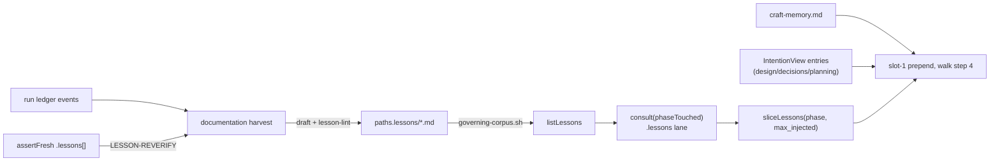

# Design — lessons-corpus

> Brief: add a committed, cited, subject-scoped **lessons** corpus beside the ADRs. The
> intention port's `consult` reads it through a new lane into the existing slot-1 prepend. The
> `documentation` phase harvests it from evidence-carrying ledger events, `assert-fresh` lists
> lessons whose subjects a change touched, and `lesson-lint` checks the corpus in CI (issue #82).
> Status: draft → self-reviewed ×3 → accepted

## Context

### What exists

- **Two cross-run stores, neither holds a lesson.** `docs/contributing/adr/` holds decisions.
  The memory port (`engine/src/observability/memory.js`, `docs/contributing/specs/memory.md`)
  holds mechanically derived facts only: ADR-123 bans prose, and ADR-116 keeps it advisory, so it
  never gates. A trap found while delivering, such as the repeated `--mutate` flag, lives today
  only in prose that `.claude/workflow.md` carries for this repo, or in private agent memory.
- **Intention port, read side.** `engine/src/intention.js` is pure, with all I/O injected.
  - `consult(scope, deps)` → `{ entries, skipped }`. It reads two lanes:
    `deps.listCorpus()` (living pages) and the optional `deps.listGoverning?.()` (ADRs, ADR-351).
    Both lanes go through `readSubjectPages(list, readPage)` → `classifySubjects(content)`, which
    uses `parseSubjects` from `engine/src/intention-subjects.js` and skips with the reason
    `no-subjects` or `malformed-subjects`. It never throws.
  - `assertFresh(change, deps)` → `{ schemaVersion: 1, stale[], uncovered[], skipped[], note? }`.
    It reads the living lane only. A `StaleRow` is `{ page, changedPaths, waived }`, built by
    `buildStaleRow(page, subjects, changed, touched, waived)`.
  - No in-process JS caller exists. Skill prose follows the procedure, which is the same
    reference-impl precedent as `dod.js` and `memory.js`.
- **Slot 1.** In `skills/run/SKILL.md` walk step 4 ("Assemble the injected block"), the
  **Memory hint** and the **Intention hint** are prepended into the same slot-1 block. The
  intention hint is limited to `design`, `decisions` and `planning`, and §0 step 1c-int loads the
  `IntentionView` once per run.
- **Enumerators.** `scripts/living-corpus.sh` exits 1 when it finds zero pages.
  `scripts/governing-corpus.sh <dir>` emits the fenced `*.md` files of one directory,
  NUL-safe, `LC_ALL=C`-sorted and `-`-guarded. It exits 0 when the directory holds zero fenced
  records and 1 when the directory is missing.
- **Lints.** `intention-lint` (`engine/bin/intention-lint.js` → `engine/src/intention-lint-main.js`)
  is the gating form check over an advisory runtime corpus. That is the posture lessons copy.
  `scripts/static-lints.sh` runs one statement per line (ADR-429/430). In
  `test/static-lints-ci.test.js`, the `LINT_IDS`/`NODE_STUB_NAMES` table makes each position fail
  in turn (ADR-431). `scripts/ci.sh` calls `bash scripts/static-lints.sh`.
- **Manifest.** `engine/src/manifest.js` `validatePaths` checks **only** `paths.dod`, as a
  file-ref. `paths.adr`, `paths.design` and `paths.plan` are inert to manifest-lint and are read
  by `adr-lint-main.js` and the skills. `TOP_KEYS` and the vocabulary sets live in
  `engine/src/manifest-vocabulary.js`, which also exports `PHASE_NAMES` (13 canonical phase ids).
- **README corpus counts.** `engine/src/readme-regions.js` `CORPUS_CLAIM` treats any README link
  `[<n> …](docs/…/)` as a counted claim. `readme-drift-main.js` `corpusCountFindings` recounts the
  `*.md` files in that directory. `test/readme-drift.test.js` runs the guard on the live tree
  inside `ci.sh`, so a count bump must land in the same commit as the file it counts.
- **Documentation synthesis.** `skills/documentation/SKILL.md` Procedure 3 is session-owned. It
  inventories findings from the ledger and handbacks, then triages, folds and files them
  (ADR-608–613, with the `FOLDED`/`FILED` tokens). It drafts the PR body from
  `templates/pr-body.md`. A late triage EXCEPTION from the background harness gets the same
  triage before `propose`.
- **Token registries.** Two registries list ledger tokens: the "Token vocabulary" section of
  `docs/contributing/specs/run-record.md`, which has a parsed regex table and a greppable-only
  list, and the "Run-record tokens" table in `skills/run/SKILL.md`. `run-state` parses
  `NO-OP(<phase>):` with `PHASE_ID = [a-z][a-z0-9-]*`.

### Decisions that constrain this one

- ADR-116 and ADR-123: the memory port stays advisory and prose-free. Lessons do not touch it.
- ADR-351: a new corpus enters `consult` through its own injected lane. It never enters through a
  widened `listCorpus`.
- ADR-355 is the precedent for a whole-corpus lint. ADR-429/430/431 set the static-lints wiring
  and its test discipline.
- ADR-379: `PHASE-START`/`PHASE-DONE`. ADR-608–613: the fold rule. A finding this design surfaces
  is folded here, not filed.

### Pinned behaviour (probed 2026-10-19 against this tree)

| Probe | Result | Consequence |
|---|---|---|
| js-yaml 4.2.0 `load('last-verified: 2026-10-19')` | a `Date` (`2026-10-19T00:00:00.000Z`), while the quoted form stays a string | the lesson parser accepts both and normalises to `YYYY-MM-DD` |
| Stryker 10.0.0 `StrykerCli` (injected `runMutationTest`), `run --mutate a.js:1-2 --mutate b.js:3-4` | `options.mutate = ["b.js:3-4"]` | the dogfood lesson's trap, reproduced |
| same, `run --mutate a.js:1-2,b.js:3-4` | `["a.js:1-2","b.js:3-4"]` | the lesson's "How to apply" |
| `matchGlob('adapters/codex/src/safe-text.js', 'adapters/*/src/**')`, `matchGlob('engine/src/guards/x.js', 'engine/src/**/*.js')` | `true`, `true` | the dogfood lesson's subjects |
| `matchGlob('.claude/workflow.md', '.claude/workflow.md')` / `(…, '**/*.md')` | `true` / `false` | a literal evidence path works as a glob, but `**` skips dot-dirs |
| `governing-corpus.sh <dir>`: missing / empty / one fenced + one unfenced | exit 1 / exit 0 + stderr note / emits only the fenced file | reusable as the lessons enumerator, behind an existence check |
| `deriveRunState` over `NO-OP(lessons):`, `LESSONS:` and `LESSON-REVERIFY(<p>):` lines with `AWAITING(propose): validation` | `warnings: []`, `awaitingHarnesses: ["validation"]` | the new tokens are inert to `run-state`, and `NO-OP(lessons)` releases nothing that is awaited |
| `bash scripts/readme-drift.sh` on this tree | exit 0 (85 design, 83 plan, 654 ADR) | this doc's commit bumps the design count to 86 |
| `test/git-no-ext-diff.differential.test.js`, which the issue cites as tap-trap evidence | it exists, but `engine/stryker.conf.json` excludes it (`!(*.differential)`) and its titles are not an escaped-title fix | not usable as tap-trap proof. The dogfood lesson uses the `--mutate` trap, which is reproduced above |

## Requirements

Hard lines (pre-decided):

- **R1 — advisory, never gating.** No lesson, lesson row or lesson token can stop a phase or
  feed `intention.gate` (`blocking` included). `lesson-lint` fails only on **form** errors, the
  same posture as `intention-lint`. An unresolved evidence path is reported but does not fail.
- **R2 — evidence is mandatory.** A lesson with no `evidence` entry fails `lesson-lint`. The
  harvest never drafts a lesson unless every evidence path resolves at draft time.
- **R3 — memory untouched.** `engine/src/observability/memory.js`,
  `docs/contributing/specs/memory.md` and ADR-123 stay byte-identical.
- **R4 — no new injection surface.** The read path is the intention port's `consult`, extended
  with an injected `listLessons` lane, and the existing slot-1 prepend in `skills/run/SKILL.md`
  walk step 4.
- **R5 — out of scope:** cross-repo or user-scope lessons, turning lessons into hooks or lint
  rules, and migrating private agent memory.

Acceptance (from the issue). Each item maps to a Test strategy row (T-n):

- **R6** — `templates/lesson.md` exists with the issue's frontmatter and the four body headings.
  `paths.lessons` and `lessons.max_injected` are validated by manifest-lint and documented in
  `docs/guides/customizing.md`. → T1, T2, T13
- **R7** — `consult` returns a `lessons` lane. Tests cover the subject match, status exclusion,
  no-subjects skip, absent lane = empty, and a malformed lesson being skipped. `sliceLessons`
  covers the phase match, the budget cap, most-recently-verified ordering, and
  `max_injected: 0`. → T3, T4
- **R8** — `skills/run/SKILL.md` prepends matched lessons into the **same** slot-1 block, for
  every phase. It adds no new slot. → T10
- **R9** — `skills/documentation/SKILL.md` drafts lessons only from ledger events that carry
  evidence, dedupes against existing lessons, and records `LESSONS:` or `NO-OP(lessons):` in the
  ledger and in the PR body. → T11
- **R10** — `assertFresh` lists the active lessons whose subjects or evidence paths the change
  touched, in a `lessons[]` key that reuses the `StaleRow` shape, with `schemaVersion` still 1.
  Validation step 5 emits `LESSON-REVERIFY(<lesson>): <path>`, and the documentation harvest
  resolves each one. → T5, T10, T11
- **R11** — `lesson-lint` is an engine bin. It has its own statement in `scripts/static-lints.sh`
  and is therefore in CI through `scripts/ci.sh`. → T6, T7, T8
- **R12** — docs: a guide page `docs/guides/lessons.md`, a "Lessons lane" section in
  `docs/contributing/specs/intention.md`, token entries in `run-record.md` and in the run skill
  table, and a README counted link to the lessons directory. → T9, T10, T12
- **R13** — dogfood: this run ratifies at least one real, evidence-backed lesson. A committed
  test proves that a later run on the same subjects receives it in the validation slot-1 slice. A
  live later run is outside this change. → T9, T14

## Design

### Shape

```
docs/contributing/
├── adr/       decisions   (why we chose X)
├── lessons/   lessons     (what bit us, and how to avoid it)   ← new, paths.lessons
├── design/
└── plan/
```



### Lesson file (`templates/lesson.md`)

This is the issue's format verbatim. The file is `<lessons-dir>/NNN-<slug>.md`.

| Key | Rule (enforced by `lesson-lint`) |
|---|---|
| `subjects` | required, a non-empty list of non-empty glob strings. It uses the shared `parseSubjects` and `matchGlob`, and `**` does not reach dot-dirs (see the pinned table) |
| `phases` | required, a non-empty list. Each entry must be in `PHASE_NAMES` |
| `kind` | `trap \| technique \| gotcha \| anti-pattern` |
| `trigger` | required non-empty string |
| `evidence` | required, a non-empty list. Each entry is `<repo-path>`, `<repo-path>:<n>` or `<repo-path>:<a>-<b>` (see Evidence) |
| `source` | `{ run: <kebab id>, phase: <PHASE_NAMES>, date: <YYYY-MM-DD> }` |
| `status` | `active \| superseded \| retired` |
| `supersedes` | optional list of lesson numbers (integers ≥ 1). Each one must name an existing lesson whose `status` is `superseded` |
| `last-verified` | `YYYY-MM-DD`, either a YAML `Date` or a quoted string, and ≥ `source.date` |

The body has an H1 `# NNN — <title>`, where `NNN` matches the filename number, followed by
exactly `## Context`, `## Lesson`, `## How to apply` and `## Evidence`, in that order. The
`How to apply` section holds at most `MAX_HOW_TO_APPLY_LINES = 20` non-empty lines, because it is
the text injected into slot 1, so its size bounds the prepend.

**Evidence grammar, resolved here.** Every entry is a **repo path**: no leading `/`, no `~`, no
`..` segment, no `$HOME`, and an optional line suffix. A commit sha is not accepted. Craft
squash-merges, which erases the branch commits a run produced, so a sha cited in a draft would
dangle once the PR merges. A file outlives the merge. Failing command output goes in the body's
`## Evidence` section, next to a path that reproduces it.

**Unresolved evidence, resolved here.** `lesson-lint` prints
`craft-lessons: stale-evidence <lesson>: <path>` to stdout and **still exits 0**. If it failed
instead, deleting a cited file in an unrelated PR would fail CI because of a lesson, which
breaks R1. The flag is therefore reported and never auto-deleted. `assertFresh` also lists the
lesson whenever a change touches one of its evidence paths, deletion included, so the run
re-verifies it. This narrows the issue's lint bullet ("repo paths in it resolve"): the lint
checks that every evidence path resolves, but an unresolved path only makes it report, never
fail. The draft-time existence check in the harvest keeps R2.

**Hygiene.** `lesson-lint` fails a lesson that contains `$HOME`, `${HOME}`, `~/`, or a home-rooted
`/Users/<name>` or `/home/<name>` anywhere in its file. Target repos have no `source-hygiene`
test, and `lesson-lint` is the gate they run on drafts. Slugs must match `^[a-z0-9]+(-[a-z0-9]+)*$`,
which also keeps lesson filenames clear of `docs-structure-lint`'s `-P<n>-` archive pattern. A
non-lesson `*.md` in the lessons directory, such as a README, fails the filename rule. That keeps
the README count honest.

### Engine — `engine/src/lesson.js` (new, pure)

```js
/** @typedef {{ subjects: string[], phases: string[], kind: string, trigger: string,
 *   evidence: string[], source: { run: string, phase: string, date: string },
 *   status: 'active'|'superseded'|'retired', supersedes: number[], lastVerified: string,
 *   number: number|null, title: string, sections: Record<string, string> }} Lesson */
export const LESSON_KINDS;          // frozen Set
export const LESSON_STATUSES;       // frozen Set
export const LESSON_SECTIONS;       // ['Context', 'Lesson', 'How to apply', 'Evidence']
export function parseLesson(content) // → { lesson } | { reason: 'malformed-lesson', errors: string[] }
export function evidencePath(entry)  // 'a/b.js:3-9' → 'a/b.js'
```

`parseLesson` reads the YAML through the existing `extractFrontmatter` and js-yaml `load`,
normalises `last-verified` and `source.date` (a `Date` becomes `toISOString().slice(0, 10)`),
splits the body on `## ` headings, and collects **every** form error. It never throws.
`lesson-lint` prints the errors. `consult` only needs to know that the lesson is malformed. Both
consumers share one parser, which is the same arrangement as `parseSubjects` shared between
`intention.js` and `intention-lint`.

### Engine — `engine/src/intention.js` (extended)

```js
// deps gains an optional listLessons: () => string[]   (absent ⇒ empty lane, as listGoverning)
consult(scope, deps)   // → { entries, skipped, lessons: LessonRow[] }
/** @typedef {{ path: string, title: string, howToApply: string, phases: string[], lastVerified: string }} LessonRow */
export function sliceLessons(lessons, { phase, max }) // → LessonRow[]
assertFresh(change, deps) // → { schemaVersion: 1, stale, uncovered, skipped, lessons: StaleRow[], note? }
```

- **Lessons lane in `consult`.** `readSubjectPages(deps.listLessons?.() ?? [], readPage)`
  provides the subject classification and the no-subjects and malformed-subjects skips, which
  join `skipped` exactly as the governing lane's skips do. Each subject page then goes through
  `parseLesson`: a malformed lesson becomes a `{ page, reason: 'malformed-lesson' }` skip, and a
  `superseded` or `retired` lesson is excluded **silently**. It is history, not an anomaly, so it
  is not a skip either. An active lesson whose subjects intersect `scope` becomes a `LessonRow`.
  `lessons` is sorted by `path` and is **always present**, `[]` when the lane is absent. The one
  existing whole-object assertion (`engine/test/intention.test.js`, the unreadable-page test,
  `{ entries: [], skipped: [] }`) gains `lessons: []`.
- **`sliceLessons`** keeps the rows whose `phases` include `phase`. It sorts them by
  `lastVerified` descending, with ties broken by `path` ascending, and takes the first `max`. A
  `max` of 0 yields `[]`. The function is pure, with no clock and no I/O.
- **`assertFresh` lessons rows.** With `deps.listLessons`, it walks the **active** lessons only.
  For each one it reuses `buildStaleRow(page, [...subjects, ...evidence.map(evidencePath)], changed, touched, waived)`,
  so the row is a `StaleRow`: listed when a subject or evidence path changed and the lesson file
  itself was not touched. A lesson file the change edits counts as re-verified. The rows go to a
  **separate** `lessons[]` key, never to `stale[]`. `stale[]` drives `INTENTION-DRIFT` and the
  `intention.gate: blocking` wiring, so a lesson in it would gate (R1). Lesson skips stay out of
  `assertFresh`'s `skipped` (`lesson-lint` reports them). `schemaVersion` stays `1`: the key is
  additive, and the only consumer is the validation skill prose, which is edited in the same
  change. `note` is unchanged, because it still describes the living lane.
- The **custom** source is unaffected. The lessons lane is a `file` lane fed by `paths.lessons`.
  Under `intention.source: custom` the orchestrator still builds it through the `file` adapter's
  `consult` with `listCorpus: () => []`, because a custom backend relocates intention, not the
  repo's committed lessons. The custom argv contract does not change.

### Engine — `lesson-lint`

`engine/bin/lesson-lint.js` → `engine/src/lesson-lint-main.js`
`main(argv, io, deps = { readFile, listDir, pathExists })`. This mirrors `intention-lint-main.js`,
with `isEntryPoint`, `isDirectoryPath` and `findRepoRoot` from `cli-io.js`.

- Usage: `lesson-lint <lessons-dir>`. A missing directory exits 0 with
  `craft-lessons: no lessons directory at <dir>`, because a target repo's default `docs/lessons/`
  usually does not exist. A usage error exits 2.
- The lint reads every `*.md` in the directory, fenced or not, so an unfenced file fails as
  "missing frontmatter". For each file it collects the filename rule, the `parseLesson` errors,
  the hygiene check, number uniqueness, `supersedes` integrity (each target exists and is
  `superseded`; each `superseded` lesson is named by some `supersedes` list), and `last-verified`
  ≥ `source.date`.
- Evidence paths are resolved against `findRepoRoot(cwd)`. Unresolved ones go to stdout as
  `stale-evidence` and do not affect the exit code.
- Exit `0` with `craft-lessons: OK — <n> lesson(s) valid.`, or `2` with
  `craft-lessons: INVALID corpus:` followed by `- <file>: <error>` lines on stderr. The exit code
  and the stderr block mirror `failInvalid` in `intention-lint`.

Wiring, as its own statement placed after the `docs-structure-lint --audience docs` line:

```bash
node engine/bin/lesson-lint.js docs/contributing/lessons
```

### Manifest

- `manifest-vocabulary.js`: `TOP_KEYS` gains `'lessons'`.
- `manifest.js`:
  - `validatePaths` gains `checkLessonsDir(paths.lessons, errors)`. When the key is present, it
    must be a non-empty string, repo-relative (no leading `/`, no `~`), with no `..` segment. The
    error reads `paths.lessons must be a repo-relative directory path`. Existence is **not**
    checked, because a repo opts in before its first lesson exists.
  - A new `validateLessons(value, errors)`, dispatched from the `switch`, requires an object.
    `unknown lessons field: <k>` is reported for any key other than `max_injected`.
    `max_injected` must be a non-negative integer:
    `lessons.max_injected must be a non-negative integer`.
- Defaults are applied by the reader, the run skill, never the validator: `paths.lessons` →
  `docs/lessons/` and `max_injected` → 3 (candidate 3).
- `.claude/workflow.md` gains `lessons: docs/contributing/lessons` under `paths:`, because
  `docs-structure-lint --audience docs` forbids a top-level `docs/lessons/` in this repo.
- `examples/lessons-corpus/` holds `workflow.md`, which declares both keys, and a `README.md`.
  `test/examples-lint.test.js` then proves that the keys lint clean through the real
  `manifest-lint`. This follows the house rule that every port row has a sample.

### Read path — `skills/run/SKILL.md` walk step 4

A new paragraph, **Lessons hint (advisory)**, sits after the Intention hint:

> At **every** phase entry, enumerate the lessons lane (`<lessons-dir>` = `paths.lessons`, else
> `docs/lessons/`). If the directory exists, run `scripts/governing-corpus.sh <lessons-dir>`;
> otherwise the lane is empty. Run `consult(<phase touched set>, { listCorpus: () => [],
> listLessons, readPage })` and slice with `sliceLessons(view.lessons, { phase: phase.id, max:
> lessons.max_injected ?? 3 })`. If the slice is non-empty, prepend it into the SAME slot-1
> prepend, after the memory and intention hints. Use this format:
>
> ```
> Lessons (advisory — read the file before relying on it):
> - <title> — <path>
>   <How to apply, verbatim>
> ```
>
> The phase touched set is `git diff --name-only <base>...HEAD`, united with the repo paths that
> the phase's input artifact names: the brief for `design`, the design doc for `planning`, the
> plan parts' `### Context` paths for `implementation`. An empty slice adds nothing. The hint
> never gates.

The lessons lane is consulted **per phase**, not once per run at 1c-int. Two reasons support
this. The touched set grows across phases, and a lesson must reach the first phase that touches
its subjects. The lane is also re-read from disk, so "Rebuild after compaction" has nothing to
rebuild. 1c-int and the "Agent spawns" slot-1 definition each gain one clause naming the lessons
hint. `governing-corpus.sh` is reused unchanged as the enumerator: the contract (fenced `*.md` of
one directory, sorted, NUL-safe) is the same, and the ADR-worded stderr note on an empty
directory is advisory text that the orchestrator ignores.

### Freshness — `skills/validation/SKILL.md` step 5

Step 5 passes `listLessons` to `assert-fresh`. For each `report.lessons[]` row with
`waived === false`, it emits one `LESSON-REVERIFY(<lesson>): <changed-path>` line per
`changedPaths` entry. That line goes to the ledger only. It never joins the drift set and never
reaches `intention.gate` (R1). A row marked waived by `INTENTION-WAIVE(<lesson>)` emits nothing,
because the row shape is reused.

### Write path — `skills/documentation/SKILL.md` Procedure 3 (candidates 1 and 2)

A new sub-step, **3.5 Lessons**, runs after Fold and File. It is session-owned and is never
delegated. The run skill's `delivery` (`documentation`) bullet names it.

1. **Harvest.** Read the ledger for lesson-shaped events:

   | Event | Ledger signal |
   |---|---|
   | reset-on-red | `PART(<n>): … outcome=blocked`, or `GATE(<phase>): red` later followed by green |
   | a review finding that needed more than one convergence round | `FINDINGS(<dim>): c<k≥2> <path> n=<m≥1>` |
   | a harness finding triaged as a real defect | a `fix(`/`test(` triage commit after `HARNESS-BG(validation:…)` |
   | a decision deviation folded back into the design | `DECISION-REVERSAL(…)`, or a design-doc `Divergences` entry |
   | a gate that failed for an environmental reason | `GATE(<phase>): red` resolved with no tracked-source change |
   | a lesson to re-verify | `LESSON-REVERIFY(<lesson>): <path>` |

2. **Draft, only with proof.** An event yields a draft only when it names at least one repo path
   that exists at `HEAD` and reproduces the event: a red test, a `file:line`, or a script. The
   ledger itself lives in the git common dir and is never evidence. An event with no such path
   yields no draft (R2). The next number is the highest existing lesson number + 1 (candidate 4),
   and `source.run`, `source.phase` and `source.date` come from the event's ledger line.
3. **Dedupe (merge before insert).** Run `consult(<event paths>, { listCorpus: () => [],
   listLessons, readPage })`. If an active lesson already covers the same trigger, add the new
   evidence to it and bump its `last-verified` instead of adding a near-duplicate.
4. **Re-verify.** For each `LESSON-REVERIFY` line, re-check the lesson's evidence. Then bump
   `last-verified`, set `superseded` and write the successor with a `supersedes` entry, or set
   `retired`. Nothing is deleted.
5. **Lint and commit.** Run `node "${CRAFT_ROOT:-${CLAUDE_PLUGIN_ROOT}}/engine/bin/lesson-lint.js" <lessons-dir>`.
   On exit 2, fix the draft, or drop it and record why. A red lesson is never committed. Commit
   with `docs(lessons): record <n> lesson(s)`. If the repo README carries a counted link to the
   lessons directory, bump it in the same commit.
6. **Record.** Append one line,
   `LESSONS: <path> (new|refreshed|reverified|superseded|retired)[, …]`, or
   `NO-OP(lessons): <reason>`, for example `no lesson-shaped event carried evidence`. The PR
   body's Provenance trailer gains `- **Lessons:** <the LESSONS line, or the NO-OP(lessons) line>`.

A lesson-shaped event that the background harness lands **after** this step is harvested before
`propose`, under the same rule synthesis already applies to a late EXCEPTION. If `validation`
auto-skipped, so that step 5 never ran, step 3.5 runs the `assert-fresh` lessons lane itself.

**Documentation auto-skip.** The provably-empty signal in walk step 1 becomes "no
`design`/`change` content maps to any documentation surface **and** the ledger holds no
lesson-shaped event". A docs-free change that hit a reset-on-red still produces its lesson.

### Tokens

| Token | Emitted by | Registry |
|---|---|---|
| `LESSONS: <path> (<outcome>)[, …]` | documentation 3.5 | the greppable-only list in `run-record.md` and the table in `skills/run/SKILL.md` |
| `NO-OP(lessons): <reason>` | documentation 3.5 | the same two registries, as a named idiom of the generic `NO-OP(<phase>):` |
| `LESSON-REVERIFY(<lesson>): <changed-path>` | validation step 5, or documentation 3.5 as the fallback | the same two registries |

None of the three gets a regex row, and `run-state` consumes none of them. The pinned probe
shows that they produce no warnings and release nothing that is awaited. The `lessons` id inside
`NO-OP(lessons)` names the harvest step, not a phase. `run-state` puts it in the released set,
where it is inert, because no executing harness is named `lessons`.

### Ratification and the dogfood lesson (R13)

Under candidate 2, ratification is the human PR review and merge. No new checkpoint is added.
This run seeds lesson `docs/contributing/lessons/001-stryker-repeated-mutate-flag-keeps-last.md`:

```yaml
subjects: [engine/src/**/*.js, adapters/*/src/**/*.js]
phases: [validation]
kind: trap
trigger: composing a per-hunk Stryker run over more than one file or line range
evidence:
  - test/mutation-scope.test.js       # characterisation test against the installed Stryker CLI
  - .claude/workflow.md               # the per-hunk scope contract
source: { run: lessons-corpus, phase: design, date: 2026-10-19 }
status: active
last-verified: 2026-10-19
```

Its How to apply section reads: emit one comma-joined `--mutate "a.js:1-2,b.js:3-4"`, and check
that the instrumented mutant count is at least the hunk count before trusting a green.
`test/mutation-scope.test.js` gains the characterisation test. It drives `StrykerCli` from
`engine/node_modules/@stryker-mutator/core/dist/src/stryker-cli.js` with an injected
`runMutationTest`, so nothing actually mutates, and asserts `["b.js:3-4"]` for the repeated flag
and both ranges for the comma-joined one. If an upgrade moves the internal path or fixes the
behaviour, the test turns red, which is the re-verify signal the lesson wants.

The run's own harvest in 3.5 then runs for real. It dedupes this run's events against 001 and
records `LESSONS:` or `NO-OP(lessons):`. The proof that a later run receives the lesson is
`engine/test/lessons-self-governance.test.js` (T14), which consults the real file. A live later
run is out of scope.

### Docs

- `docs/contributing/specs/intention.md`: a new section, "Lessons lane", covering the deps,
  `LessonRow`, status exclusion, `sliceLessons`, `assertFresh` `lessons[]` (never `stale[]`,
  never gated), the per-phase consult and the file-only lane. Its `subjects` gain
  `engine/src/lesson*.js`.
- `docs/contributing/specs/run-record.md`: the three tokens.
- `docs/guides/lessons.md` (new): what a lesson is, the format, where it lives, how a run
  harvests and injects it, how it is ratified, and the two knobs.
  `docs-structure-lint docs/guides` allows the filename.
- `docs/guides/customizing.md`: a Ports row, **lessons** *(Tier 0)*, naming `paths.lessons`,
  `lessons.max_injected` and the sample `examples/lessons-corpus/`, plus an examples-index row.
- `docs/contributing/README.md`: a row for `lessons/`. Its `paths.*` sentence gains
  `paths.lessons`.
- `docs/README.md`: the guides cell names the lessons guide.
- `README.md` line ~200: the counted link `[1 lesson](docs/contributing/lessons/)`, placed after
  the ADR link, lands in the commit that adds lesson 001. The noun is free text, because
  `CORPUS_CLAIM` only needs the label to open with the count.

### Proposed parts (6-file ceiling per part, gate `bash scripts/ci.sh`)

| Part | Files | Context to hand over |
|---|---|---|
| P1 lesson parser and lint | `engine/src/lesson.js`, `engine/src/lesson-lint-main.js`, `engine/bin/lesson-lint.js`, `engine/test/lesson.test.js`, `engine/test/lesson-lint-main.test.js`, `engine/test/lesson-lint.bin.test.js` | `extractFrontmatter` (`engine/src/frontmatter.js`), `parseSubjects` (`intention-subjects.js`), `PHASE_NAMES` (`manifest-vocabulary.js`), `isEntryPoint`/`findRepoRoot`/`isDirectoryPath` (`cli-io.js`). Bin and main shape: `engine/bin/intention-lint.js`, `intention-lint-main.js` `main`/`failInvalid`. Bin test pattern: `engine/test/intention-lint.bin.test.js` |
| P2 consult lane, slice, freshness | `engine/src/intention.js`, `engine/test/intention.test.js` | `consult`, `assertFresh`, `readSubjectPages`, `mergeLanes`, `buildStaleRow`, `sortBy`, `extractPurpose`. Fixture helpers `page()`, `corpusOf()`, `governingOf()` gain a `lessonsOf()` sibling. Update the line-67 whole-object assertion |
| P3 manifest keys | `engine/src/manifest.js`, `engine/src/manifest-vocabulary.js`, `engine/test/manifest.test.js`, `examples/lessons-corpus/workflow.md`, `examples/lessons-corpus/README.md`, `.claude/workflow.md` | `validatePaths` (L99), the `validateManifest` switch (L575–621), the `validateHygiene` pattern (L335). Test pattern: `manifest.test.js` L2459–2500 |
| P4 template, seed lesson, proof | `templates/lesson.md`, `docs/contributing/lessons/001-stryker-repeated-mutate-flag-keeps-last.md`, `test/mutation-scope.test.js`, `engine/test/lessons-self-governance.test.js`, `README.md`, `docs/contributing/README.md` | the pinned `StrykerCli` probe above. Proof-test pattern: `engine/test/intention-self-governance.test.js`. The README count and the lesson land in one commit |
| P5 CI wiring | `scripts/static-lints.sh`, `test/static-lints-ci.test.js` | `LINT_IDS` and `NODE_STUB_NAMES` gain `lesson-lint docs/contributing/lessons` / `lesson-lint`. The first test's title changes "twelve" to "thirteen" |
| P6 read path and freshness prose | `skills/run/SKILL.md`, `skills/validation/SKILL.md`, `docs/contributing/specs/intention.md`, `docs/contributing/specs/run-record.md`, `test/lessons-prose.test.js` | walk step 4 (L294–311), 1c-int (L94–107), Agent spawns slot 1 (L471–477), the token table (L195–210), validation step 5 (L98–110), `sliceProse` from `test/helpers/region-slice.js`. Pin pattern: `test/fold-followups.test.js` |
| P7 write path and guides | `skills/documentation/SKILL.md`, `templates/pr-body.md`, `docs/guides/lessons.md`, `docs/guides/customizing.md`, `docs/README.md`, `test/lessons-harvest-prose.test.js` | Procedure 3 (L42–95), the walk step 1 auto-skip row for `documentation` (`skills/run/SKILL.md` L225, so P6 owns that edit), the customizing Ports table (L227–236) |

The planner may re-split these parts under the ceiling. P2 depends on P1, P4's proof test
depends on P1 and P2, and P5 depends on P1.

### Edge behaviour

- A lessons directory that holds no fenced file gives an empty lane, and `lesson-lint` fails any
  unfenced `*.md` in it.
- A lesson with `subjects: []` or no `subjects` key is a consult skip (`no-subjects`). It is
  never injected and never an error at runtime, but `lesson-lint` rejects it, because a lesson
  needs a scope.
- When two lessons tie on `last-verified`, the one with the smaller path comes first, so the
  order is deterministic.
- A phase id that is not in `PHASE_NAMES`, such as an `extends`-inserted phase, fails the lint.
  An inserted phase can only receive lessons once a later change widens the vocabulary.
- A lesson edited in the same change is not listed by `assertFresh`: editing it counts as
  re-verifying it, the same rule as for a touched living page.
- A manifest `override:` of the documentation procedure replaces step 3.5 along with the rest of
  the default body, the same rule ADR-609 states for the fold step.

## Decision candidates

| # | Choice | Alternatives (≤3) | Recommendation | Why |
|---|---|---|---|---|
| 1 | Where harvesting runs | (a) **`documentation` Procedure 3.5**, a session-owned sub-step after Fold and File. (b) **A new default-on `lessons` phase** between `documentation` and `propose`, which `pipeline.skip` can turn off | (a) | Synthesis already reads the same input (the ledger and the handbacks), already drafts the PR body that carries `LESSONS:`, and already handles late EXCEPTIONs. (b) needs a `pipeline/default.yml` descriptor, a new `PHASE_NAMES` id, a `skills/lessons/SKILL.md`, contract and strand checks, and README mermaid/timeline edits (readme-drift sub-guard 2 pins the phase set). It would also give `NO-OP(lessons)` a real phase. **If (b) is chosen:** step 3.5 moves into the new skill, the auto-skip row moves to the new phase, `PHASE_NAMES` gains `lessons` (so lessons can target it), and P7 splits in two |
| 2 | Ratification | (a) **The PR review and merge is the ratification**. (b) **A `decisions`-style user checkpoint inside documentation 3.5**, one approval per draft. (c) **Defer the drafts to the next run's `decisions` phase** | (a) | `decisions` runs before implementation, and drafts exist only at documentation, so (c) leaves a lesson unratified for a whole run. (b) adds a third checkpoint and blocks unattended runs. Known cost of (a): under `policy: integrate: always` (headless auto-merge), no human reads the PR before merge. Lessons are advisory, linted and evidence-bound, and the `LESSONS:` line keeps them visible, so the residual risk is a weak lesson in slot 1, not a gate. **If (b) is chosen:** 3.5 gains a user conversation before the commit, plus a `POLICY`-style skip when the session is headless. **If (c) is chosen:** drafts are committed with `status: draft`, a fourth status that consult excludes and that `decisions` promotes |
| 3 | `lessons.max_injected` default, and the budget scope | (a) **3, per phase**. (b) 5, per phase. (c) 3, **per run**, shared across phases | (a) | Slot 1 is assembled per phase. A per-phase budget is a pure function of (phase, touched set) and needs no cross-phase state, so it survives compaction for free. A per-run budget would let `design` consume what `validation` needs. 3 × ≤20 lines keeps the prepend at about 60 lines next to the memory hint. **If (b):** only the default constant and the docs change. **If (c):** the orchestrator must keep an injected-so-far set across phases (lost on compaction unless it goes in the ledger), and `sliceLessons` gains an `exclude` argument |
| 4 | Numbering | (a) **A separate sequence**, starting at 001 in `<lessons-dir>`. (b) **A sequence shared with ADRs** | (a) | Each corpus allocates by "highest in its own directory + 1", and lesson-lint checks uniqueness inside one directory. (b) makes ADR allocation (`skills/decisions/SKILL.md`: "highest existing + 1") scan two directories, leaves gaps in the ADR series, and puts lesson numbers next to `ADR-NNN` citations, which `adr-lint`'s sweep matches. Lessons are cited by path, never as `ADR-NNN`. **If (b):** the decisions skill and the harvest allocate from `max(adr, lessons) + 1`, and `lesson-lint` takes the ADR directory to check cross-directory uniqueness |

## Test strategy

London-School TDD, `node --test`, Given/When/Then titles, AAA bodies, a `sut` variable, and one
behaviour per test. **Titles are printable ASCII only**: no em dash, `>=` rather than `≥`, and no
NEL or U+2028, because `engine/test/**` enters Stryker's tap run. No provenance references appear
in tests or source.

| # | Surface (file) | RED test (gist) | Fails today because |
|---|---|---|---|
| T1 | `engine/test/manifest.test.js` | `paths.lessons` absolute / `..` / non-string fails, and relative passes. `lessons.max_injected` -1 / 1.5 / `'3'` fails, and 0 / 3 pass. `lessons.bogus` gives "unknown lessons field". `lessons: []` gives an object error | `lessons` is an unknown top-level key, and `paths.lessons` is inert |
| T2 | `test/examples-lint.test.js` (existing loop) | `examples/lessons-corpus/workflow.md` lints clean | the example is absent |
| T3 | `engine/test/intention.test.js`, consult | the lessons lane returns a row on subject ∩ scope. A superseded or retired lesson is excluded and is not in skipped. No-subjects skips. A malformed lesson skips with `malformed-lesson`. An absent `listLessons` gives `lessons: []`. An unreadable lesson is omitted. Rows are sorted by path. `title` and `howToApply` are extracted | `consult` has no lessons lane |
| T4 | `engine/test/intention.test.js`, `sliceLessons` | phase filter. Cap at `max`. Order by `lastVerified` descending, ties by path. `max: 0` gives `[]`. Input not mutated | the function is absent |
| T5 | `engine/test/intention.test.js`, `assertFresh` | an active lesson with a changed subject gives a `lessons[]` StaleRow. A changed evidence path also lists it. A touched lesson is not listed. A retired lesson is not listed. Lesson rows never appear in `stale[]`. `schemaVersion` is still 1. No `listLessons` gives `lessons: []` | there is no `lessons` key |
| T6 | `engine/test/lesson.test.js` | `parseLesson`: a valid lesson. Each missing key. The kind and status enums. Unknown phase. Empty evidence. Absolute, `~`, `..` or `$HOME` evidence. Date and string `last-verified`. Heading order. H1 number mismatch. `How to apply` over 20 lines. All errors collected, never thrown | the module is absent |
| T7 | `engine/test/lesson-lint-main.test.js`, `lesson-lint.bin.test.js` | a missing directory exits 0. A valid corpus exits 0 with OK. A form error exits 2 with an INVALID block. A stale evidence path prints `stale-evidence` and exits 0. A duplicate number, bad `supersedes` integrity, a non-lesson filename, an unfenced file and a home-rooted path each exit 2. The bin runs `main` only as the entry point | the bin is absent |
| T8 | `test/static-lints-ci.test.js` | the extended `LINT_IDS` table: thirteen invocations in order, and the `lesson-lint` position fails with its own status | the line is absent |
| T9 | `test/readme-drift.test.js` (existing live-tree test) | `[1 lesson](docs/contributing/lessons/)` matches the tree | the link is absent (it goes red if the count is not bumped) |
| T10 | `test/lessons-prose.test.js` | walk step 4 names a Lessons hint that goes into the SAME slot-1 prepend, for every phase, through `consult` with `listLessons` and `sliceLessons`. 1c-int and the Agent spawns slot 1 name it. Validation step 5 emits `LESSON-REVERIFY` and says it never gates. Both registries list the three tokens with no regex row. The walk step 1 `documentation` auto-skip row names lesson-shaped events. The intention spec carries a "Lessons lane" section | the text is absent |
| T11 | `test/lessons-harvest-prose.test.js` | documentation 3.5 comes after Fold and File, and its order is harvest, draft, dedupe, re-verify, lint, record. It says drafting needs an existing evidence path and that the ledger is never evidence. `LESSONS:` and `NO-OP(lessons):` appear. The pr-body trailer has a **Lessons** line | the text is absent |
| T12 | `test/lessons-harvest-prose.test.js` | `docs/guides/lessons.md` exists and names both knobs. The customizing Ports table has a lessons row | absent |
| T13 | `engine/test/lessons-self-governance.test.js` | `templates/lesson.md` has the four body headings in order, and its frontmatter carries every required key | the template is absent |
| T14 | `engine/test/lessons-self-governance.test.js` | the **real** lesson 001: `consult(['engine/src/intention.js'], { listCorpus: () => [], listLessons: () => [LESSON], readPage })`, then `sliceLessons(…, { phase: 'validation', max: 3 })`, contains its row with the How-to-apply text. Phase `design` gives `[]`. Scope `['docs/README.md']` gives `[]` | the lesson and the lane are absent |
| T15 | `test/mutation-scope.test.js` | the Stryker CLI keeps only the last of two `--mutate` flags, and a comma-joined flag keeps both ranges (a characterisation test, green on its first run) | this is evidence, not a red test |

Mutation (validation, `npm --prefix engine run mutation`) covers `lesson.js`,
`lesson-lint-main.js`, the changed `intention.js` hunks and the `manifest.js` hunks, with one
comma-joined `--mutate` as the seeded lesson itself says. R3 is checked at review with
`git diff --no-ext-diff --name-only <base>...HEAD`: neither memory file may appear in it.

## Out of scope

- User-scope or cross-repo lessons, and a promote path for them: the per-repo scoping invariant
  holds (R5).
- Turning a frequently injected lesson into a hook or lint rule (R5). A later change can count
  how often each lesson is injected.
- Migrating private agent memory into the corpus (R5). The seed lesson is re-derived from an
  on-repo probe, not copied.
- A `custom` intention backend serving lessons: the lane is `file`-only by design, and the custom
  argv contract does not change.
- Accepting `extends`-inserted phase ids in `phases`: the vocabulary stays `PHASE_NAMES` until a
  consumer needs more.
- Rewording `governing-corpus.sh`'s ADR-specific stderr note: it is advisory text, and a test
  pins it.
