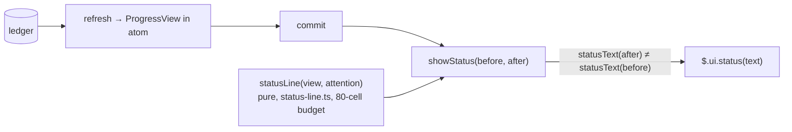

# Design — run progress: a segmented status-line bar replaces the pane

> Brief: remove the run-progress pane and the `/craft-progress` command. The status line becomes
> the only surface and shows done / working / remaining as a segmented bar:
> `craft ■■■■■▶□□□□□ 5/11 · ▸ review c2 · next refactoring · waiting on you`. When the line is
> too narrow, `next` goes first, then the bar. `<done>/<total> · ▸ <phase> · <attention>` always
> stays. A run with no pipeline list gets no bar and no `next`. This reverses decision 1 (a) of
> `run-visibility-task-list` (ADR-710), so a new ADR supersedes that choice.
> Status: draft → self-reviewed ×3 → revised against ADR-718, ADR-719, ADR-720. ADR-719 replaces
> "too narrow" with a fixed 80-cell budget: no terminal width is read.

---

## Context

### What exists

- **The mod.** `hooks/hooks.json` `"modules": ["./progress/register.tsx"]`. `.claude-plugin/plugin.json`
  `"types": "./hooks/progress/state.d.ts"`. Only `hooks.json` registers the module. The command
  is registered at runtime (`$.command.register`), not in `plugin.json`.
- **`hooks/progress/register.tsx`** (221 lines):
  - `:16` imports `PANE`, `PANE_TITLE`, `progressPane` from `./pane`;
  - `:19` `SHAPE = 'progress-2'`;
  - `:22-25` `COMMAND_NAME = 'craft-progress'` + `COMMAND`;
  - `:27-36` `EMPTY` (holds `isPaneOpened: false`);
  - `:43` `type Surface = { isDocked: boolean }`;
  - `:46-49` `showStatus($, before, after)` pushes `$.ui.status(text)` only when
    `statusText(after) !== statusText(before)`;
  - `:53-62` `commit($, patch)`;
  - `:73-78` `openPaneOnce($, surface)`, called from `:80-84` `bindAndRefresh($, surface)`.
    `surface` is threaded through `onTurnStart`, `onSessionCompact`, `onTurnComplete`,
    `onAsk`, `onMainLoop` and `onBash`;
  - `register`: `:151-154` the comment "Docking is only visible to a render … the AbovePrompt
    draw records it here" and the closure `surface: Surface = { isDocked: false }`.
    `classic.SessionStart` calls `$.command.register(COMMAND)` before `onMainLoop`. The
    `command.run` handler opens the pane. The `ui.render` `AbovePrompt` handler (`:211-214`)
    does one thing: `surface.isDocked = e.viewport?.isFullscreen === true`, then `next(e)`. The
    `ui.render` `Pane` handler draws `progressPane`.
  - `isDocked` is read in one place only: `openPaneOnce` (`:75`). `grep -rn "isDocked\|AbovePrompt"
    hooks/` finds `register.tsx:43,75,153,154,211,212` and the `BAND` fixture in
    `pane.test.tsx:102-134`, nothing else.
- **`hooks/progress/bind.ts`** (252 lines):
  - `:31-37` `UNBOUND` (holds `isPaneOpened: false`);
  - `:113` `currentPhase(view)` = `inFlight[0] ?? next ?? 'done'`;
  - `:117` `completedCount(view)`;
  - `:121-128` `statusLine(runId, view, attention)` → `craft <runId> · <phase> · <done>/<total>[ · <attention>]`;
  - `:130-134` `statusText(state)` → `undefined` while unbound or with no view;
  - `:240` `waitingOnYou(view)` and `:244` `attentionAfterTurn($, view)` build the attention
    string with `currentPhase`.
- **`hooks/progress/state.d.ts`**: `ProgressView { run, source: 'effective'|'ledger-only', items[{id,
  status, note, children[{label,status,note}]}], inFlight[], next, background[{phase,pid}],
  warnings[] }`. `ProgressState` holds `isPaneOpened: boolean` (`:37`). It is used only by the
  pane.
- **`hooks/progress/pane.tsx`** (56 lines) + **`pane.test.tsx`** (140 lines). They are the pane,
  the command, and the docked/undocked auto-open tests.
- **The projection.** `engine/src/run-progress.js` `cycleChildren` (`:116-128`) gives review one
  child per cycle, `{ label: 'cycle <n>', status, note: 'n=<k>' }`. The newest cycle is
  `in_progress` while review is `in_progress`. `itemOf` (`:136`) gives the item status from
  `run-state`. `view.next` is `run-state`'s first effective id that is neither completed nor in
  flight (`engine/src/run-state.js:159`).
- **Tests.** `progress.test.tsx`, `attention.test.tsx`, `lifecycle.test.tsx` assert whole status
  strings in today's format, for example `'craft demo · planning · 1/3 · working'`
  (attention `:68…:193`, lifecycle `:57,:81,:108`, progress `:97,:119,:140,:179,:273`). No
  test outside `pane.test.tsx` names `isPaneOpened`, the pane or the command.
  `test/run-progress-docs.test.js` pins the guide heading `### Run progress — pane and status
  line (Claude Code)` and the token `/craft-progress`. It also pins the smoke tokens.
- **Docs.** `docs/guides/customizing.md:469-490` describes the pane, the command and the line.
  The live check in `docs/contributing/maintainer-smokes.md:477-504` names the pane and its
  auto-open record.
- **CI.** `.github/workflows/ci.yml:34` installs `@anthropic-ai/claude-code@2.1.311` and runs
  `claude plugin validate . && claude plugin test .`.

### Pinned evidence (probed 2026-10-30; Claude Code 2.1.314 local and 2.1.311 via `npx`, the CI pin; every probe ran in a `mktemp` throwaway plugin)

| # | Probe | Result | Consequence |
|---|---|---|---|
| P1 | Throwaway `pure.ts` exporting a plain function, imported by `pure.test.tsx` under `claude plugin test` | pass (2 pass, 0 fail) | the pure renderer is unit-tested directly in the mod harness, with no `$` stubs |
| P2 | Types (`.claude-plugin/types/claude-code/index.d.ts`, written by 2.1.311) `CommandPresentation.columns` | "80 where no terminal has measured (headless with no tty)" | 80 is the engine's own unknown-width default, and the fixed budget of ADR-719 |
| P3 | Types `ui.status` | "its first 2000 characters drawn"; one line per plugin, "beside the engine's own pinned notices" | the engine sets no width cap, so fitting is the mod's job |
| P4 | Types `AtomOptions.shape` | "Bump it when the code's idea of the value changed; … the tag is how the new code declines it" | dropping `isPaneOpened` bumps `SHAPE` |
| P5 | `python3 unicodedata.east_asian_width` | `■` U+25A0 A, `▶` U+25B6 A, `□` U+25A1 A, `▸` U+25B8 N, `∥` U+2225 A, `·` A, `—` A | no glyph is East-Asian Wide. Each counts as one cell, except on a terminal set to draw ambiguous glyphs wide |

The draft also pinned `viewport.columns` on the `AbovePrompt` render hook and a status push
from inside a render. ADR-719 reads no width, so those probes have no consumer and are dropped.

Not pinned. Each is checked in the live smoke (Test strategy):

- **U1** How the terminal draws a status line wider than the screen (clip or wrap). ADR-719
  accepts either below 80 columns. Proof: the live check at 60 columns with a full 80-cell line.
- **U2** How many cells the engine's own pinned notices take from the status row. Proof: the
  same live check with a notice up.

### Constraints already decided

- The brief's decisions are final, and ratified:
  - remove the pane, the command and `isPaneOpened` outright; the status line is the only
    surface (ADR-718, superseding ADR-710's pane);
  - the segmented bar format above, with its order of degradation;
  - the degradation is evaluated against a fixed 80-cell budget; no terminal width is read or
    stored (ADR-719);
  - no bar and no `next` without a pipeline list: that run keeps today's line verbatim (ADR-720).
- Kept as is: fail-open (`failOpen`), read-only ledger access, the binding and locate path, and
  the `session.compact` / `session.end` behaviour. The attention strings are unchanged
  (`working` / `waiting on you — <phase>` / `waiting on background — <phase>` / `closed`), and
  so is their `currentPhase` (`inFlight[0]`).
- Mod harness rules (repo practice): a helper that takes `$` is a `function` declaration. A
  render may not write state. One `on('<service>')` per test. A failure is simulated with
  `{ deny }`.

## Requirements

- **R1** With `source: 'effective'`, the line is
  `craft <bar> <done>/<total> · ▸ <phase> · next <next> · <attention>`.
- **R2** `<bar>` has one glyph per pipeline item, in pipeline order: `■` completed, `▶`
  in_progress, `□` pending. `<done>` counts `■` and `<total>` counts items.
- **R3** `<phase>` is `view.inFlight` joined with ` ∥ `. When review is in flight and has an
  `in_progress` cycle child `cycle <n>`, its token reads `review c<n>`. With nothing in flight
  it is `view.next`, or `done` when there is none (today's `currentPhase` fallback).
- **R4** `<next>` is the first pending item that the `▸` segment does not already name. With
  none, the `next` segment is left out.
- **R5** An empty `<attention>` drops its segment, as today. A non-empty one is printed unchanged.
- **R6** Fitting: the line is the first of these whose cell count is ≤ 80:
  1. full;
  2. without `next`;
  3. without `next` and without the bar (`craft <done>/<total> · ▸ <phase>[ · <attention>]`).

  If even the third is over 80, the third is printed anyway.
- **R7** The budget is the constant 80 (ADR-719, P2). No terminal width is read, stored, or
  reacted to: a resize changes nothing the mod pushes.
- **R8** With `source: 'ledger-only'`, the line is today's, verbatim and unfitted:
  `craft <run-id> · <phase> · <done>/<total>[ · <attention>]` (ADR-720).
- **R9** No pane, no `/craft-progress` command, no `ui.open`, no `isPaneOpened`, and no
  `ui.render` handler of any component (`Pane` or `AbovePrompt`) remain. `SHAPE` is bumped (P4).
- **R10** `$.ui.status` is called only when the pushed text changes. Unbound, nothing is pushed.
  `session.end` clears the line (`undefined`), as today.
- **R11** Everything else is unchanged: fail-open, binding, locate retries, gate, attention
  transitions, `closed` → unbind at `turn.start`.

## Design

### Shape



The push path is today's: only a state commit pushes. Nothing renders, and no host input
other than the ledger feeds the line.

### The pure renderer: `hooks/progress/status-line.ts` (new)

`bind.ts` already mixes host I/O and rendering. The new rules (bar, phase token, next, fitting)
make up one pure unit with no `$`, so they go in their own module. P1 shows such a module tests
directly. `bind.ts` keeps `currentPhase` for the attention strings, which stay unchanged.

```ts
// hooks/progress/status-line.ts — shape, not final code
const STATUS_LINE_CELLS = 80
const PREFIX = 'craft'
const SEPARATOR = ' · '
const PARALLEL = ' ∥ '
const PHASE_MARK = '▸ '
const NEXT_LABEL = 'next '
const DONE_LABEL = 'done'
const REVIEW = 'review'
const CYCLE_LABEL = /^cycle (\d+)$/
const BAR_GLYPHS: Record<ProgressItem['status'], string> = {
  completed: '■',
  in_progress: '▶',
  pending: '□',
}

export function statusLine(view: ProgressView, attention: string): string
//   forms(view, attention) → [full, withoutNext, minimal]
//   return forms.find(form => cells(form) <= STATUS_LINE_CELLS) ?? minimal
```

The budget is a module constant, not a parameter: no caller has another value to pass
(ADR-719). Tests reach each step of the degradation through the content, padding the free-text
`attention` to land a form on 80 or 81 cells.

Helpers, each under 20 lines:

- `bar(items)` → `items.map(i => BAR_GLYPHS[i.status]).join('')`.
- `phaseToken(view, id)` → `review c<n>` when `id === 'review'` and the review item has an
  `in_progress` child that matches `CYCLE_LABEL`. Otherwise `id`. The cycle number comes from
  the projection's label because the perimeter holds no engine change. `cycleChildren` is the
  only producer of that label.
- `phaseSegment(view)` → `▸ ` + `inFlight.map(phaseToken).join(' ∥ ')`. With nothing in flight
  it is `▸ ` + `(view.next ?? 'done')`.
- `nextSegment(view)` → the first `pending` item whose id is not named by `phaseSegment` (so
  between phases `▸ planning` is not followed by `next planning`). It gives `null` when there is
  none.
- `cells(text)` → `[...text].length`. Code points, not UTF-16 units: every glyph is one BMP code
  point, and P5 shows none is Wide.
- `join(segments)` drops `null` and empty segments and joins them with ` · `. The head segment
  is `craft <bar> <done>/<total>`, or `craft <done>/<total>` without the bar.

Worked examples against the 80-cell budget (cell counts measured with `python3 len()` on the
literal; every glyph is one code point):

| View / attention | Line (cells) |
|---|---|
| 11 items, 5 done, review c2, next refactoring, `waiting on you` | `craft ■■■■■▶□□□□□ 5/11 · ▸ review c2 · next refactoring · waiting on you` (72: full) |
| same, `waiting on background — review` | full is 88, so: `craft ■■■■■▶□□□□□ 5/11 · ▸ review c2 · waiting on background — review` (69: without `next`) |
| 12 items, 8 done, `validation ∥ documentation`, next lessons, `working` | `craft ■■■■■■■■▶▶□□ 8/12 · ▸ validation ∥ documentation · next lessons · working` (79: full) |
| same, `waiting on background — validation` | full 106, without `next` 91, so: `craft 8/12 · ▸ validation ∥ documentation · waiting on background — validation` (78: minimal) |
| 3 items, validation in flight, next propose, `waiting on background — validation` | `craft ■▶□ 1/3 · ▸ validation · next propose · waiting on background — validation` (80: full, the `<=` edge) |
| minimal form over 80 (long attention) | the minimal form, printed anyway (R6) |
| all completed, attention `''` | `craft ■■■ 3/3 · ▸ done` (22) |
| between phases (planning done, nothing in flight, next implementation) | `craft ■■□ 2/3 · ▸ implementation` (32) |
| review in flight, no `FINDINGS` yet | `… · ▸ review · …` (no `c<n>`) |

The attention for parallel phases still names `inFlight[0]` only (`currentPhase`, unchanged by
decision). The `▸` segment names both.

### `statusText`

`statusText(state)` keeps its signature and stays in `bind.ts`. It returns `undefined` while
unbound or with no view, as today. With `view.source === 'effective'` it calls
`statusLine(view, attention)`. With `'ledger-only'` it returns today's line, built by today's
`bind.ts` `statusLine(runId, view, attention)`, which is kept and renamed `legacyStatusLine`
so the two do not share a name (ADR-720). The new `statusLine` has no `runId` parameter,
because the decided format has no run-id.

### Binding changes: `hooks/progress/register.tsx`

Removed:

- the `./pane` import;
- `COMMAND_NAME` and `COMMAND`;
- `$.command.register` in `classic.SessionStart`, which keeps `onMainLoop`;
- `openPaneOnce`;
- the `command.run` handler;
- the `ui.render` `Pane` handler;
- the `ui.render` `AbovePrompt` handler (`:211-214`). Its only effect today is to set
  `surface.isDocked`, whose only reader is `openPaneOnce` (`:75`, see Context). With
  `openPaneOnce` gone the write has no reader, and ADR-719 gives the hook no width to record,
  so the hook goes too;
- the `Surface` type (`:43`), the `surface` closure and its comment (`:151-154`). The comment
  explains why docking lives in a closure and not the atom; with no docking it describes nothing;
- `isPaneOpened` from `EMPTY`, from `bind.ts` `UNBOUND` and from `state.d.ts` `ProgressState`;
- the `surface` parameter on `bindAndRefresh` / `onTurnStart` / `onSessionCompact` /
  `onTurnComplete` / `onAsk` / `onMainLoop` / `onBash`. Only `openPaneOnce` read it.

`register` then holds no closure state: every value it needs lives in the atom.

Changed:

- `SHAPE = 'progress-3'` (P4). After a reload the old `progress-2` value reads as absent. The
  next trigger re-binds through `locate`, as on a fresh session.

Unchanged: `showStatus($, before, after)` and `commit($, patch)`. The line depends only on the
state, so comparing `statusText(before)` with `statusText(after)` is still the whole "changed"
test (R10).

`hooks/hooks.json` and `.claude-plugin/plugin.json` are unchanged. Neither registers the
command, and `types` keeps naming `state.d.ts`.

### Edge behaviour

| Case | Behaviour |
|---|---|
| Unbound / no view | `statusText` → `undefined` before and after, so nothing is pushed (R10) |
| `closed` | attention `closed`. The line keeps its last view with `· closed`. `turn.start` unbinds, which pushes `undefined` |
| `session.end` | commit `UNBOUND` → push `undefined`, as today |
| Resize, headless, any terminal width | no effect: the budget is 80 whatever the screen (ADR-719) |
| Terminal narrower than 80 | an 80-cell line may clip or wrap; ADR-719 accepts it. Which one is U1 |
| Terminal wider than 80 | the line is never longer than its 80-cell form; `next` may be dropped with room to spare (ADR-719) |
| Reload of the mod | as today. On the first load of this version, the `SHAPE` bump makes the `progress-2` value read absent → rebind on the next trigger, which pushes |
| Minimal form over 80 | printed anyway (R6) |
| Pipeline longer than the room | the bar is dropped as a whole, never cut (R6) |
| Ledger-only run | today's line, not fitted (R8, ADR-720) |
| Ambiguous-wide terminal | each bar glyph takes 2 cells, so a line that "fits" can overflow by up to `items` cells. That case is outside the budget (P5) |

### Docs impact (written by the documentation phase)

| File | Change |
|---|---|
| `docs/guides/customizing.md:469-490` | heading → `### Run progress — status line (Claude Code)`. Describe the bar, the `▸` / `next` segments, the degradation past 80 cells, the attention values, the ledger-only form (today's line), "ask Claude for detail", and mods must be on. Drop `/craft-progress` and the pane |
| `test/run-progress-docs.test.js` | `GUIDE_START` → the new heading. In `GUIDE_TOKENS`, `/craft-progress` → `■` and `next`. `pipeline list unavailable` is the pane footer's text (`pane.tsx:12`, `customizing.md:490`), not the line's, so it is replaced by `craft <run-id>`, the guide's spelling of the ledger-only line (ADR-720) |
| `docs/contributing/maintainer-smokes.md:477-504` | live check: drop the pane and the auto-open record. Add the 80-cell checks (U1, U2). Keep the mods-off step. `SMOKE_TOKENS` are unchanged |
| `README.md` | no count change in this revision: the design count was bumped with the design, the ADR count with ADR-718–720 |
| `docs/contributing/adr/710-…` | superseded in part by ADR-718 (decisions phase, done) |

## Decision candidates

All choices are settled. The brief fixes the format, the order of degradation and the glyphs;
the user ratified the rest:

| Choice | Settled as | ADR |
|---|---|---|
| Surface | status line only; the pane, its unasked opening and `/craft-progress` are removed; `isPaneOpened` goes, so `SHAPE` is bumped (P4) | ADR-718 |
| Width budget | a fixed 80-cell budget; no terminal width read or stored, no viewport tracking, no push from a render hook. The draft's "missing viewport" candidate has no subject and is void | ADR-719 (the user chose against the draft's live-width recommendation) |
| Ledger-only line (no `EFFECTIVE:`) | today's line verbatim: `craft <run-id> · <phase> · <done>/<total>[ · <attention>]` | ADR-720 |

The revision exposes no new open candidate. Dropping the `AbovePrompt` hook is not a choice: its
only effect has no reader once the pane is gone (Design, Binding changes).

## Test strategy

All mod tests run under `claude plugin test .` (CI-gated, pinned 2.1.311, no credentials).
Titles are Given/When/Then, bodies are AAA, and the unit under test is `sut`. A helper taking
`$` is a `function` declaration, with one `on('<service>')` per test. RED first for each rule.

- **`hooks/progress/status-line.test.tsx` (new, pure, P1).** It imports `statusLine` and builds
  `ProgressView` literals. No `$` stubs.
  1. Effective view, 11 items, 5 done, review `in_progress` with cycle 2 `in_progress`, next
     `refactoring`, `waiting on you` → the 72-cell full worked example (R1–R4).
  2. Bar glyphs: completed, in_progress and pending map to `■▶□` in item order, and two
     in_progress items give `▶▶` (R2).
  3. Parallel in-flight `validation`, `documentation` → `▸ validation ∥ documentation` (R3).
  4. Review in flight with no children → `▸ review`. Review completed with cycles → no `c<n>`
     anywhere (R3).
  5. Nothing in flight, next `implementation` → `▸ implementation` and no `next` segment. All
     completed → `▸ done`, no `next` (R3/R4).
  6. Empty attention → no trailing separator (R5).
  7. Degradation at the 80-cell edges, reached by padding `attention`: full at exactly 80 →
     full. Full at 81 with without-`next` ≤ 80 → without `next`. Without-`next` at 81 with
     minimal ≤ 80 → minimal. Minimal at 81 → minimal, printed anyway (R6, R7).
  8. Width counting: with a 12-glyph bar, a full line of exactly 80 code points (each glyph
     3 UTF-8 bytes) is kept whole, so the count is code points, not bytes (R6).
- **Ledger-only line, new case in `progress.test.tsx`.** No binding test seeds a ledger without
  `EFFECTIVE:` today (the only ledger-only case is in `pane.test.tsx:91`, deleted). Given a bound
  ledger with no `EFFECTIVE:` line, then the pushed line is today's string verbatim, run-id
  included, with no `■□▶` and no `next`; given a run-id long enough to pass 80 cells, then it
  is still pushed whole (R8, ADR-720).
- **Binding tests (existing files, `$`-driven).**
  - `progress.test.tsx`, `attention.test.tsx`, `lifecycle.test.tsx`: every expected status string
    moves to the new format. For example, the attention planning ledger gives
    `craft ■▶□ 1/3 · ▸ planning · next implementation · working` (58). The validation ledger
    with a live background pid gives
    `craft ■▶□ 1/3 · ▸ validation · next propose · waiting on background — validation`, exactly
    80 cells, so it also pins the `<=` edge through the binding. The nine-item progress ledger
    gives `craft ■■■▶□□□□□ 3/9 · ▸ planning · next implementation` (54).
  - Removal: given a session start, when it runs, then `command.register` is never called
    (counting stub). Given a bound session, when an `AbovePrompt` band is mounted fullscreen
    (the `BAND` fixture, moved from `pane.test.tsx` before that file is deleted), then
    `ui.open` and `ui.status` are never called by the mount (R9).
- **Deleted:** `hooks/progress/pane.test.tsx` with `pane.tsx`. No width test file: no width is
  read (ADR-719).
- **Docs pins (node:test, CI):** `test/run-progress-docs.test.js` follows the new heading and
  tokens (Docs impact).
- **Mutation:** `.tsx`/`.ts` mod files are outside Stryker (`engine/stryker.conf.json` mutates
  `engine/src/**`). Validation hand-mutates `status-line.ts` on a temp copy: flip `<=` to `<` in
  the fit, swap the drop order, drop the `next`-dedup, glyph swaps, the ` ∥ ` join, the
  `CYCLE_LABEL` match, `STATUS_LINE_CELLS` 80 → 79 and → 81. Each must turn a test red.
- **Live smoke (user-run, mods on; updates the PR #101 record).** In a throwaway git repo run
  `claude --plugin-dir <worktree>`. `run-ledger.sh open demo`, then append a seeded block with
  `EFFECTIVE:` and some `PHASE-START` / `PHASE-DONE` / `FINDINGS(…): c2` lines. Confirm the bar
  follows the ledger and survives `/compact`. Confirm that no pane opens and `/craft-progress` is
  unknown. Seed attention lengths that land the line on each step of the degradation (full,
  without `next`, minimal) and confirm each at a 120-column terminal. Resize the terminal and
  confirm the line does not change. At 60 columns, with an 80-cell line, record clip vs wrap
  (U1), and the room a pinned notice takes (U2). The mods-off step is unchanged.
- **Gate:** `bash scripts/ci.sh` plus `claude plugin validate . && claude plugin test .`.
- **Eval:** not warranted. No skill, prompt or model-judgment change.

## Out of scope

- Any pane, band (`AbovePrompt` content), toast or on-demand command. These were removed by
  decision (ADR-718). For detail, the user asks Claude in chat.
- Reading or tracking the terminal width, and any `ui.render` hook (ADR-719). A terminal
  narrower than 80 may clip or wrap the line.
- Engine changes (`engine/src/run-progress.js`), for example a numeric cycle field. The label is
  parsed in the mod, and the perimeter holds only the mod.
- Parts `k/n` under implementation, warnings counts, and notes on the line. The line carries only
  the decided segments.
- Changing the attention strings or making them name every parallel phase. They are unchanged by
  decision.
- Hosts other than Claude Code.
- Measuring ambiguous-wide terminals: the mod API exposes no such setting (P5).
