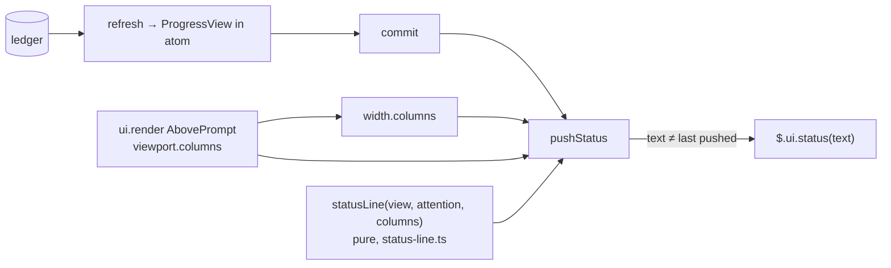

# Design — run progress: a segmented status-line bar replaces the pane

> Brief: remove the run-progress pane and the `/craft-progress` command. The status line becomes
> the only surface and shows done / working / remaining as a segmented bar:
> `craft ■■■■■▶□□□□□ 5/11 · ▸ review c2 · next refactoring · waiting on you`. When the line is
> too narrow, `next` goes first, then the bar. `<done>/<total> · ▸ <phase> · <attention>` always
> stays. A run with no pipeline list gets no bar and no `next`. This reverses decision 1 (a) of
> `run-visibility-task-list` (ADR-710), so a new ADR supersedes that choice.
> Status: draft → self-reviewed ×3

---

## Context

### What exists

- **The mod.** `hooks/hooks.json` `"modules": ["./progress/register.tsx"]`. `.claude-plugin/plugin.json`
  `"types": "./hooks/progress/state.d.ts"`. Only `hooks.json` registers the module. The command
  is registered at runtime (`$.command.register`), not in `plugin.json`.
- **`hooks/progress/register.tsx`** (221 lines):
  - `:16` imports `PANE`, `PANE_TITLE`, `progressPane` from `./pane`;
  - `:19` `SHAPE = 'progress-2'`;
  - `:22-25` `COMMAND_NAME = 'craft-progress'` + `COMMAND`;
  - `:27-36` `EMPTY` (holds `isPaneOpened: false`);
  - `:43` `type Surface = { isDocked: boolean }`;
  - `:46-49` `showStatus($, before, after)` pushes `$.ui.status(text)` only when
    `statusText(after) !== statusText(before)`;
  - `:53-62` `commit($, patch)`;
  - `:73-78` `openPaneOnce($, surface)`, called from `:80-84` `bindAndRefresh($, surface)`.
    `surface` is threaded through `onTurnStart`, `onSessionCompact`, `onTurnComplete`,
    `onAsk`, `onMainLoop` and `onBash`;
  - `register`: `classic.SessionStart` calls `$.command.register(COMMAND)` before `onMainLoop`.
    The `command.run` handler opens the pane. The `ui.render` `AbovePrompt` handler records
    `surface.isDocked = e.viewport?.isFullscreen === true`. The `ui.render` `Pane` handler draws
    `progressPane`.
- **`hooks/progress/bind.ts`** (252 lines):
  - `:31-37` `UNBOUND` (holds `isPaneOpened: false`);
  - `:113` `currentPhase(view)` = `inFlight[0] ?? next ?? 'done'`;
  - `:117` `completedCount(view)`;
  - `:121-128` `statusLine(runId, view, attention)` → `craft <runId> · <phase> · <done>/<total>[ · <attention>]`;
  - `:130-134` `statusText(state)` → `undefined` while unbound or with no view;
  - `:240` `waitingOnYou(view)` and `:244` `attentionAfterTurn($, view)` build the attention
    string with `currentPhase`.
- **`hooks/progress/state.d.ts`**: `ProgressView { run, source: 'effective'|'ledger-only', items[{id,
  status, note, children[{label,status,note}]}], inFlight[], next, background[{phase,pid}],
  warnings[] }`. `ProgressState` holds `isPaneOpened: boolean` (`:37`). It is used only by the
  pane.
- **`hooks/progress/pane.tsx`** (56 lines) + **`pane.test.tsx`** (140 lines). They are the pane,
  the command, and the docked/undocked auto-open tests.
- **The projection.** `engine/src/run-progress.js` `cycleChildren` (`:116-128`) gives review one
  child per cycle, `{ label: 'cycle <n>', status, note: 'n=<k>' }`. The newest cycle is
  `in_progress` while review is `in_progress`. `itemOf` (`:136`) gives the item status from
  `run-state`. `view.next` is `run-state`'s first effective id that is neither completed nor in
  flight (`engine/src/run-state.js:159`).
- **Tests.** `progress.test.tsx`, `attention.test.tsx`, `lifecycle.test.tsx` assert whole status
  strings in today's format, for example `'craft demo · planning · 1/3 · working'`
  (attention `:68…:193`, lifecycle `:57,:81,:108`, progress `:97,:119,:140,:179,:273`). No
  test outside `pane.test.tsx` names `isPaneOpened`, the pane or the command.
  `test/run-progress-docs.test.js` pins the guide heading `### Run progress — pane and status
  line (Claude Code)` and the token `/craft-progress`. It also pins the smoke tokens.
- **Docs.** `docs/guides/customizing.md:469-490` describes the pane, the command and the line.
  The live check in `docs/contributing/maintainer-smokes.md:477-504` names the pane and its
  auto-open record.
- **CI.** `.github/workflows/ci.yml:34` installs `@anthropic-ai/claude-code@2.1.311` and runs
  `claude plugin validate . && claude plugin test .`.

### Pinned evidence (probed 2026-10-30; Claude Code 2.1.314 local and 2.1.311 via `npx`, the CI pin; every probe ran in a `mktemp` throwaway plugin)

| # | Probe | Result | Consequence |
|---|---|---|---|
| P1 | Throwaway plugin whose `ui.render` `{ component: 'AbovePrompt' }` hook calls `$.ui.status(\`cols=${e.viewport?.columns}\`)`. Test mounts the band at `viewport.columns` 73, then 41, then with no viewport | `SEEN ["cols=73","cols=41","cols=undefined"]`, pass on 2.1.311 and 2.1.314 | the render hook gets the terminal width. A redraw at a new width gets the new width. The viewport can be absent |
| P2 | Same probe | `$.ui.status` from inside `ui.render` is not refused. Only `$.state.set` is refused during a render (types: "Refused while a `ui.render` hook draws") | a width change can re-push the line from the band's redraw, with no state write |
| P3 | Throwaway `pure.ts` exporting a plain function, imported by `pure.test.tsx` under `claude plugin test` | pass (2 pass, 0 fail) | the pure renderer is unit-tested directly in the mod harness, with no `$` stubs |
| P4 | Types (`.claude-plugin/types/claude-code/index.d.ts`, written by 2.1.311) `RenderViewport` | `columns`: "Cells across"; on the terminal, "a change of width re-draws every hooked site once the resize settles"; `viewport` is "absent where no surface has measured" | width is a cell count. It is fresh after a resize settles. It needs a fallback |
| P5 | Types `CommandPresentation.columns` | "80 where no terminal has measured (headless with no tty)" | 80 is the engine's own unknown-width default |
| P6 | Types `ui.status` | "its first 2000 characters drawn"; one line per plugin, "beside the engine's own pinned notices" | the engine sets no width cap, so fitting is the mod's job |
| P7 | Types `AtomOptions.shape` | "Bump it when the code's idea of the value changed; … the tag is how the new code declines it" | dropping `isPaneOpened` bumps `SHAPE` |
| P8 | `python3 unicodedata.east_asian_width` | `■` U+25A0 A, `▶` U+25B6 A, `□` U+25A1 A, `▸` U+25B8 N, `∥` U+2225 A, `·` A, `—` A | no glyph is East-Asian Wide. Each counts as one cell, except on a terminal set to draw ambiguous glyphs wide |

Not pinned. Each is checked in the live smoke (Test strategy):

- **U1** How the terminal draws a status line wider than the screen (clip or wrap). Proof: the
  live check at 60 columns with a forced full line.
- **U2** Whether `AbovePrompt` draws on the main screen (`isFullscreen: false`), not only in
  fullscreen. The 2026-10-27 smoke implies it does ("stayed closed on the main screen") but
  recorded no width. Proof: the live check on the main screen, narrowing the terminal.
- **U3** How many cells the engine's own pinned notices take from the status row. Proof: the
  same live check with a notice up.

### Constraints already decided

- The brief's decisions are final:
  - remove the pane, the command and `isPaneOpened` outright;
  - the status line is the only surface;
  - the segmented bar format above, with its order of degradation;
  - no bar and no `next` without a pipeline list;
  - a new ADR supersedes decision 1 of `run-visibility-task-list`. The decisions phase writes it.
- Kept as is: fail-open (`failOpen`), read-only ledger access, the binding and locate path, and
  the `session.compact` / `session.end` behaviour. The attention strings are unchanged
  (`working` / `waiting on you — <phase>` / `waiting on background — <phase>` / `closed`), and
  so is their `currentPhase` (`inFlight[0]`).
- Mod harness rules (repo practice): a helper that takes `$` is a `function` declaration. A
  render may not write state. One `on('<service>')` per test. A failure is simulated with
  `{ deny }`.

## Requirements

- **R1** With `source: 'effective'`, the line is
  `craft <bar> <done>/<total> · ▸ <phase> · next <next> · <attention>`.
- **R2** `<bar>` has one glyph per pipeline item, in pipeline order: `■` completed, `▶`
  in_progress, `□` pending. `<done>` counts `■` and `<total>` counts items.
- **R3** `<phase>` is `view.inFlight` joined with ` ∥ `. When review is in flight and has an
  `in_progress` cycle child `cycle <n>`, its token reads `review c<n>`. With nothing in flight
  it is `view.next`, or `done` when there is none (today's `currentPhase` fallback).
- **R4** `<next>` is the first pending item that the `▸` segment does not already name. With
  none, the `next` segment is left out.
- **R5** An empty `<attention>` drops its segment, as today. A non-empty one is printed unchanged.
- **R6** Fitting: the line is the first of these that fits the width budget:
  1. full;
  2. without `next`;
  3. without `next` and without the bar (`craft <done>/<total> · ▸ <phase>[ · <attention>]`).

  If even the third does not fit, the third is printed anyway.
- **R7** The width budget is the latest terminal width the mod has seen (P1), or 80 while none
  is known (P5). When a width change takes effect follows decision candidate 1.
- **R8** With `source: 'ledger-only'`, the line has no bar and no `next` (form per decision
  candidate 2).
- **R9** No pane, no `/craft-progress` command, no `ui.open`, no `isPaneOpened` and no `Pane`
  render handler remain. `SHAPE` is bumped (P7).
- **R10** `$.ui.status` is called only when the pushed text changes. Unbound, nothing is pushed. `session.end` clears the line (`undefined`), as today.
- **R11** Everything else is unchanged: fail-open, binding, locate retries, gate, attention
  transitions, `closed` → unbind at `turn.start`.

## Design

### Shape



### The pure renderer: `hooks/progress/status-line.ts` (new)

`bind.ts` already mixes host I/O and rendering. The new rules (bar, phase token, next, fitting)
make up one pure unit with no `$`, so they go in their own module. P3 shows such a module tests
directly. `bind.ts` keeps `currentPhase` for the attention strings, which stay unchanged.

```ts
// hooks/progress/status-line.ts — shape, not final code
export const FALLBACK_COLUMNS = 80
const PREFIX = 'craft'
const SEPARATOR = ' · '
const PARALLEL = ' ∥ '
const PHASE_MARK = '▸ '
const NEXT_LABEL = 'next '
const DONE_LABEL = 'done'
const REVIEW = 'review'
const CYCLE_LABEL = /^cycle (\d+)$/
const BAR_GLYPHS: Record<ProgressItem['status'], string> = {
  completed: '■',
  in_progress: '▶',
  pending: '□',
}

export function statusLine(view: ProgressView, attention: string, columns: number): string
//   forms(view, attention) → [full, withoutNext, minimal]
//   return forms.find(form => cells(form) <= columns) ?? minimal
```

Helpers, each under 20 lines:

- `bar(items)` → `items.map(i => BAR_GLYPHS[i.status]).join('')`.
- `phaseToken(view, id)` → `review c<n>` when `id === 'review'` and the review item has an
  `in_progress` child that matches `CYCLE_LABEL`. Otherwise `id`. The cycle number comes from
  the projection's label because the perimeter holds no engine change. `cycleChildren` is the
  only producer of that label.
- `phaseSegment(view)` → `▸ ` + `inFlight.map(phaseToken).join(' ∥ ')`. With nothing in flight
  it is `▸ ` + `(view.next ?? 'done')`.
- `nextSegment(view)` → the first `pending` item whose id is not named by `phaseSegment` (so
  between phases `▸ planning` is not followed by `next planning`). It gives `null` when there is
  none.
- `cells(text)` → `[...text].length`. Code points, not UTF-16 units: every glyph is one BMP code
  point, and P8 shows none is Wide.
- `join(segments)` drops `null` and empty segments and joins them with ` · `. The head segment
  is `craft <bar> <done>/<total>`, or `craft <done>/<total>` without the bar.

Worked examples (cells):

| View / attention / columns | Line |
|---|---|
| 11 items, 5 done, review c2, next refactoring, `waiting on you`, 120 | `craft ■■■■■▶□□□□□ 5/11 · ▸ review c2 · next refactoring · waiting on you` (72) |
| same, 60 | `craft ■■■■■▶□□□□□ 5/11 · ▸ review c2 · waiting on you` (53) |
| same, 50 | `craft 5/11 · ▸ review c2 · waiting on you` (41) |
| same, 30 | `craft 5/11 · ▸ review c2 · waiting on you` (41: the floor, R6) |
| 12 items, `validation ∥ documentation`, background alive, 120 | `craft ■■■■■■■■▶▶□□ 8/12 · ▸ validation ∥ documentation · next lessons · waiting on background — validation` |
| all completed, attention `''` | `craft ■■■ 3/3 · ▸ done` |
| between phases (planning done, nothing in flight, next implementation) | `craft ■■□ 2/3 · ▸ implementation` |
| review in flight, no `FINDINGS` yet | `… · ▸ review · …` (no `c<n>`) |

The attention for parallel phases still names `inFlight[0]` only (`currentPhase`, unchanged by
decision). The `▸` segment names both.

### `statusText` and the width

`statusText(state, columns)` stays in `bind.ts`. It returns `undefined` while unbound or with no
view, as today. Otherwise it calls `statusLine(view, attention, columns)`, or the ledger-only
form (decision candidate 2). `statusLine` drops its `runId` parameter, because the decided
format has no run-id. `binding.runId` is still kept for the ledger lookup.

### Binding changes: `hooks/progress/register.tsx`

Removed:

- the `./pane` import;
- `COMMAND_NAME` and `COMMAND`;
- `$.command.register` in `classic.SessionStart`, which keeps `onMainLoop`;
- `openPaneOnce`;
- the `command.run` handler;
- the `ui.render` `Pane` handler;
- `isPaneOpened` from `EMPTY`, from `bind.ts` `UNBOUND` and from `state.d.ts` `ProgressState`;
- the `surface` parameter on `bindAndRefresh` / `onTurnStart` / `onSessionCompact` /
  `onTurnComplete` / `onAsk` / `onMainLoop` / `onBash`. Only `openPaneOnce` read it.

Changed:

- `SHAPE = 'progress-3'` (P7). After a reload the old `progress-2` value reads as absent. The
  next trigger re-binds through `locate`, as on a fresh session.
- `Surface` becomes `Screen = { columns: number | undefined; pushed: string | undefined }`. It is
  one closure object per `register` call, the same way `surface` is today. A render may not
  write state, so the latest width and the last pushed text cannot live in the atom.
  `pushed` replaces the `before`/`after` comparison in `showStatus`. The line now depends on the
  width as well as on the state, so "changed" means "differs from what is on screen".

```ts
function pushStatus($: Ctx, screen: Screen, state: ProgressState) {
  const text = statusText(state, screen.columns ?? FALLBACK_COLUMNS)
  if (text === screen.pushed) return
  screen.pushed = text
  $.ui.status(text)
}
```

- `commit($, screen, patch)` calls `pushStatus` with the merged value. The early return for an
  empty patch stays: no write means no push.
- The `ui.render` `AbovePrompt` handler (decision candidate 1 (a)) records `screen.columns = e.viewport?.columns`. A
  missing viewport keeps the last known width (decision candidate 3). When the width changed, the handler reads the atom (reads are allowed in a render)
  and calls `pushStatus`. It then returns `next(e)` unchanged and draws nothing. The push is
  wrapped in `failOpen($, 'ui.render', …)`. A status push that redraws the band ends at the
  second pass, because the text is unchanged (`pushed`).

`hooks/hooks.json` and `.claude-plugin/plugin.json` are unchanged. Neither registers the
command, and `types` keeps naming `state.d.ts`.

### Edge behaviour

| Case | Behaviour |
|---|---|
| Unbound / no view | `statusText` → `undefined`. `pushed` starts `undefined`, so nothing is pushed (R10) |
| `closed` | attention `closed`. The line keeps its last view with `· closed`. `turn.start` unbinds, which pushes `undefined` |
| `session.end` | commit `UNBOUND` → push `undefined`, as today |
| Width unknown (headless, remote before its first report, U2) | budget 80 |
| Resize | the band redraw re-pushes only if the fitted text differs |
| Reload of the mod | `pushed` is reset, so the first commit pushes again (a harmless duplicate). `SHAPE` bump → rebind |
| Minimal form wider than the budget | printed anyway. How the terminal draws it is U1 |
| Pipeline longer than the room | the bar is dropped as a whole, never cut (R6) |
| Ambiguous-wide terminal | each bar glyph takes 2 cells, so a line that "fits" can overflow by up to `items` cells. That case is outside the budget (P8) |

### Docs impact (written by the documentation phase)

| File | Change |
|---|---|
| `docs/guides/customizing.md:469-490` | heading → `### Run progress — status line (Claude Code)`. Describe the bar, the `▸` / `next` segments, the width degradation, the attention values, the ledger-only form, "ask Claude for detail", and mods must be on. Drop `/craft-progress` and the pane |
| `test/run-progress-docs.test.js` | `GUIDE_START` → the new heading. In `GUIDE_TOKENS`, `/craft-progress` → `■` and `next`. Keep `pipeline list unavailable` only if decision candidate 2 keeps that text, else replace it with the chosen marker |
| `docs/contributing/maintainer-smokes.md:477-504` | live check: drop the pane and the auto-open record. Add the width check (U1–U3). Keep the mods-off step. `SMOKE_TOKENS` are unchanged |
| `README.md:227` | design count 99 → 100 (this commit). The ADR count is bumped by the decisions phase |
| `docs/contributing/adr/710-…` | marked superseded by the new ADR (decisions phase) |

## Decision candidates

The brief fixes the surface, the removal, the format, the order of degradation, the no-pipeline
rule, and the removal of `isPaneOpened` (so `SHAPE` is bumped, P7). The glyphs come from the
decided format. Three choices remain.

| # | Choice | Alternatives (≤3) | Recommendation | Why |
|---|---|---|---|---|
| 1 | Width budget source and refresh | (a) `viewport.columns` recorded by the existing `AbovePrompt` render hook, re-pushed from that hook on change; budget 80 while unknown · (b) the same width, but applied only at the next commit (next Bash call or turn event) · (c) a fixed 80-cell budget, no width tracking | **(a)** | P1/P2 show the API gives the width and allows the push from the render. (b) leaves a stale, overflowing or over-trimmed line after a resize until the next tool call, which can be minutes into a wait-on-you. (c) drops `next` on wide screens that have room, and still overflows below 80. 80 matches the engine's own unknown-width default (P5). Cost of (a): one atom read per band redraw while the width changes, and none while it holds still |
| 2 | Ledger-only line (no `EFFECTIVE:`) | (a) today's line kept verbatim: `craft <run-id> · <phase> · <done>/<total>[ · <attention>]` · (b) the decided minimal form with an unknown total: `craft <done>/? · ▸ <phase>[ · <attention>]` · (c) the decided minimal form with the seen total: `craft <done>/<seen> · ▸ <phase>[ · <attention>]` | **(a)** | The brief says "keep today's fallback". (a) is that reading, and it keeps the run-id that tells an older run's line apart. Only runs opened before `EFFECTIVE:` existed reach this branch, and that set only shrinks. (b) is honest about the unknown total but adds a second line grammar for a dying case. (c) shows a denominator that grows as the run goes, which reads as progress going backwards |
| 3 | Missing viewport on a redraw | (a) keep the last known width · (b) fall back to 80 | **(a)** | P1 shows a mount can carry no viewport. On the terminal that is a redraw before measurement, not a narrower screen. (b) would make the line flap between the fitted and the 80-cell form on every unmeasured draw |

## Test strategy

All mod tests run under `claude plugin test .` (CI-gated, pinned 2.1.311, no credentials).
Titles are Given/When/Then, bodies are AAA, and the unit under test is `sut`. A helper taking
`$` is a `function` declaration, with one `on('<service>')` per test. RED first for each rule.

- **`hooks/progress/status-line.test.tsx` (new, pure, P3).** It imports `statusLine` and builds
  `ProgressView` literals. No `$` stubs.
  1. Effective view, 11 items, 5 done, review `in_progress` with cycle 2 `in_progress`, next
     `refactoring`, width 120 → the full worked example (R1–R4).
  2. Bar glyphs: completed, in_progress and pending map to `■▶□` in item order, and two
     in_progress items give `▶▶` (R2).
  3. Parallel in-flight `validation`, `documentation` → `▸ validation ∥ documentation` (R3).
  4. Review in flight with no children → `▸ review`. Review completed with cycles → no `c<n>`
     anywhere (R3).
  5. Nothing in flight, next `implementation` → `▸ implementation` and no `next` segment. All
     completed → `▸ done`, no `next` (R3/R4).
  6. Empty attention → no trailing separator (R5).
  7. Degradation at the exact edges: width = cells(full) → full. Width = cells(full) − 1 →
     without `next`. Width = cells(withoutNext) − 1 → minimal. Width 10 → minimal (R6).
  8. Ledger-only view → the form chosen in candidate 2, with no `■□▶` and no `next` (R8).
  9. Width counting: a line whose glyphs are 3-byte UTF-8 / 1 UTF-16 unit is measured in code
     points. Pin it by a width equal to the code-point count.
- **Binding tests (existing files, `$`-driven).**
  - `progress.test.tsx`, `attention.test.tsx`, `lifecycle.test.tsx`: every expected status string
    moves to the new format at the 80-cell fallback (no band mounted). For example, the
    attention planning ledger gives `craft ■▶□ 1/3 · ▸ planning · next implementation · working`.
    The validation ledger with a live background pid gives
    `craft ■▶□ 1/3 · ▸ validation · next propose · waiting on background — validation`. The
    nine-item progress ledger gives `craft ■■■▶□□□□□ 3/9 · ▸ planning · next implementation`.
  - New, in a new `hooks/progress/width.test.tsx`: it reuses the `AbovePrompt` `BAND` fixture
    and the engine `ui.render` stub from `pane.test.tsx` before that file is deleted.
    - Given a bound session and a band mounted at 40 columns, when a trigger runs, then the
      pushed line is the minimal form.
    - Given a bound session pushed at 80, when the band is mounted again at 200, then the full
      line is pushed with no ledger read (`reads` unchanged).
    - Given an unchanged width, when the band redraws, then no extra `ui.status` call is made.
    - Given an unbound session, when the band renders, then `ui.status` is never called.
    - Given a band mounted with no viewport after one at 40, then the 40-column form stays
      (candidate 3).
  - Removal: given a session start, when it runs, then `command.register` is never called
    (counting stub) and `ui.open` is never called after a bind on a fullscreen band.
- **Deleted:** `hooks/progress/pane.test.tsx` with `pane.tsx`.
- **Docs pins (node:test, CI):** `test/run-progress-docs.test.js` follows the new heading and
  tokens (Docs impact).
- **Mutation:** `.tsx`/`.ts` mod files are outside Stryker (`engine/stryker.conf.json` mutates
  `engine/src/**`). Validation hand-mutates `status-line.ts` on a temp copy: flip `<=` to `<` in
  the fit, swap the drop order, drop the `next`-dedup, glyph swaps, the ` ∥ ` join, the
  `CYCLE_LABEL` match. Each must turn a test red.
- **Live smoke (user-run, mods on; updates the PR #101 record).** In a throwaway git repo run
  `claude --plugin-dir <worktree>`. `run-ledger.sh open demo`, then append a seeded block with
  `EFFECTIVE:` and some `PHASE-START` / `PHASE-DONE` / `FINDINGS(…): c2` lines. Confirm the bar
  follows the ledger and survives `/compact`. Confirm that no pane opens and `/craft-progress` is
  unknown. Narrow the terminal past each step of the order of degradation, on the main screen
  and in fullscreen (U2), and record the widths. Force the minimal form wider than the screen,
  and record clip vs wrap (U1) and the room a pinned notice takes (U3). The mods-off step is
  unchanged.
- **Gate:** `bash scripts/ci.sh` plus `claude plugin validate . && claude plugin test .`.
- **Eval:** not warranted. No skill, prompt or model-judgment change.

## Out of scope

- Any pane, band (`AbovePrompt` content), toast or on-demand command. These were removed by
  decision. For detail, the user asks Claude in chat.
- Engine changes (`engine/src/run-progress.js`), for example a numeric cycle field. The label is
  parsed in the mod, and the perimeter holds only the mod.
- Parts `k/n` under implementation, warnings counts, and notes on the line. The line carries only
  the decided segments.
- Changing the attention strings or making them name every parallel phase. They are unchanged by
  decision.
- Hosts other than Claude Code.
- Measuring ambiguous-wide terminals: the mod API exposes no such setting (P8).
