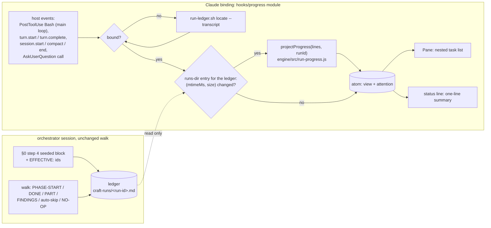

# Design — run visibility: show a craft run as a live task list in Claude Code

> Brief: project the run ledger (`<git-common-dir>/craft-runs/<run-id>.md`) onto a live task list
> the user sees beside the chat. One item per phase in `Resolution.effective[]`, plan parts nested
> under `implementation`, review cycles under `review`. Statuses go `pending → in_progress →
> completed`; auto-skips and no-ops are completed with their reason. The ledger stays the single
> source of truth: the list is a derived view, re-projected after compaction, never rebuilt from
> the summary. Constraints: `run-state` keeps tolerating every ledger token (`DEFERRED(`,
> `TRIAGED(`, the `impact-triage` phase), and no ledger-format change unless the design proves it
> is needed.
> Status: draft → self-reviewed ×3

---

## Context

### What exists

- **The ledger.** `scripts/run-ledger.sh` verbs `open | append | defer | verdict | locate | close |
  dir`. Only the orchestrator appends (`skills/run/SKILL.md` §0 step 4, L139–196). The seeded §0
  block (L153–159) is `RESOLVE:`, the `Resolution.record[]` lines, the config and load notes, the
  waivers, and `AWAITING(propose):`. `effective[]` itself is **not** written: the record lines
  hold only deltas (`default-skip:`, `enable:`, `skip:`, `insert:`, `reorder:` from
  `engine/src/edits.js` L65–209), and their prose cannot rebuild an order.
- **Session → run binding.** `hooks/bound-run.sh` `bound_run` reads the hook payload's
  `transcript_path` and `cwd`, then runs `run-ledger.sh locate --transcript <path>`
  (`locate_by_transcript`, `scripts/run-ledger.sh` L405–415). It scans the trusted pointers newest
  first and binds the first whose run-key the transcript holds. The run-key reaches the transcript
  as the stdout of `open`. `require_trusted_pointer` and `is_symlinked` refuse planted or
  symlinked files.
- **The reader.** `engine/src/run-state.js` `deriveRunState(lines, runId, resolution)` is pure: no
  I/O, no clock, no `process`. Its one import is `engine/src/observability/skip-signals.js`
  `autoSkipPhasesInText`, also pure. It returns `completed`, `inFlight[{phase,since}]`, `next`,
  `awaitingHarnesses`, `parts[{n,sha,size,outcome}]`, `findings[{dimension,cycle,path,count}]`,
  `background[]` and `warnings[]`. It needs `resolution.effective[].id`. It also needs
  `resolution.gateDecisions` for the `AWAITING(propose)` mismatch check (L286–293). The bin
  `engine/bin/run-state.js` → `engine/src/run-state-main.js` `main(argv, io)` always reads the
  Resolution JSON from stdin: there is no ledger-only mode. It does not keep the reason of an
  auto-skip or a `NO-OP(<phase>):`.
- **Re-deriving the Resolution** (`skills/run/SKILL.md` "Rebuild after compaction" step 2) means
  re-running §0 steps 0b, 1 and 1b: the session parses the flags on the `RESOLVE:` line,
  `config-resolve.js` resolves `--config <name>`, `manifest-lint.sh` runs, then
  `pipeline-resolve.js` runs. Step 0a's flag parsing is prose: no engine module parses a
  `RESOLVE:` line.
- **Asks.** The ledger records an ask only after the user answers:
  `POLICY(ask:<action>→approved|declined)` (`docs/contributing/specs/policy.md` L77–97). An
  `ask` raises `AskUserQuestion`. Decision questions and the impact-triage verdict table are
  printed text, after which the turn ends.
- **Hosts.** The root plugin is the Claude binding (`.claude-plugin/plugin.json`,
  `.claude-plugin/marketplace.json` with one entry, `"source": "./"`). `hooks/hooks.json` holds
  three command hooks (PreToolUse/Bash, SessionStart/compact, PreCompact). Other hosts sit in
  `adapters/{aider,antigravity,codex,copilot,cursor,opencode,pi}`. Port specs (`execution.md`,
  `vcs.md`, …) follow `## Port interface` / `## Binding set` / `## <Host> binding` /
  `## Failure → blocker`.
- **Maintainer smokes.** `docs/contributing/maintainer-smokes.md` holds the live checks that are not
  CI-gated (`skills/run/SKILL.md` L645–650). CI (`.github/workflows/ci.yml`) runs `scripts/ci.sh`,
  which runs only `node --test` suites and has no `claude` binary.

### Pinned evidence (probed 2026-10-27 against `57774c4`; Claude Code CLI `2.1.311`, plugin-authoring skill build `2.1.310`; every state-mutating probe ran in a `mktemp` throwaway)

| # | Probe | Result | Consequence |
|---|---|---|---|
| E1 | Orchestrator session: ToolSearch "todo task list progress" | no task-list tool. Found only `CronList`, `TaskStop`, `ListMcpResourcesTool` and unrelated MCP tools. No `TodoWrite` / `TaskCreate` / `TaskUpdate`. Same result as the 2026-10-23 probe. Spawned agents get a subset of the parent's tools, so they have none either | **Binding decision point 1 is not a fork: a Claude Code mod is the only binding.** No candidate below has the orchestrator call a task tool |
| E2 | `git archive` copy of craft. `hooks/hooks.json` = `{"modules": ["../mod/register.tsx"], "hooks": {PreToolUse…}}` → `claude plugin validate <copy>` | `✔ Validation passed with warnings` (icon only). The validator lists the module's hooks next to the command hooks | one `hooks.json` may carry both keys, and the module path may climb out of `hooks/` while staying inside the plugin |
| E3 | Same copy: the module imports `../engine/src/run-state.js` and calls `deriveRunState` in a `classic.SessionStart` hook; `claude plugin test <copy>` | pass. The module saw `inFlight=[design]`, `next=planning`, `e.transcript_path`, and `$.plugin.root` = the copy's root | the pure engine core loads inside a mod as it is, so the projection is shared, not re-implemented |
| E4 | Separate plugin `mods/rv/` (own `plugin.json`) importing `../../../engine/src/run-state.js` | validate `✘`, test fails: `cannot import "…/engine/src/run-state.js" … it is outside the plugin's folder` | a separate mod plugin cannot reuse the engine. It would need a vendored copy |
| E5 | Live `claude -p --model haiku --plugin-dir <probe>`. Probe plugin: one command hook (PreToolUse/Bash → `touch HOOK_FIRED`) and one module (`classic.PostToolUse` → `$.fs.write MODULE_FIRED`) | both markers written. The module received `transcript_path`. The module loaded on this box, where mods are already on | command hooks and a module coexist live. With mods switched off, the effect on the command hooks is **not pinned**: it is a user-run check (Test strategy) |
| E6 | Same harness. At `classic.PostToolUse`, the module reads `e.transcript_path` and checks for the echoed marker | `has=true` (the `tool_use` line), `resHas=false` (no `tool_result` line yet). Payload keys: `session_id, transcript_path, cwd, …, agent_id, agent_type, …, tool_name, tool_input, tool_response, tool_use_id` | `locate --transcript` cannot bind from the `open` call's own PostToolUse, because the run-key is in the not-yet-written result. Binding retries at the next trigger. `agent_id` tells a sub-agent's call from the main loop's |
| E7 | `claude plugin test` on a copy holding `engine/node_modules/fakepkg/x.test.ts` (failing) | only the mod's test ran (1 pass) | the repo's `node_modules` `.test.ts` files (zod ships some) do not leak into the mod suite |
| E8 | `deriveRunState` over a ledger with `EFFECTIVE: …`, `DEFERRED(…)`, `FINDINGS(…) c1/c2`, `auto-skip: lessons`, `PHASE-START(impact-triage)`, `TRIAGED(I1)`, `FILED(…)` | `kind: state`, `warnings: []`, `impact-triage` in flight, `lessons` completed | an `EFFECTIVE:` line is inert to `run-state`. The new tokens stay tolerated |
| E9 | `pipeline-resolve.js pipeline/default.yml .claude/workflow.md --config lean` | `unknown option --config`, exit 2 | a mod cannot replay the `RESOLVE:` flags through one bin. It would re-implement step 0a/0b |
| E10 | `run-state.js` on this run's live ledger with the re-resolved Resolution piped in | `completed [workspace]`, `inFlight [design]`, `next decisions`, `warnings []`. 0.03 s | the existing derivation gives the phase spine. Reasons and cycles still need a projection |
| E11 | `git grep "RESOLVE:" engine/src scripts hooks` | only the reorient hook's prose | no other code parses seeded ledger lines. A new seeded token has no other reader to update |

The plugin-authoring facts the design relies on come from the bundled skill's `reference.md`
and `types/claude-code.d.ts` (build 2.1.310). They are cited by symbol, not by path:
`$.plugin.root`; `$.fs.read` (rejects files over 4 MiB); `$.fs.list(dir)` → `{ name, kind, size,
mtimeMs, isLink }` per entry (`$.fs.stat` exists too; the listing is kept because one call
yields both the ledger entry and the pointer set); `$.process.run(argv, { cwd, timeoutMs })`
(30 s default); `$.ui.open({ id, title })` + `ui.render` on `{ component: 'Pane', requestId }`;
`$.ui.status(text)` (one line per plugin under the prompt); `atom`/`read`/`update`;
`$.command.register`; the events `session.start`, `session.compact`, `session.end`,
`turn.start`, `turn.complete` (`agentId` absent on the main loop), `tool.call`, and the
`classic.<Event>` envelope (`transcript_path`, `cwd`). A pane opens unasked only where the
surface docks one (`viewport.isFullscreen`). Elsewhere a pane opens inline.

### Constraints already decided

- The ledger is the single source of truth, and only the orchestrator appends to it
  (`skills/run/SKILL.md` §0 step 4). The view only reads.
- Hook posture: a craft hook never blocks the event it is attached to (`never_block`,
  `hooks/bound-run.sh`). Ledger bytes shown to a terminal are stripped of control characters
  first (`craft_control_chars_ere`).
- Self-hosting boundary: this run walks with the pre-change plugin, so it cannot show its own
  list. Live proof of the mod is a user-run step, because a mod needs the user to turn mods on
  interactively.
- Evals are local and user-run, never CI-gated. Provenance never goes in source or tests.

## Requirements

- **R1** One item per id in the run's effective pipeline, in pipeline order, each `pending`,
  `in_progress` or `completed`.
- **R2** A completed item carries its reason: the `NO-OP(<phase>):` text when present, then the
  `auto-skip:` signal, then the `PHASE-DONE` outcome.
- **R3** `implementation` nests one child per landed `PART(<n>)` (`completed`, or `in_progress`
  with note `blocked`). `review` nests one child per cycle seen in `FINDINGS(…): c<k>`: earlier
  cycles are `completed`, the newest is `in_progress` while review is in flight, and each
  carries the cycle's total `n`.
- **R4** The projection is pure (lines in, view out). It lives in the engine, is shared with
  `run-state`'s parsing, and is unit-tested with `node:test` in CI.
- **R5** The Claude binding needs no model call: it re-projects from the ledger on host events
  and never from the conversation.
- **R6** After a compaction, a resume or a reload, the view is re-projected from the ledger.
- **R7** An outstanding ask is distinct: the run shows `waiting on you — <phase>` while an
  `AskUserQuestion` is open or after the main loop's turn ended with the run open. It shows
  `waiting on background — <phase>` when that phase has a `HARNESS-BG` line whose pid is still
  alive. It shows `working` while a turn runs.
- **R8** `run-state` behaviour and output are unchanged. Every existing token, including
  `DEFERRED(`, `TRIAGED(`, `FILED(` and `impact-triage`, stays tolerated, and the new
  `EFFECTIVE:` token too (E8).
- **R9** The binding is fail-open and inert. Outside a git work tree, with no open run, or on any
  error, it draws nothing and blocks nothing. A sub-agent's tool call never binds or rebinds.
- **R10** A session binds only to its own run, through the same trusted lookup as the compaction
  hooks (`run-ledger.sh locate --transcript`). Rendered notes are control-stripped and truncated.
- **R11** A ledger without `EFFECTIVE:` (a run opened before this change) degrades: only the phases
  the ledger names are listed, and the view's `source: 'ledger-only'` renders as a `pipeline list
  unavailable` note. It never fails.
- **R12** Hosts other than Claude need no change (no task list surface, see candidate 4).

## Design

### Shape



### The projection: `engine/src/run-progress.js` (pure, R4)

```js
/** @returns {ProgressView} */
export function projectProgress(lines, runId)

// ProgressView
{
  run: 'run-visibility-task-list',
  source: 'effective' | 'ledger-only',          // R11
  items: [
    { id: 'workspace', status: 'completed', note: 'worktree … on feat/…', children: [] },
    { id: 'review', status: 'in_progress', note: '', children: [
        { label: 'cycle 1', status: 'completed', note: 'n=5' },
        { label: 'cycle 2', status: 'in_progress', note: 'n=0' } ] },
    { id: 'propose', status: 'pending', note: '', children: [] },
  ],
  inFlight: ['review'],                          // from deriveRunState
  background: [{ phase: 'validation', pid: 4242 }], // HARNESS-BG lines of in-flight phases
  warnings: [],                                  // deriveRunState's, plus a malformed EFFECTIVE
}
```

- **Effective ids** come from the last `EFFECTIVE: <ids comma-joined>` record of the run
  (candidate 5 (a)). Its regex is `^EFFECTIVE: ([a-z][a-z0-9-]*(?:,[a-z][a-z0-9-]*)*)$`. A
  record with the prefix that fails the regex adds `malformed EFFECTIVE record: …` to the
  warnings and falls back to ledger-only. In ledger-only mode the ids are the phases named by
  `PHASE-START` / `PHASE-DONE` / `auto-skip:`, in order of first appearance.
- **Spine.** `deriveRunState(lines, runId, { effective: ids.map(id => ({ id })), gateDecisions:
  [{ phaseId: 'propose', awaitingHarnesses: <the ledger's own AWAITING ids> }] })`. Feeding the
  ledger's own AWAITING list makes the mismatch branch unreachable by construction: there is no
  second resolution to disagree with. Status: `inFlight` → `in_progress`, `completed` →
  `completed`, else `pending`. In ledger-only mode the synthesised list holds every phase the
  ledger names, so `deriveRunState`'s `phase X is not in the effective pipeline` warning never
  fires there.
- **Seams to export from `run-state.js`**, so no regex is duplicated: `recordsForRun`,
  `lastAwaiting`, and the `PHASE_DONE_RE` / `NO_OP_RELEASE_RE` patterns, or a small
  `phaseOutcomes(records)` helper next to them. `run-state`'s exported behaviour stays
  byte-identical (R8).
- **Notes** (R2, R10): precedence `NO-OP(<id>):` text, then the `auto-skip:` parenthetical
  signal, then the `PHASE-DONE(<id>):` outcome. Control characters (C0 except tab, DEL, C1,
  U+2028/2029, the bidi overrides) are stripped to a fixpoint. The note is then cut to
  `NOTE_MAX_CHARS = 120`. The constants are named, and the strip set matches
  `craft_control_chars_ere` in `hooks/bound-run.sh`.
- **Purity guard.** `run-progress.js` and its import closure import no Node built-in (no
  `node:` specifier, no bare built-in name such as `fs`). Otherwise the mod cannot import it (E3 shows the pure path loads; a Node import is
  outside the mod runtime).

### The `EFFECTIVE:` token (candidate 5 (a))

One seeded line in `skills/run/SKILL.md` §0 step 4's heredoc, after `RESOLVE:`:

```
EFFECTIVE: <Resolution.effective[].id comma-joined>
```

This adds a token to the vocabulary. It does not change the line shape. `run-state` does not
consume it (E8). The spec's regex table gets a row marked "consumed by `run-progress`, not by
`run-state`". **Why the brief's bar is met:** without the token, the view has to re-run §0 steps
0a/0b/1b from the `RESOLVE:` line. No engine code parses that line (E11). `pipeline-resolve`
refuses the `--config` flag the line may hold (E9). So the mod would re-implement the prose of
step 0a and step 0b's two-scope config lookup, spawn two Node processes per refresh, and drift
from what the run walks whenever the manifest is edited mid-run. The orchestrator learns of such
an edit only at a rebuild, through the AWAITING mismatch. The token freezes what the run
actually resolved, at the moment it resolved it.

### The Claude binding: a module in the craft plugin (candidates 1–3, 6–8)

Files (new): `hooks/progress/register.tsx` (wiring, render), `hooks/progress/bind.ts` (locate,
listing gate, attention), `hooks/progress/state.d.ts` (`PluginState` declaration), and
`hooks/progress/*.test.tsx`. `hooks/hooks.json` gains `"modules": ["./progress/register.tsx"]`
beside the unchanged `"hooks"` (E2).

```ts
// hooks/progress/register.tsx — shape, not final code
const PANE = 'craft-progress'
const view = atom({ plugin: 'craft', key: 'progress' } as const, EMPTY, { shape: 'progress-1' })

export const register: Register = on => {
  on('session.start', async ($, e, next) => { await registerCommand($); await rebind($, e); return next(e) })
  on('classic.PostToolUse', async ($, e, next) => { await refreshIfMainLoopBash($, e); return next(e) })  // filters tool_name === 'Bash' itself
  on('turn.start', ...)      // attention := working
  on('turn.complete', ...)   // main loop only (no agentId): attention := waiting on you | background
  on('tool.call', { tool: 'AskUserQuestion' }, ...)  // waiting on you while open, then next(e)
  on('session.compact', ...) // after next(e): rebind + re-project from the ledger (R6)
  on('session.end', ...)     // unbind, clear the status line
  on('command.run', { command: 'craft-progress' }, ...)  // open the pane on demand
  on('ui.render', { component: 'Pane', requestId: PANE }, ...)  // nested list from read($, view)
}
```

- **Binding (candidate 8 (a)).** Binding runs on main-loop triggers only. While unbound, the
  module lists the runs dir with `$.fs.list`. The runs dir comes once per session from
  `run-ledger.sh dir` and is cached. A non-zero exit means not a git work tree, and the module
  stays inert. With no `*.pointer` entry nothing is spawned, so a non-craft session pays one
  `dir` call per session. With a pointer present, the module runs
  `$.process.run(['bash', `${$.plugin.root}/scripts/run-ledger.sh`, 'locate', '--transcript',
  tp], { cwd, timeoutMs: LOCATE_TIMEOUT_MS })`. `tp` and `cwd` come from the `classic.*`
  envelope (E3, E5). For `turn.complete` and `session.*` they are the last ones cached from a
  `classic.*` event, or `classic.SessionStart`'s. The stdout `<run-id> <ledger-path>` is cached
  in the atom. The `open` call's own PostToolUse cannot bind, because the run-key sits in the
  not-yet-written result (E6). The same Bash call appends the seeded lines (`open && append`),
  so the next trigger binds: the workspace `PHASE-START` call, or `turn.complete`. A miss is
  cached against the pointer set's signature (each non-link pointer's name and mtime): an
  unchanged set is located at most twice, so a session that does not own the live run stops
  spawning `locate` after its second trigger. The run id is the text before the first space of
  `locate`'s output, and the ledger path is built from the runs dir, so a path holding a space
  binds. On every
  trigger, binding runs before the refresh and the attention update.
- **Refresh (candidate 2 (a)).** On each trigger while bound, one `$.fs.list(runsDir)` gives the
  ledger entry's `(mtimeMs, size)`; `$.fs.exists` guards a runs dir no run has created yet. If
  the pair is unchanged, the
  module does nothing. If it changed, the module runs `$.fs.read` → `projectProgress` →
  `update($, view, …)`, which redraws the pane and resets the status line. An entry with
  `isLink` is refused, the same as `run-ledger.sh`'s symlink refusal. A ledger entry that is
  gone means the run closed (`close` removed it): the module shows `closed` once, then unbinds
  at the next `turn.start`. A `$.fs.read` rejection (a file over 4 MiB, a race with `close`)
  keeps the previous view and logs it. A sub-agent's PostToolUse (`agent_id` present, E6) may
  refresh, but it never binds (R9).
- **Attention (candidate 6 (a), R7).** It is host state, not ledger state:

  | Event | attention |
  |---|---|
  | `turn.start` (main loop) | `working` |
  | `tool.call` `AskUserQuestion` before `next(e)` resolves | `waiting on you — <inFlight[0]>` |
  | `turn.complete` (main loop), run open, an in-flight phase holds a `HARNESS-BG` whose pid is alive (`$.process.run(['kill', '-0', pid])`) | `waiting on background — <phase>` |
  | `turn.complete` (main loop), run open, otherwise | `waiting on you — <inFlight[0] or next>` |
  | ledger gone | `closed` |

  The decision question, the verdict table and the merge confirmation all end the main loop's
  turn or open `AskUserQuestion`, so all three surface as `waiting on you` with the phase name,
  and nothing new is appended to the ledger.
- **Surfaces (candidate 1 (a)).** While bound, the status line shows
  `craft <run-id> · <in-flight or next> · <done>/<total> · <attention>`. The pane shows the nested
  list, with `✓` / `▸` / `·` glyphs plus a dim note, sized to `e.props.bodyColumns`. It opens
  unasked once per bind where the surface docks panes. Elsewhere `/craft-progress` opens it. A
  `warnings` count shows in the pane footer when non-zero.
- **Failure posture (R9).** Every hook calls `next(e)`: none guards or refuses, so none needs a
  `.catch` deny. A thrown error is logged through `$.ui.log` to `debug` with the plugin, event and
  message, and the hook continues with the previous view. No error is swallowed silently, and no
  host event is blocked.

### Edge behaviour

- **Compaction / resume / `/reload-plugins`:** `session.compact` and `session.start` re-run
  `locate` and project from the ledger. The atom carries a `shape` tag, so a reload drops a value
  an older version stored.
- **`/clear`:** `session.end` with `reason: 'clear'` unbinds. The new transcript lacks the key, so
  the module does not rebind. The ledger stays untouched.
- **Two sessions in one repo:** only the session whose transcript holds the run-key binds (R10).
- **Parallel phases** (validation ∥ documentation): both are `in_progress`, and the status line
  names the first in pipeline order.
- **Driven / headless runs** (`claude --bg`, `-p`): no pane is seated. The status line is
  harmless, and the module stays fail-open.
- **A phase id in the ledger but not in `EFFECTIVE`:** `deriveRunState`'s existing warning is
  counted in the footer. The item is not invented.
- **Discovered impacts:** `DEFERRED` / `TRIAGED` / `FILED` lines are inert to the projection
  (R8). `impact-triage` is an ordinary item.

### Change map (for the planner)

| File | Symbol / region | Change |
|---|---|---|
| `engine/src/run-state.js` | `recordsForRun`, `lastAwaiting`, `PHASE_DONE_RE`, `NO_OP_RELEASE_RE` (L9–30, L48–69) | export the seams the projection reuses. No behaviour change |
| `engine/src/run-progress.js` | new `projectProgress(lines, runId)` | the projection (above) |
| `engine/test/run-progress.test.js` | new | Test strategy |
| `engine/test/fixtures/run-ledger/` | new fixtures beside `mid-validation.md` | `with-effective.md`, `pre-effective.md`, `impacts-and-cycles.md` |
| `skills/run/SKILL.md` | §0 step 4 heredoc L153–159; `### Run-record tokens` L200–220 | seed `EFFECTIVE:`; name it in the walk-token sentence |
| `docs/contributing/specs/run-record.md` | `## Token vocabulary` regex table L82–90 | `EFFECTIVE:` row, plus a "Derived views" paragraph naming `run-progress` as its only reader |
| `hooks/hooks.json` | top level | `"modules": ["./progress/register.tsx"]`. `test/hooks.test.js` `readHooksConfig` reads only `.hooks[event]` and stays green |
| `hooks/progress/register.tsx`, `bind.ts`, `state.d.ts`, `*.test.tsx` | new | the binding |
| `docs/contributing/maintainer-smokes.md` | new section | `claude plugin validate .`, `claude plugin test .`, and the live check (Test strategy) |
| `docs/guides/customizing.md` | new `###` section after "Long sessions — auto-compaction (Claude Code)" (L447) | what the pane and status line show, `/craft-progress`, and that mods must be on |
| `README.md` | corpus counts | `design` count bump (this commit) |

Pre-chewed context. `test/run-record.test.js` pins `skills/run/SKILL.md` regions (e.g. L167):
re-run it after the heredoc edit. `test/craft-root-shim.test.js` counts shimmed invocations, and
the new heredoc line adds none. `scripts/static-lints.sh` runs shellcheck on `hooks/*.sh` only
and does not see the `.tsx`. `engine/stryker.conf.json` mutates `engine/src/**`, so
`run-progress.js` falls under the validation phase's per-hunk mutation scope.

## Decision candidates

Decision point 1 of the brief (orchestrator task-tool calls vs a mod) is **not** a fork. E1 finds
no task-list tool for the orchestrator or its spawns, so the mod is the only binding. The
candidates below are the choices left inside it.

| # | Choice | Alternatives (≤3) | Recommendation | Why |
|---|---|---|---|---|
| 1 | Mod surface | (a) pane for the nested list, plus a one-line status-line summary, plus `/craft-progress` to open the pane · (b) band above the prompt (`AbovePrompt`) holding the list · (c) status line only | **(a)** | Only a pane fits R1/R3's nesting without taking prompt height on every turn. The status line works at any width and on surfaces that seat no pane, and it carries R7's attention. A pane opens unasked only where the surface docks one, so a narrow terminal still gets the summary. (b) costs vertical room on every screen. (c) cannot show nesting |
| 2 | Refresh trigger | (a) event-driven: main-loop `classic.PostToolUse` (Bash), `turn.start` / `turn.complete`, `session.start` / `compact`, gated by the ledger's `(mtimeMs, size)` from one `$.fs.list` of the runs dir · (b) `$.clock.every` poll with the same listing gate · (c) PostToolUse only when the command text holds `run-ledger.sh` | **(a)** | Every ledger write is an orchestrator Bash call, so the next PostToolUse sees it. Turn events cover R7. Idle costs nothing. (b) burns a timer in every session where craft is installed, craft run or not. (c) saves one directory listing per Bash call, but it makes correctness depend on the command text: in §0's own spelling, `run-ledger.sh` appears only in the `ledger=` assignment of the same call, before `"$ledger" append`. A reworded skill would silently freeze the view, while the listing reads the ledger itself |
| 3 | Where the mod lives | (a) inside the craft plugin: `hooks/hooks.json` `"modules"` + `hooks/progress/` · (b) a separate plugin dir (e.g. `mods/run-progress/`) listed in `.claude-plugin/marketplace.json` · (c) not shipped: the user-local mods folder | **(a)** | E2/E3: one plugin, and the module imports the pure engine directly. E4: (b) cannot import outside its own folder, so it would vendor a copy of `run-state.js` + `run-progress.js` behind a sync check like `sync-adapter-agents.sh`, and it would have to locate `run-ledger.sh` with no way to learn craft's root (its `$.plugin.root` is its own folder). (c) is unversioned and untested. Cost of (a): every craft session loads the module. It is inert without a pointer (one `dir` call). The mods-off behaviour of the command hooks is not pinned (E5) and goes to the live check |
| 4 | A `Progress` port | (a) no port: the projection is an engine function documented in the run-record spec; the Claude module is its only consumer, and other hosts change nothing · (b) a spec `docs/contributing/specs/progress.md` in the port shape, with the Claude binding (the mod) and "none" rows for pi/codex/opencode/copilot/cursor/aider/antigravity · (c) (b) plus a pi TUI binding now | **(a)** | The view is pull-only: nothing in the walk calls it, so there is no orchestrator-side verb to abstract. A "no-op binding" would be the absence of a reader, which needs no spec. `projectProgress` is already the host-agnostic seam: any adapter can import it, as the mod does. (b) adds a living-corpus page whose binding set has one live member. (c) is wish-list work: the brief scopes Claude Code |
| 5 | Where `effective[]` comes from | (a) a seeded `EFFECTIVE: <ids>` line at §0 step 4, consumed only by `run-progress` · (b) the mod re-resolves from `RESOLVE:` via `config-resolve.js` + `pipeline-resolve.js` · (c) ledger-only: list only the phases the ledger has named | **(a)** | See "The `EFFECTIVE:` token". E9/E11 prove (b) re-implements prose-only step 0a/0b and drifts on a mid-run manifest edit. (c) cannot show pending phases, which fails R1, and stays only as R11's fallback. (a) adds vocabulary, not line shape, and is inert to `run-state` (E8) |
| 6 | "Waiting on you" | (a) host-event derived: an open `AskUserQuestion`, or a main-loop `turn.complete` with the run open, labelled with the in-flight phase; a live `HARNESS-BG` pid turns it into "waiting on background" · (b) a new ledger token pair `ASK(<phase>):` / `ANSWERED(<phase>):` appended around each ask · (c) no distinct status | **(a)** | The ledger cannot derive it: asks are recorded only after the answer (`policy.md` L97). (b) is a format change that costs orchestrator tool calls at every ask and fails open when one is forgotten. The host already knows when it hands control to the user. (c) leaves the user's most frequent question ("is it waiting for me?") unanswered |
| 7 | Plan parts under `implementation` | (a) landed `PART(<n>)` lines only · (b) read the plan doc for the full part list · (c) a seeded `PLAN: <n> parts` token at planning | **(a)** | Ledger-only, and needs no worktree path. The ledger names the plan's location only in free-text `PHASE-DONE` outcomes, so (b) would guess a path. (c) is a second format change for a cosmetic `k/n` |
| 8 | Session → run binding | (a) `run-ledger.sh locate --transcript` via `$.process.run`, retried on the next trigger, behind a pointer-list gate · (b) parse the run-key from the `open` call's `tool_response.stdout`, then verify with `locate --run` · (c) `locate --run` on a run-id parsed from the command text | **(a)** | The same trusted path as the compaction hooks (pointer trust, symlink refusal), with no new parsing. The retry lag is one Bash call (E6). (b) adds a stdout parser for a first bind only one call earlier. (c) binds any session that ran a command naming the run, which breaks R10 |

## Test strategy

- **RED first, engine (CI).** `engine/test/run-progress.test.js`: `node:test`, Given/When/Then
  titles, AAA, `sut`, fixtures under `engine/test/fixtures/run-ledger/`:
  1. With `EFFECTIVE:`: items in pipeline order. Statuses come from PHASE-START/DONE, and
     `source: 'effective'` (R1).
  2. Note precedence: a phase with both `NO-OP(x):` and `PHASE-DONE(x):` notes the NO-OP. An
     `auto-skip:` phase notes its signal (R2).
  3. `PART(1)` pass and `PART(2)` blocked → two children, the second `in_progress` / `blocked`.
     A later `PART(2)` pass supersedes it (`lastPartPerNumber`) (R3).
  4. `FINDINGS` with c1 and c2 across two dimensions → two cycle children with summed `n`. c2 is
     `in_progress` while review is in flight and `completed` after `PHASE-DONE(review)` (R3).
  5. `DEFERRED(` / `TRIAGED(` / `FILED(` / `PHASE-START(impact-triage)` → `warnings: []`, and
     `impact-triage` is `in_progress` (R8).
  6. No `EFFECTIVE:` → `source: 'ledger-only'`, items in first-appearance order. A malformed
     `EFFECTIVE:` → one warning, plus the fallback (R11).
  7. Another run's lines are ignored. A `PHASE-START` for an id outside `EFFECTIVE` → the
     existing warning, no item (R10, edge).
  8. Notes with C0/C1/U+2028/bidi bytes come out stripped, and a 500-char note comes out cut to
     `NOTE_MAX_CHARS`. Test titles escape these characters: raw NEL/U+2028 in a title breaks the
     Stryker tap dry run.
  9. Purity: the import closure of `engine/src/run-progress.js` imports no Node built-in (no
     `node:` specifier, no bare built-in name). A text scan for `process` would false-positive
     on `run-state.js`'s header comment, so the rule scans specifiers only. Use the source-scan idiom of `test/architecture-boundaries.test.js`,
     two-sided (a synthetic offender is caught).
- **`run-state` unchanged (CI).** The existing `engine/test/run-state*.test.js` stay green with no
  edit. One added case feeds an `EFFECTIVE:` line and asserts byte-identical state (E8).
- **Prose pins (CI).** `test/run-record.test.js` gains: the §0 step 4 heredoc holds `EFFECTIVE:`
  between `RESOLVE:` and `AWAITING(propose):`, and the run-record regex table holds the
  `EFFECTIVE:` row.
- **Mod (local, maintainer smoke, not CI: CI has no `claude`).** `claude plugin validate .` and
  `claude plugin test .` from the repo root (E7: only the mod's tests run). Each
  `hooks/progress/*.test.tsx` stubs the engine beneath the plugin, as the plugin-authoring
  example does (`on('process.run'…)`, `on('fs.list'…)`, `on('fs.read'…)`, `on('ui.status'…)`):
  - an unbound session with no pointer spawns nothing;
  - a `locate` stdout binds, and a second trigger with an unchanged `(mtimeMs, size)` does not re-read;
  - a changed `(mtimeMs, size)` re-projects and the pane mounts the nested list (`$.ui.mount` on `Pane`, every
    surface);
  - a PostToolUse carrying `agent_id` never binds;
  - `turn.complete` without `agentId` → `waiting on you — <phase>`, with a live `HARNESS-BG` pid →
    `waiting on background`, and `turn.start` → `working`;
  - a ledger entry gone from the listing → `closed`, then unbound at the next `turn.start`; an `isLink` entry is refused;
  - a throwing `process.run` leaves the previous view and logs to `debug`.
- **Hang safety.** No `node:test` case spawns `claude`. A new test that spawns
  `run-ledger.sh` spawns it `detached`, and on timeout calls `process.kill(-child.pid,
  'SIGKILL')`, then resolves on `close` (lesson 010). In the module, `$.process.run` always passes
  `timeoutMs`.
- **Live proof (user-run, mods turned on interactively).** In a throwaway git repo,
  `claude --plugin-dir <worktree>`. Have the session run `run-ledger.sh open demo` and append a
  seeded block with `EFFECTIVE:`, then append `PHASE-START` / `PHASE-DONE` lines. The pane and
  status line follow, and they survive `/compact`. Then turn mods off and confirm the craft
  command hooks still fire, for example that the PreToolUse guard refuses a `git diff` without
  `--no-ext-diff`. This closes E5's unpinned half. The first real craft run after merge is the
  dogfood (self-hosting boundary).
- **Gate:** `bash scripts/ci.sh`. Validation's mutation runs on `engine/src/run-progress.js` and the
  `run-state.js` export hunks only. Bash, prose and `.tsx` are outside Stryker.
- **Eval:** not warranted. The change adds one seeded ledger line and no model judgment. The
  existing suite's runs exercise §0 step 4. Evals stay local and user-run, never CI-gated.

## Out of scope

- An orchestrator-driven task list (TodoWrite/Task tools): E1 shows the tools do not exist.
- Bindings for other hosts (pi TUI, codex, …), and a `Progress` port spec (candidate 4 (a)).
- Showing the content of discovered impacts (counts or ids under `impact-triage`) beyond
  tolerating their tokens.
- A pending-parts list or `k/n` under implementation (candidate 7 (a)).
- Live elapsed-time tickers: `since` is shown as a start time, and no timer runs.
- Changing `run-state`'s CLI (a ledger-only mode): the module imports the pure core, so it needs
  no bin.
